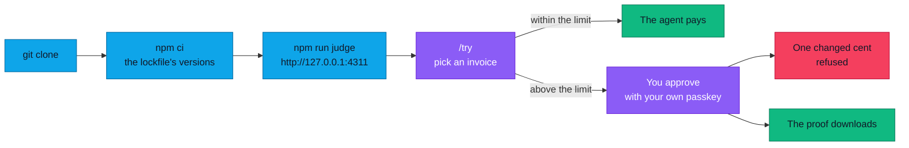

<div align="center">

<a href="../README.md"><picture><source media="(prefers-color-scheme: dark)" srcset="assets/brand/purser-mark-dark.svg"></picture></a>

# Install, quick start and uninstall

**Install Purser, do something with it in five minutes, set up a development environment, and remove it again.**

[](https://github.com/agamemnon-coder/x402-business-agents/actions/workflows/ci.yml?query=branch%3Amain)&nbsp;[](#quick-start-no-keys-offline)&nbsp;[](#quick-start-no-keys-offline)&nbsp;[](#install-quick-start-and-uninstall)&nbsp;[](#where-purser-writes)&nbsp;[](../README.md#built-with)

[Quick start](#quick-start-no-keys-offline) · [Development](#the-development-environment) · [Running it live](#running-it-live-sandbox-and-testnet-keys) · [Where Purser writes](#where-purser-writes) · [Uninstall](#uninstall) · [MCP connector](#the-mcp-connector) · [Claude Code plugin](#the-claude-code-plugin)

</div>

How to install Purser, do something with it in five minutes, set up a development environment, and remove it again.
Written on 19 November 2026. Test money only: nothing here touches real money, and the quick start needs no key and no
network beyond npm.

Purser comes in three forms; each installs and uninstalls with its platform's usual commands.

| Form | Install | Uninstall |
|---|---|---|
| **The code** (the runner, the agents, the CLIs, the pages) | `git clone` and `npm ci` | delete the folder, and the ledger and keys folders if you set them elsewhere |
| **The MCP connector** (your AI reads a Purser company's books) | add a remote MCP server in your AI client | remove that server in your AI client |
| **The Claude Code plugin** | `/plugin marketplace add` and `/plugin install` | `/plugin uninstall` and `/plugin marketplace remove` |

## Quick start (no keys, offline)

Requirements: Node.js 22.13 or newer (or 24), npm and git.

```sh
git clone https://github.com/agamemnon-coder/x402-business-agents.git
cd x402-business-agents
npm ci                       # installs exactly the lockfile's versions
npm run judge                # serves the recorded demo, the simulated month and the hands-on /try at http://127.0.0.1:4311
```



Open `/try`: pick an invoice, the agent pays it within its limit; above the limit you approve with your own passkey,
one changed cent is refused, and the proof downloads. `npm run judge -- --check` builds every page once and exits
(what CI runs). To check a recorded approval offline: `npm run verify-approval`.

## The development environment

The same clone is the development environment; the tests need no key and make no network call.

```sh
npm ci
npm run typecheck            # TypeScript, strict
npm run lint                 # ESLint
npm test                     # the whole suite (vitest); npm run test:coverage adds coverage per area
npx playwright install chromium   # only for the browser checks in test/browser/*.check.ts
```

The relay Worker has its own lockfile: `cd worker && npm ci`. What a pull request must pass:
[CONTRIBUTING.md](../CONTRIBUTING.md).

## Running it live (sandbox and testnet keys)

[run-it.md](run-it.md): copy `.env.example` to `.env` (never committed), fill in the Airwallex sandbox and Alta testnet
credentials, set `KIT11_KEYS_DIR` to a folder outside the repository, and `npm run health`, then `npm run demo:all`.
Purser Cloud's deployment on Cloudflare: [cloud.md](cloud.md).

## Where Purser writes

Nothing outside the folders you name:

| What | Where | Set by |
|---|---|---|
| Dependencies | `node_modules/` in the clone (and `worker/node_modules/`) | npm |
| The ledger (SQLite) | `data/kit11.sqlite` in the clone | `KIT11_DB` names another file |
| Owner key, mandate keys, agent credentials | the keys folder, which must lie outside the repository | `KIT11_KEYS_DIR` |
| Pages, screenshots, run records written by CLIs | under `docs/`, `test-results/` and `coverage/` in the clone, only when you run those commands | the command's arguments |

Nothing is installed system-wide, and nothing runs at install time beyond the dependencies' own install scripts from
the lockfile.

## Uninstall

1. Stop any running `npm run …` process (Ctrl+C).
2. If you ran it live, keep or delete what you set up outside the clone: the keys folder (`KIT11_KEYS_DIR`) and a ledger
   you put elsewhere (`KIT11_DB`). Revoke the sandbox API keys at Airwallex and the Alta console if you no longer need
   them.
3. Delete the clone: `rm -rf x402-business-agents` (on Windows, delete the folder). That removes the code, its
   `node_modules/`, the default ledger in `data/` and everything the commands wrote.
4. The browsers Playwright downloaded for the browser checks are in its own cache (`~/.cache/ms-playwright` on Linux);
   `npx playwright uninstall --all` removes them.

## The MCP connector

Install: add `https://purser-try.max-31b.workers.dev/mcp` (or your own Purser Cloud's `/mcp`) as a remote MCP server in
your AI client, each client's steps in [connect-claude.md](connect-claude.md); for example in Claude Code,
`claude mcp add --transport http purser <address>/mcp`.

Uninstall: remove the server in the same place (in Claude Code, `claude mcp remove purser`; in claude.ai and the Claude
apps, under Settings → Connectors), and revoke its token in Purser Cloud (Settings → Connect your AI).

## The Claude Code plugin

Install:

```text
/plugin marketplace add agamemnon-coder/x402-business-agents
/plugin install purser@purser
```

Uninstall:

```text
/plugin uninstall purser@purser
/plugin marketplace remove purser
```
