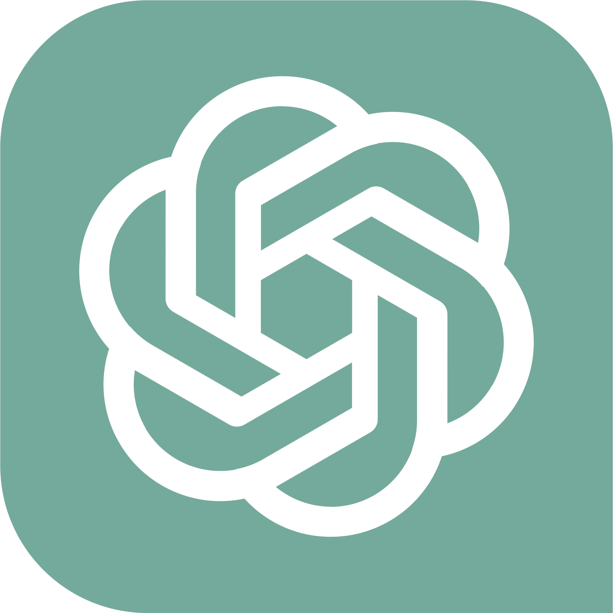
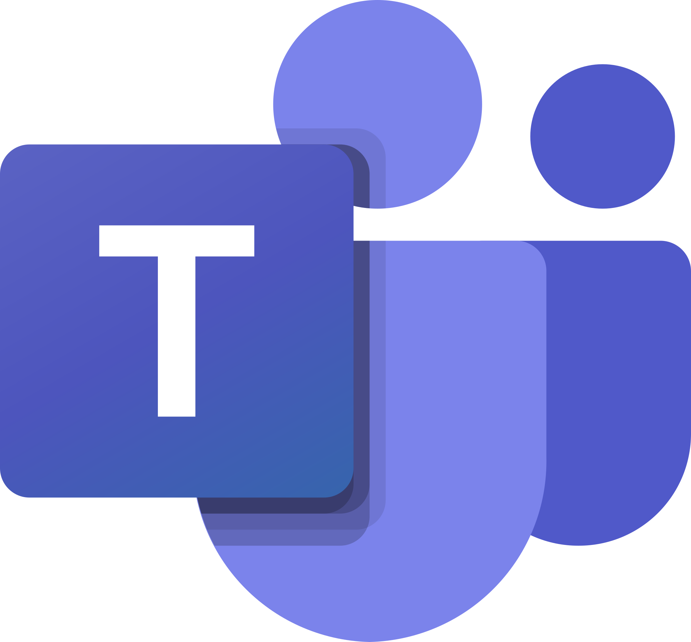
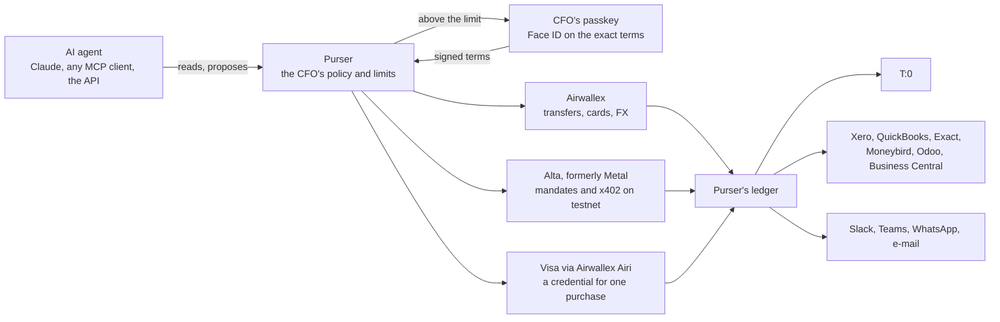

# Connect Purser to anything

Every way into Purser and out of it, on one page: the payment rails, AI agents over MCP, the API and its webhooks,
no-code tools, accounting packages, Peppol, ISO 20022, chat and the full export. Each has its honest label, a quickstart
of a line or two and a link to its guide. Purser Cloud shows the same list (its Connections page), read from
`GET /v1/connections` (`cloud/src/connections.ts`), and `test/connections-hub.test.ts` holds this page to it.

**The rule behind all of them.** An agent or an integration may **read** and **propose**. Only the CFO's **passkey**
approves money: a signed-in person in Purser Cloud signs the exact terms, and one changed cent breaks the signature. No
key, agent, integration, webhook or chat message can approve. The approve route refuses every API key
(`POST /v1/engine/proposals/{id}/approve` needs a signed-in person's session). If the CFO set a pay-alone limit
(`ap.alone_eur`, off unless set), a proposal within it is paid under the CFO's own policy, and the answer says so in
`alone`. Test money only until a company goes live.

**The labels.** **live**: built, and running in Purser Cloud. **sandbox** or **testnet**: live calls to the service's
test environment, with test money. **format export**: Purser writes a file or message in the other product's documented
format, and a person or the team's own tooling takes it from there; there is no live connection to that product.
**built, not tested live**: the code (or the recipe) exists and is tested against stand-ins, not against the real
service. **built, run once in a sandbox**: as it says. **planned**: not built yet; the guide says what it needs. No
label here is stronger than its record.

**Setting it up.** Each company connects its own systems in Purser Cloud, Connections (each card shows what is
connected, not connected, or not available yet). What the platform registers once (OAuth apps, redirect URIs, secrets,
costs, reviews): [owner-setup.md](owner-setup.md). Invoices by e-mail from Gmail or Outlook:
[email-forwarding.md](email-forwarding.md). QuickBooks bills, planned: [quickbooks-plan.md](quickbooks-plan.md).

## At a glance


The sponsors' services are the money rails (Airwallex, Alta (formerly Metal), Visa through Airwallex's Airi) and the
model (Claude, by Anthropic). Everything else on this page connects to Purser itself: it reads, proposes, receives the
books or carries a message, and none of it moves money.

### Works with

<table>
<tr>
<td><b>Money rails</b></td>
<td align="center"><br><sub>Airwallex</sub></td>
<td align="center"><br><sub>Alta (formerly Metal)</sub></td>
<td align="center"><b>Visa</b><br><sub>via Airwallex Airi</sub></td>
<td align="center"><b>T:0</b><br><sub>outside ledger</sub></td>
</tr>
<tr>
<td><b>AI and agents</b></td>
<td align="center"><picture><source media="(prefers-color-scheme: dark)" srcset="../assets/logos/claude-logo-ivory.svg"></picture><br><sub>Claude</sub></td>
<td align="center"><br><sub>MCP</sub></td>
<td align="center"><br><sub>ChatGPT</sub></td>
<td align="center"><br><sub>Cursor</sub></td>
<td align="center"><br><sub>VS Code</sub></td>
<td align="center"><br><sub>Gemini CLI</sub></td>
</tr>
<tr>
<td><b>Books and ERP</b></td>
<td align="center"><br><sub>Xero</sub></td>
<td align="center"><br><sub>QuickBooks</sub></td>
<td align="center"><br><sub>Exact Online</sub></td>
<td align="center"><br><sub>Moneybird</sub></td>
<td align="center"><br><sub>Odoo</sub></td>
<td align="center"><b>BC</b><br><sub>Business Central</sub></td>
</tr>
<tr>
<td><b>Messages and mail</b></td>
<td align="center"><br><sub>Slack</sub></td>
<td align="center"><br><sub>Microsoft Teams</sub></td>
<td align="center"><br><sub>WhatsApp</sub></td>
<td align="center"><br><sub>Gmail</sub></td>
</tr>
<tr>
<td><b>Build on it</b></td>
<td align="center"><br><sub>Zapier</sub></td>
<td align="center"><br><sub>Make</sub></td>
<td align="center"><br><sub>Python SDK</sub></td>
<td align="center"><br><sub>TypeScript SDK</sub></td>
<td align="center"><b>n8n</b><br><sub>node, not published</sub></td>
<td align="center"><b>Peppol</b> · <b>ISO 20022</b><br><sub>files</sub></td>
</tr>
</table>

Each mark is the file on record, unchanged: sources and hashes in [src/ui/logos/README.md](../../src/ui/logos/README.md)
and [docs/assets/logos/SOURCES.md](../assets/logos/SOURCES.md); permissions in
[logo-permissions.md](../evidence/logo-permissions.md). Visa and T:0 are named in text (the owner's decision for Visa
outside Purser Cloud's Connections page; no T:0 mark on file); so are the connections whose mark is not cleared for this
page. A mark names a service Purser connects to: never "certified", "endorsed", "approved by" or "partner of".

### Where each one stands

The labels in the tables further down are the catalogue's. This table adds one stricter question: **is there a dated
run on record?**

| Badge | Means |
|---|---|
|  | Ran against the real service (or its sandbox or testnet), with a dated record linked. |
|  | Code done and tested against stand-ins; waits for credentials or a first recorded run. |
|  | Code exists, but a named piece is missing. |
|  | Named only; nothing built yet. |

| Partner | Status | Catalogue label | Proof, or what is missing |
|---|---|---|---|
| Airwallex |  | sandbox | [Soak, 20 Nov](../runs/2026-11-20-airwallex-soak.md): 30 supplier payments, 5 negative controls refused; [API coverage, 19 Nov](../runs/2026-11-19-airwallex-coverage.md). Check: `npm run health`. |
| Alta (testnet) |  | testnet | [Series, 19 Nov](../runs/2026-11-19-alta-series.md): 21 mandate-checked payments, 3 refused on chain; [refusals, 20 Nov](../runs/2026-11-20-alta-refusals.md). Check: `npm run health`. |
| Visa via Airwallex Airi |  | sandbox | [vic-5, 14 Nov](../runs/2026-11-14-vic-5.md): Airi's test card, terms hash read back, credential reuse refused. Check: `npm run airi:vic-5 -- --dry`. |
| Claude (MCP connector) |  | live | Added in the Claude iOS app on 13 Nov ([how it was verified](../connect-claude.md#which-clients-were-verified-and-how)). |
| Claude (models in Purser) |  | not a catalogue row | [Payables agents' evals, 20 Nov](../runs/2026-11-20-claude-ap-evals.md): Haiku, Sonnet and Opus, 62 of 62 cases each. |
| T:0 |  | sandbox | [Read-back, 14 Nov](../runs/2026-11-14-t0-readback.md): 95 entries, every account to the cent; [at every payment, 20 Nov](../runs/2026-11-20-partner-rails.md). Check: `npm run t0 -- accounts`. |
| Moneybird |  | built, run once in a sandbox | [Sandbox administration, 12 Nov](../runs/2026-11-12-moneybird-sandbox.md): read back, 0 differences. |
| Agent API (local MCP) |  | sandbox | [An outside agent, 29 Oct](../runs/2026-10-29-agent-api.md). |
| ChatGPT, Cursor, VS Code, Gemini CLI, Windsurf |  | built, not tested live | Nothing to build: one try per client with the demo token, then a record ([setup per client](../connect-claude.md)). |
| Airwallex sandbox in Code Mode (MCP) |  | built, not tested live | Tested against a stand-in gateway; no live read on record ([codemode.md](../codemode.md)). |
| Read API (REST), Webhooks, Full export |  | live | Served by Purser Cloud; no dated outside run on record yet ([connections.md](../connections.md)). |
| A2A Agent Card |  | built, not tested live | Served at `/.well-known/agent.json`; no agent has read it on record. |
| TypeScript and Python SDKs |  | built, not tested live | Tested in-process ([TypeScript](#typescript-sdk), [Python](#python-sdk)); no run against a deployed cloud on record. |
| Zapier and Make |  | built, not tested live | Recipes on the HTTP modules ([no-code.md](no-code.md)); not run in Zapier or Make. |
| n8n |  | built, not tested live | The node's code exists; it is not built or published ([n8n](#n8n)). |
| Xero |  | format export; built, not tested live | CSV export, the runner's API and the Purser Cloud connect; needs Xero's OAuth app ([owner-setup.md](owner-setup.md#16-xero)). |
| QuickBooks Online |  | format export; built, not tested live | CSV export and the connect flow; sending bills is planned ([quickbooks-plan.md](quickbooks-plan.md)). |
| Exact Online |  | format export; built, not tested live | CSV export, connect and the runner's connector; needs Exact's app ([erp.md](../erp.md#exact-online)). |
| Business Central and Odoo |  | built, not tested live | The runner's connectors; need a sandbox or trial ([erp.md](../erp.md)). |
| Slack and Microsoft Teams |  | built, not tested live | Needs a company's own webhook URL; no real channel has received a post ([setup](#slack-and-microsoft-teams-approval-notifications)). |
| WhatsApp and e-mail alerts |  | built, not tested live | Needs Twilio's WhatsApp sandbox or a Resend key ([cloud.md](../cloud.md#approval-alerts)). |
| Gmail and Outlook (invoices by e-mail) |  | built, not tested live | No mail domain routed yet; checks of incoming mail (SPF, DKIM, DMARC) not built ([email-forwarding.md](email-forwarding.md)). |
| Google Workspace and Microsoft 365 |  | built, not tested live | The runner's polling; needs the owner's OAuth apps ([workplace.md](workplace.md)). |
| Sign in with Google, Microsoft and Apple |  | built, not tested live | Tested against a stand-in provider; needs the platform's OAuth apps ([owner-setup.md](owner-setup.md#12-sign-in-with-google)). |
| Peppol invoices (UBL) and ISO 20022 |  | built, not tested live; format export | Files only, nothing to connect: `npm run peppol:check -- <file.xml>`, `npm run iso20022`. |
| Peppol network |  | planned | Needs a certified Access Point, the owner's choice ([peppol.md](peppol.md#receiving-over-peppol-the-owners-step)). |

### How it fits together



No arrow from an agent, a key or an integration reaches a rail without passing Purser's policy, and above the limit only
the CFO's passkey opens it ([the rule](#connect-purser-to-anything)).

### Connect in 5 minutes

Sandbox, testnet and test cards only: no real card, no real money. Keys go into the environment (a runner's `.env`, which
git ignores) or into a Worker as a secret, from `worker/`: `npx wrangler secret put <NAME> --config <its wrangler file>`
(the prompt asks for the value). Never into git, code or a chat.

#### Airwallex

1. Open a sandbox account ([Airwallex's sandbox guide](https://www.airwallex.com/docs/developer-tools/sandbox-environment/sandbox-environment-overview)).
2. In the sandbox web app, make a scoped API key: Read or Write per resource, no more than [the scoped key](../airwallex.md#the-scoped-key) lists.
3. Set `AIRWALLEX_CLIENT_ID` and `AIRWALLEX_API_KEY` in the runner's environment.
4. `npm run health`. Working: `ok    airwallex sandbox: EUR …` (the balances). The whole story: [run-it.md](../run-it.md).

#### Alta (formerly Metal)

1. In the [Alta testnet console](https://console-testnet.metalntwx.com), make an RPC endpoint; fund test accounts from
   the faucet ([Alta's guide](https://docs.metalntwx.com/build/prepare/fund-a-test-account)).
2. Set `METAL_RPC_URL` (the URL is the credential) and `METAL_ENDPOINT_SECRET`.
3. `npm run health`. Working: `ok    metal chain id: 63825`, `ok    metal finality`, `ok    x402 facilitator: ready`.
4. Mandates and payments: [metal-award.md](../metal-award.md).

#### Visa via Airwallex Airi

1. Install Airwallex's [airi-cli](https://github.com/airwallex/airi-cli) and sign in with `airi-cli auth login`.
2. Add only Airi's test card. The Airwallex sandbox keys from above go alongside.
3. `npm run airi:vic-5 -- --dry`: the whole flow on labelled stand-ins, no network. Working: every check ok, marked STAND-IN.
4. Live preflight (3 read-only Airi calls, no purchase): `KIT11_AIRI_RAIL=on VIC5_GO=yes npm run airi:vic-5 -- preflight`.
   Details: [visa-award.md](../visa-award.md).

#### Claude

1. In Claude: Settings, Connectors, *Add custom connector*; paste `https://<your-purser-cloud>/mcp`.
2. Sign in with a connector token (Purser Cloud, Connections, Connect your AI) or the demo company's `purser-demo-read-only`.
3. Ask "What needs my attention?". Working: Purser's read tools answer with the company's books. Claude Code:
   `claude mcp add --transport http purser <address>/mcp`. Every client: [connect-claude.md](../connect-claude.md).
4. Optional, Claude inside Purser (reading invoices, the agents): `KIT11_ANTHROPIC_API_KEY` in the runner's environment;
   `npm run health` then says `ok    claude api key: set`.

## Payment rails

Money moves only on these, and only within the limits the CFO signed or after the CFO's Face ID on the exact terms. T:0
is an outside ledger in the same group: it receives the books and moves no money. The services are named as the ones
Purser calls; no endorsement implied.

| Connection | Label | Quickstart | Guide |
|---|---|---|---|
| Airwallex | sandbox | Sandbox keys in the runner's environment (`AIRWALLEX_CLIENT_ID`, `AIRWALLEX_API_KEY`); `npm run health` checks them, and [run-it.md](../run-it.md) runs the whole story. | [airwallex.md](../airwallex.md) |
| Alta (formerly Metal) | testnet | An Alta testnet RPC from the Alta console in `METAL_RPC_URL`; `npm run health` checks it. A mandate per agent on chain, x402 payments. | [metal-award.md](../metal-award.md) |
| Visa via Airwallex Airi | sandbox | `npm run airi:vic-5 -- --dry` runs the flow on labelled stand-ins with no network; `preflight` and `live` need `KIT11_AIRI_RAIL=on`, the Airwallex sandbox keys and Airi. | [visa-award.md](../visa-award.md) |
| T:0 (outside ledger) | sandbox | `T0_API_KEY` in the environment, then `npm run t0 -- push --rate USD=0.92 --dry-run`, then without `--dry-run`. | [t0.md](../t0.md) |

## AI agents over MCP

One remote MCP server per Purser Cloud, at `/mcp`: 14 read tools, resources and prompts; with a token made to propose,
it can file a payment for the CFO. No tool approves or pays. Each client's exact config for your cloud's address is on
its `/connect-ai` page.

| Connection | Label | Quickstart | Guide |
|---|---|---|---|
| MCP server (Connect any AI) | live | Add `https://<your-purser-cloud>/mcp` to any client that speaks MCP over HTTP; sign in with a connector token (Connections, Connect your AI) or the demo company's `purser-demo-read-only`. | [connect-any-ai.md](../connect-any-ai.md) |
| Claude | live | claude.ai or the Claude apps: Settings, Connectors, *Add custom connector*, paste the `/mcp` address. Claude Code: `claude mcp add --transport http purser <address>/mcp`. | [connect-claude.md](../connect-claude.md#claude) |
| ChatGPT | built, not tested live | Apps, **+**, *Add custom MCP server*, URL `<address>/mcp`, authentication OAuth. | [connect-claude.md](../connect-claude.md#chatgpt) |
| Cursor | built, not tested live | The *Add to Cursor* link on `/connect-ai`, or `.cursor/mcp.json`. | [connect-claude.md](../connect-claude.md#cursor) |
| VS Code | built, not tested live | The *Add to VS Code* link on `/connect-ai`, or *MCP: Add Server*, *HTTP*. | [connect-claude.md](../connect-claude.md#vs-code-github-copilot-agent-mode) |
| Gemini CLI | built, not tested live | `gemini mcp add --transport http purser <address>/mcp` | [connect-claude.md](../connect-claude.md#gemini-cli) |
| Windsurf | built, not tested live | `serverUrl` and `headers` in its `mcp_config.json`. | [connect-claude.md](../connect-claude.md#windsurf-now-devin-desktop) |
| Airwallex sandbox, read only (Code Mode MCP) | built, not tested live | The same connector token at `https://<your-purser-cloud>/mcp/airwallex`: two tools, `search` and `execute`, GET reads of the Airwallex sandbox only. Tested against a stand-in gateway; no live read on record yet. | [codemode.md](../codemode.md) |
| Agent API on the runner (local MCP) | sandbox | `npm run -s mcp` on stdio, with `KIT11_AGENT` naming the outside agent; it asks for a company card, and each card and each raise waits for the CFO's Face ID. | [agent-api.md](../agent-api.md) |

## The API and webhooks

| Connection | Label | Quickstart | Guide |
|---|---|---|---|
| Read API (REST) and its OpenAPI | live | `curl -H "Authorization: Bearer $PURSER_API_KEY" https://<host>/v1/invoices`; the document at `/v1/openapi.json` (the read part at `/v1/openapi.read.json`). | [REST and OpenAPI](#rest-and-openapi), [connections.md](../connections.md#the-read-apis-openapi) |
| Webhooks | live | `POST /v1/webhook { "url": "https://…" }` as an owner; check `x-purser-signature` (HMAC-SHA256 of `t.body`) on every event. | [connections.md](../connections.md#webhooks) |
| TypeScript and Python SDKs | built, not tested live | `Purser.fromEnv()` (`PURSER_URL`, `PURSER_API_KEY`), then `proposePayment("AP-0004")`; no approve method. | [TypeScript](../../sdk/typescript/README.md), [Python](../../sdk/python/README.md) |
| A2A Agent Card | built, not tested live | `curl https://<host>/.well-known/agent.json`: skills that read or propose, for discovery. | [A2A Agent Card](#a2a-agent-card) |

## No-code tools

Through the API and the signed webhook, with the plain HTTP modules every tool has. Nothing here is a published Zapier
or Make app.

| Connection | Label | Quickstart | Guide |
|---|---|---|---|
| Zapier and Make (HTTP modules) | built, not tested live | GET `https://<host>/v1/engine/invoices`, then POST `/v1/engine/invoices/{id}/pay` with a read+propose key; trigger on Purser's webhook (*Catch Hook*, *Custom webhook*). Written from the OpenAPI document; not run in Zapier or Make. | [no-code.md](no-code.md) |
| n8n node | built, not tested live | `cd integrations/n8n && npm install && npm run build`, link the folder into n8n, credential: your cloud's URL and a read+propose key. Not yet built or published from here. | [n8n](../../integrations/n8n/README.md) |

## Accounting

| Connection | Label | Quickstart | Guide |
|---|---|---|---|
| Xero | format export | `GET /v1/export/csv/xero/bills` or `/journals` with a read key; import the file in Xero. | [connections.md](../connections.md#accounting-exports-format-exports) |
| Xero (API) | built, not tested live | With the owner's Xero OAuth app: `npx tsx src/cli/workplace.ts xero-tenants`, then `books xero --dry-run`. | [workplace.md](workplace.md) |
| QuickBooks Online | format export | `GET /v1/export/csv/quickbooks/bills`; QuickBooks maps the columns at import. No journals yet. | [connections.md](../connections.md#accounting-exports-format-exports) |
| Exact Online (CSV) | format export | `GET /v1/export/csv/exact/bills` or `/journals`: Exact's own import templates. | [connections.md](../connections.md#accounting-exports-format-exports) |
| Xero bills (connected in Purser Cloud) | built, not tested live | Each company: Connections, **Connect Xero**, pick its organisation; then **Send bills to Xero (drafts)**. Drafts only, never authorised or paid in Xero. | [owner-setup.md](owner-setup.md#16-xero) |
| QuickBooks Online (API) | built, not tested live | Each company: Connections, **Connect QuickBooks**. Connect flow only; sending bills is planned. | [quickbooks-plan.md](quickbooks-plan.md) |
| Exact Online (API) | built, not tested live | Each company: Connections, **Connect Exact Online**; its runner sets `ERP_EXACT_OAUTH=on`. `npm run erp -- sync --connector exact --dry-run` shows the requests and sends nothing. | [erp.md](../erp.md#exact-online), [owner-setup.md](owner-setup.md#18-exact-online) |
| Moneybird (API) | built, run once in a sandbox | `npm run erp -- sync --connector moneybird --dry-run`, then `--live` with the runner's Moneybird token. | [moneybird.md](../moneybird.md) |
| Business Central and Odoo (API) | built, not tested live | `npm run erp -- sync --connector bc --dry-run` (or `--connector odoo`). | [erp.md](../erp.md) |

## Peppol, ISO 20022, chat, workplace and the full export

| Connection | Label | Quickstart | Guide |
|---|---|---|---|
| Peppol invoices (UBL, BIS Billing 3.0) | built, not tested live | `npm run peppol:check -- <file.xml>` reads a file and names each rule broken; `npm run payables -- add <file.xml>` files it in the payables inbox, checked like a PDF. | [peppol.md](peppol.md) |
| Peppol network (an Access Point) | planned | Receiving over the network needs a certified Access Point, the owner's choice and registration; nothing is wired yet. | [peppol.md](peppol.md#receiving-over-peppol-the-owners-step) |
| ISO 20022 pacs.008 | format export | `npm run iso20022` writes a pacs.008.001.08 message for one paid invoice, validated against the official schema. | [connections.md](../connections.md#accounting-exports-format-exports) |
| Slack and Microsoft Teams messages | built, not tested live | Each company: Connections, **Slack and Teams**, paste its own Slack incoming webhook or Teams Workflow URL, **Send a test**. `approval.needed`, `payment.paid` and `books.closed` then post there; no real channel has received one yet. | [connections.md](../connections.md#slack-and-microsoft-teams) |
| Invoices by e-mail (forwarded from Gmail or Outlook) | built, not tested live | Forward supplier invoices to the company's Purser address (Settings, Company, Inbox); Gmail's confirmation code shows in Settings. No mail domain is routed yet. | [email-forwarding.md](email-forwarding.md) |
| Sign in with Google, Microsoft and Apple | built, not tested live | Each person: Settings, **Sign-in accounts**, **Link (Face ID)**; then "Sign in with …" on the sign-in page, read only. | [owner-setup.md](owner-setup.md#12-sign-in-with-google) |
| Approval alerts (e-mail, WhatsApp, Slack, Teams) | built, not tested live | Purser Cloud: Connections, Alerts. A single runner: `PURSER_SLACK_WEBHOOK_URL` or `PURSER_TEAMS_WEBHOOK_URL`, then `npm run notify:approvals`. | [cloud.md](../cloud.md#approval-alerts), [below](#slack-and-microsoft-teams-approval-notifications) |
| Google Workspace and Microsoft 365 | built, not tested live | With the owner's OAuth apps: `npx tsx src/cli/workplace.ts poll gmail` (or `drive`, `outlook`, `onedrive`) files invoices through the inbox. | [workplace.md](workplace.md) |
| Full export | live | `GET /v1/export` as an owner: every record as staged JSON parts with signed links. | [connections.md](../connections.md) |

## Build your own connector

Four things are enough for anything not listed above.

1. **A key with the scopes read and propose.** An owner makes it in Purser Cloud (Settings, API keys, "read and
   propose"); it is shown once. Send it as `Authorization: Bearer <key>`. Use `read` alone if the connector only reads;
   never give it `admin`.
2. **The OpenAPI document.** `https://<host>/v1/openapi.json` (everything) or `/v1/openapi.read.json` (the read API
   alone); in the repository, [`openapi/purser.yaml`](../../openapi/purser.yaml). Each operation names the scope it
   needs (`x-purser-needs`). Proposing is `POST /v1/engine/invoices/{id}/pay`; no scope approves.
3. **The webhook signature.** Every event carries `x-purser-signature: t=<unix seconds>,v1=<hex>`. Compute
   HMAC-SHA256 under your webhook's secret over `` `${t}.${raw body}` ``, compare it with `v1` in constant time, and
   refuse a `t` older than a few minutes. Then read the invoice or proposal again with your key before acting: an
   event is a nudge, never the truth.
4. **The MCP endpoint.** `https://<host>/mcp` for an AI client, with a connector token (Connections, Connect your AI) or
   OAuth 2.1. A connector token works at `/mcp` only.

## Keys and scopes

**Keys.** An owner makes a key in Purser Cloud (Settings, API keys, "read and propose"), or with
`POST /v1/keys { "name": "…", "scopes": ["read", "propose"] }` from their signed-in session. The key is shown once,
expires (90 days by default) and can be revoked. Keep it in the environment (`PURSER_API_KEY`), never in code. Scopes:

| Scope | What it may do |
|---|---|
| `read` | Read invoices, documents, suppliers, payments, the transactions register, the ledger and its reports. |
| `propose` | File an invoice's payment for the CFO's approval (`POST /v1/engine/invoices/{id}/pay`). Nothing more. |
| `admin` | Manage the company (keys, people, settings). It covers `propose`. An integration should not hold it. |
| `sync` | The company's own runner pushing its records. Not for integrations. |
| `approve` | Never a key's. A signed-in CFO's (or, in a company with no CFO, an owner's): approve or reject with their own passkey. `admin` does not cover it. Roles: [security/roles.md](../security/roles.md). |

Status of the sections below: the SDKs, the A2A card, the n8n node, the no-code recipes and the approval notifications are
built and tested locally (see "Tests" at the end). None of them has been used live by an outside agent or a no-code tool
yet.

## MCP (Claude and other AI clients)

```
URL:    https://<your-purser-cloud>/mcp
Auth:   Authorization: Bearer <connector token>   (Connections, Connect your AI; "may propose" to file payments)
Try it: the demo company's public read-only token, purser-demo-read-only
```

Safety boundary: the read tools always; `propose_invoice_payment` and `payment_proposal` only with a token made to
propose. No tool approves or pays. A connector token works at `/mcp` only. Details:
[mcp.md](../mcp.md), [connect-claude.md](../connect-claude.md) and [connect-any-ai.md](../connect-any-ai.md).

## REST and OpenAPI

```
curl -H "Authorization: Bearer $PURSER_API_KEY" https://<host>/v1/invoices
curl -X POST -H "Authorization: Bearer $PURSER_API_KEY" https://<host>/v1/engine/invoices/AP-0004/pay
curl -H "Authorization: Bearer $PURSER_API_KEY" https://<host>/v1/engine/proposals/P-0009
```

The API as OpenAPI 3.1: [`openapi/purser.yaml`](../../openapi/purser.yaml), and served at `/openapi.json` (also
`/v1/openapi.json`; the read-only part at `/v1/openapi.read.json`). The reference page is `/api`: the same document as
one HTML page, with no script and no third-party asset. `npm run openapi` writes the YAML from the route table
(`cloud/src/app.ts`) and the zod schemas its routes parse bodies with, and `test/openapi-spec.test.ts` fails when a
route is in the code but not in the document, or the other way round, or when the file is out of date.

Safety boundary: each operation names the scope it needs (`x-purser-needs`). Proposing needs `propose`. Approving needs
`approve`, which no key can hold: a signed-in CFO's own passkey over the exact terms.

## TypeScript SDK

```ts
import { Purser } from "./sdk/typescript/src/index.js";   // no dependencies; the platform's fetch
const purser = Purser.fromEnv();                          // PURSER_URL, PURSER_API_KEY
const { proposal } = await purser.proposePayment("AP-0004"); console.log(proposal.status); // PENDING_APPROVAL
```

See [sdk/typescript/README.md](../../sdk/typescript/README.md). Safety boundary: the client has no approve method. Its
operations are checked against the OpenAPI document by `test/sdk-typescript.test.ts`.

## Python SDK

```python
from purser import Purser                       # sdk/python, standard library only (urllib)
purser = Purser.from_env()                      # PURSER_URL, PURSER_API_KEY
print(purser.propose_payment("AP-0004")["proposal"]["status"])   # PENDING_APPROVAL
```

See [sdk/python/README.md](../../sdk/python/README.md). Safety boundary: the same as the TypeScript client, with no
approve method. Checked against the document by `test/sdk-python.test.ts`.

## A2A Agent Card

```
curl https://<host>/.well-known/agent.json        # also /.well-known/agent-card.json
skills: read-books, pending-approvals, propose-payment, proposal-status
auth:   securitySchemes.bearer (an API key, or a connector token at /mcp)
```

An Agent Card in Google's Agent2Agent (A2A) protocol format (0.3 fields): Purser's name, description, skills, auth
scheme and URL. Purser does not run A2A task messaging (`message/send`). The card is for discovery, and points an
agent to the MCP server (`url`) and the REST API (`capabilities.extensions[0].params`). Purser Cloud's Worker serves
it. The site's own Worker (`worker/src`) does not: it passes only the hands-on demo's paths to Purser Cloud, and a card
there would name an MCP address the site does not serve.

Safety boundary: each skill reads or proposes (`x-purser.effect`). The card says `approves_payments: false`, and
`test/a2a-agent-card.test.ts` checks the required fields and that no skill approves.

## n8n

```
cd integrations/n8n && npm install && npm run build     # the owner's step; not done in this repository
n8n: Settings, Community Nodes, install n8n-nodes-purser (once published), or link the built folder
Credential "Purser API": your Purser Cloud URL and a read+propose key
```

Operations: Invoice (Get Many, Get, Get Payable) and Proposal (Propose Payment, Get Status). See
[integrations/n8n/README.md](../../integrations/n8n/README.md). Building and publishing the package to npm is the
owner's step. It has not been built or published from here.

Safety boundary: there is no approve operation. The key is stored in n8n's credential store as a password and sent as
a bearer header. `test/n8n-node.test.ts` checks every request against the OpenAPI document.

## Zapier, Make and other no-code tools

```
HTTP module: GET  https://<host>/v1/engine/invoices          header Authorization: Bearer <read+propose key>
HTTP module: POST https://<host>/v1/engine/invoices/{{id}}/pay
Trigger:     Purser's signed webhook (POST /v1/webhook), or a schedule that polls the list
```

Step-by-step setups: [no-code.md](no-code.md). Safety boundary: the same key scopes. A scenario can file a proposal and
read its status, and the CFO still signs in Purser Cloud.

## Slack and Microsoft Teams approval notifications

```
export PURSER_SLACK_WEBHOOK_URL=…   # and/or PURSER_TEAMS_WEBHOOK_URL; from the environment only
export PURSER_URL=https://<host> PURSER_API_KEY=<read key>
npm run notify:approvals            # once per waiting proposal; run it from cron
```

The message reads "Payment P-0009 needs your signature: EUR 1,309.00, payee Bergtex Textil GmbH". It carries one
link, to the invoice's page in Purser Cloud, where the CFO signs in with their passkey and signs
(`src/integrations/approvalChat.ts`, `scripts/approval-chat.ts`).

Purser Cloud also sends the same kind of alert per company (Connections, Alerts: Slack, Teams, e-mail, WhatsApp), and posts
every business event to a company's own Slack or Teams channel (Connections, Slack and Teams; built, not tested live). There an
owner adds each target, and the API never shows a target back. Use that one on a multi-company cloud. The environment-configured notifier is for a
single company's runner or deployment.

Safety boundary: a notification only tells. It has no button that acts, no reply word, no code and no token. Its only
link opens the passkey page (Slack: a plain link; Teams: `Action.OpenUrl` only). `test/approval-chat.test.ts` checks the
words, that no secret is in the payload (no webhook URL, key, terms hash or challenge), and that there is no approve
action. The webhook URL never appears in a log line, a result or an error.

To set up Slack: create a Slack app with an incoming webhook for the channel (api.slack.com, Incoming Webhooks), and put
its URL in `PURSER_SLACK_WEBHOOK_URL`. To set up Teams: in the channel, add the "Post to a channel when a webhook
request is received" workflow, and put its URL in `PURSER_TEAMS_WEBHOOK_URL`.

## Webhooks out

```
POST /v1/webhook { "url": "https://your.host/purser" }   # an owner; the signing secret is returned once
Each event: x-purser-signature: t=<seconds>,v1=<HMAC-SHA256 hex of "t.body">
Events: approval.needed, payment.paid, books.closed, and the runner's alerts
```

Purser posts its business events to one HTTPS URL per company, signed with HMAC-SHA256 (`cloud/src/monitor.ts`). Check
the signature and the time before you act on an event. See [connections.md](../connections.md) and
[cloud.md](../cloud.md).

Safety boundary: events go out only, and an event carries no secret and no way to approve. `approval.needed` names the
approval page, and the CFO signs there.

## Tests

Built and tested locally, with no network. Each test runs in `npx vitest run`:

| What | Test |
|---|---|
| OpenAPI document and route table agree, both ways; the file is up to date; the reference page has no script | `test/openapi-spec.test.ts` |
| TypeScript client against Purser Cloud in-process (list, propose, status; a read key cannot propose; a propose key cannot approve) | `test/sdk-typescript.test.ts` |
| Python client: its own tests on a local mock, and the quickstart against Purser Cloud on 127.0.0.1 | `test/sdk-python.test.ts`, `sdk/python/tests/test_client.py` |
| A2A Agent Card: required fields, skills read or propose, no secret | `test/a2a-agent-card.test.ts` |
| n8n node: operations, requests in the OpenAPI document, credential | `test/n8n-node.test.ts` |
| Slack and Teams notifications: words, no secrets, no approve action | `test/approval-chat.test.ts` |
