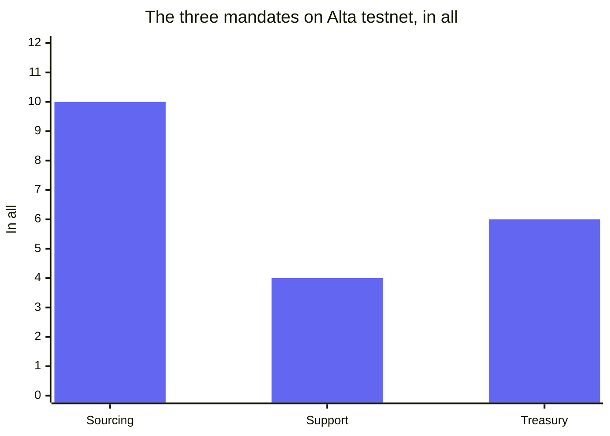

<a href="../README.md"><picture><source media="(prefers-color-scheme: dark)" srcset="assets/brand/purser-mark-dark.svg"></picture></a>

# Kit 11, step by step

**The Starter Kit 11 brief's flow, step by step, as Purser ran it live once on 3 November, with an id for every step.**

&nbsp;&nbsp;&nbsp;&nbsp;&nbsp;

[The steps](#kit-11-step-by-step) · [The main run's log](runs/2026-11-03-main-run.md) · [All 86 transactions](runs/2026-11-03-main-run-metal-transactions.md) · [Alta](metal-award.md) · [Airwallex](airwallex.md)

Moved from the [README](../README.md) on 15 November, to keep it short.

The Starter Kit 11 brief's flow ("x402 Business Agents", the builder guide), step by step, run live once on 3 November on Alta (formerly Metal) testnet and the Airwallex sandbox with test money. Every id opens on the explorer or in its record.

```mermaid
flowchart LR
  A["Accounts and<br/>three mandates"] --> B["The provider and<br/>a signed-order route"] --> C["Sell queries<br/>41 sales"]
  C --> D["The price rises<br/>#24 refused on chain"] --> E["Replace the mandates<br/>Face ID"]
  E --> F["Resolve the dispute<br/>3 refunded"] --> G["Sweep earnings<br/>to Airwallex"] --> H["Pay the licence<br/>FX, SWIFT"]
  classDef rails fill:#0ea5e9,stroke:#0369a1,color:#111827
  classDef ok fill:#10b981,stroke:#047857,color:#111827
  classDef stop fill:#f43f5e,stroke:#be123c,color:#111827
  classDef purser fill:#8b5cf6,stroke:#6d28d9,color:#ffffff
  class A,B,G rails
  class C,H ok
  class D stop
  class E,F purser
```

Record: [the first row of the table below](kit11.md#kit-11-step-by-step), from the main run of 3 November ([run log](runs/2026-11-03-main-run.md)), read by `test/docs-charts.test.ts`: Sourcing 10.00 in all (0.03 a purchase), Support 4.00, Treasury 6.00.

| Kit 11 step, in the brief's words | What Purser does | Proof, 3 Nov main run |
|---|---|---|
| "create your account, its three mandates, and a customer's account and mandate" | One account on Alta (formerly Metal) testnet; a mandate each for Sourcing (0.03 a purchase, 10.00 in all), Support (4.00) and Treasury (6.00); the simulated customer's own account and mandate | [Sourcing's bind](https://testnet.metalntwx.com/tx/0xb7ef08bb4531c3cbd4b56f4307255b4d88f68d279c8073d9bc96d352fb3d44ad) |
| "run the upstream provider and a query route that requires a signed order" | A simulated upstream provider, and Northwind's stock-check route over x402; each sale's signed order is kept with its transaction hash | [Sale #1](https://testnet.metalntwx.com/tx/0x2cc5a16e4aa74d5912e1b155f815270bd6f8a82796c08371dafa540410fa2fc7) |
| "sell queries" | 41 sales at 0.05, each with its own upstream purchase at 0.02 | [all 86 transactions](runs/2026-11-03-main-run-metal-transactions.md) |
| "raise the upstream price and show the refusal" | The upstream price rose to 0.04; Alta refused purchase #24 on chain (`mandate_cap_exceeded`); the customer got an error status and was not charged | [#24 refused](https://testnet.metalntwx.com/tx/0x2e92f9cb4549246f58b9b888881c258bf117c6233c1d8f126f4833ae6ae41871) |
| "replace the mandates" | The Treasury agent (Claude) proposed new limits within the 20.00; the CFO signed with Face ID, a labelled test passkey as second approver; Sourcing's new mandate carries what it had spent | [Sourcing's replace](https://testnet.metalntwx.com/tx/0x2a91ac97fc2a459da2b0c73f2b8020edec1901d051c7ef03bb088d36067fe790) |
| "resolve the disputed batch" | The signed orders show the customer's agent placed all 12; Support refunded only the 3 with wrong data (0.15); "refund all 9" was rejected with Face ID | [Refund #7](https://testnet.metalntwx.com/tx/0xe4bf79623f9cb9212a49ea7c0ced60d241041051f322d199e319989d6548c89d) |
| "then move earnings to Airwallex" | 0.69 swept after finality; the Airwallex sandbox deposit (a simulation) takes the transaction hash as its reference | [the sweep](https://testnet.metalntwx.com/tx/0x86936a5b29f9550857676fa710231af9e20882ebe6eee16f75a90af29767ccb4), deposit `b3812e05-2afa-4698-8f64-429f9608e0a0` |
| "and pay the licence fee" | The Treasury agent planned the euro licence; Purser bought only the euros it lacked (FX), and after the CFO's Face ID paid by SWIFT, settlement simulated by the sandbox | transfer `03360bfa-afce-457b-89d1-e1097fbe3985` PAID ([record](runs/2026-11-03-main-run.md)) |
