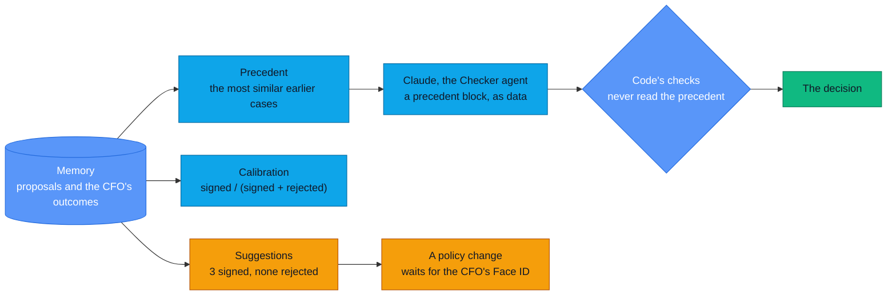
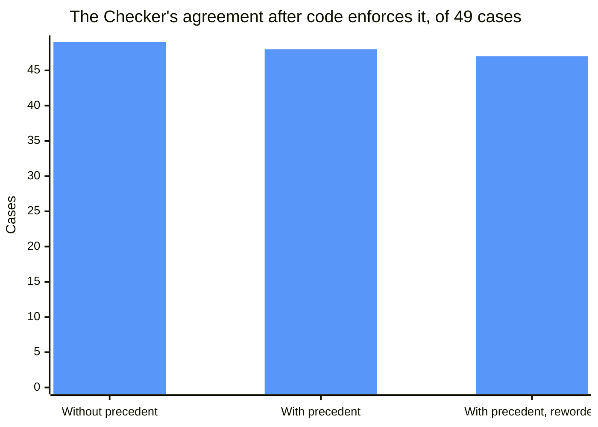

<a href="../README.md"><picture><source media="(prefers-color-scheme: dark)" srcset="assets/brand/purser-mark-dark.svg"></picture></a>

# How the agents learn from the CFO's past decisions

**In-context learning from signed outcomes: the most similar earlier cases go to Claude as precedent; code's checks still decide.**

&nbsp;&nbsp;&nbsp;&nbsp;&nbsp;

[The four parts](#the-four-parts) · [Where it runs](#where-it-runs) · [Does precedent help?](#does-precedent-help-the-eval) · [Agent evals](agent-evals.md) · [The record](evals/precedent.json)

Purser's agents learn from the CFO's past decisions. This is **in-context learning from signed outcomes**: when an
agent decides, the most similar earlier cases, and what the CFO did with them, go to Claude as precedent. No model is
trained or fine-tuned. No limit changes on its own: a pattern can only suggest a policy change, and that change waits
for the CFO's Face ID like any other.

## The four parts

| Part | What it does | Where |
|---|---|---|
| Memory | Every proposal an agent made and its outcome (the CFO signed it, rejected it with a reason, or let it expire), every purchase a card's lock refused, every Checker decision that code made stricter. One labelled case each, read from the company's own audit rows. Nothing new is stored. | `src/learning/precedent.ts` `casesFromAudit` |
| Precedent | For a new decision: the most similar earlier cases. Same supplier counts 3, same kind 1, same amount band 2 (the next band 1, same currency only). A kind alone is no precedent. Never the case itself, never a later case, never one still waiting. Up to five, each with the reason it matched. | `precedentsFor`, `precedentBlock` |
| Calibration | Per agent and kind: how often the CFO signed its proposals this month and last month. Rate = signed / (signed + rejected). Expired proposals, lock refusals and overrides are counted but are not the CFO's answer. | `calibration` |
| Suggestions | When the CFO signed at least 3 of an agent's proposals for one supplier and kind, and rejected none. For a card raise this maps to the agent's card limit (`card.<agent>.per_tx`): the suggestion is the highest amount the CFO signed. It becomes a `policy_change` proposal from the agent, and the limit changes only when the CFO approves it and it executes. A supplier-payment pattern has no setting (every invoice waits for Face ID), so it is shown and never proposed. | `suggestions`, `src/learning/propose.ts` |

## Where it runs

- **The Checker agent** (supplier invoices, `src/ap/checks.ts` → `src/ap/checkerCore.ts`): its prompt carries a
  `<precedent>` block with the CFO's past decisions on this supplier and amount band, as data. Code's checks never read
  it: a precedent informs the agent and loosens nothing. The decision row (`ap.checker_decided`) records which cases
  Claude was given (`precedents`).
- **The Agents tab** in Purser Cloud (`cloud/src/learning.ts`): per agent, "Learns from the CFO's past decisions", the
  approval rate this month against last month, the suggestions, and under each proposal its precedent. A decision Claude
  made with precedent shows "Learned from N past decisions"; a proposal made without it (the demo company's were made by
  code, with no model) shows "N similar past decisions (precedent next time)". Each case links to its invoice.
- **The demo company** uses only its own simulated history, and the tab says so.

## Does precedent help? The eval

`npm run precedent-eval` runs the Checker on the payables eval set (49 cases, `src/evals/apAgentCases.ts`) twice with
the same real model: without precedent, and with the CFO's outcomes on the most similar *other* cases of the set (leave
one out: pay or ask the CFO → signed; hold or reject → rejected, with the case's own description as the reason).
Scored on agreement with the case's recorded outcome.

Run on 14 Nov 2026 with `claude-haiku-5-5`, real Claude calls (`docs/evals/precedent.json`):

| | Claude's own decision agrees | After code enforces it |
|---|---|---|
| Without precedent | 49 of 49 | 49 of 49 |
| With precedent | 48 of 49 | 48 of 49 |

Record: [evals/precedent.json](evals/precedent.json) and [evals/precedent-run2-wording.json](evals/precedent-run2-wording.json) (14 Nov 2026, `claude-haiku-5-5`), read by `test/docs-charts.test.ts`: `summary.without.right_after` 49, `summary.with.right_after` 48 and, reworded, 47.

**Precedent did not improve agreement on this set.** The Checker already agrees with every recorded outcome without
it, so there is no room to improve. With precedent it held one clean invoice (`clean-nl-under-limit`) that should have
been paid: that supplier's other cases in the set are mostly a copy, a forged account and a rejected invoice, and the
precedent made the agent more careful. The miss is on the safe side (held, not paid).

One change to the wording was tried ("a rejected case counts only when its reason applies to today's case") and did
not help: 47 of 49 (`docs/evals/precedent-run2-wording.json`). It was taken out again.

What this means: the eval set is built to test the checks (two thirds of it are frauds and attacks), not to test
learning. A fair test needs a company's real history of the CFO's decisions, where the CFO's habits differ from the
default. Until such a run exists, Purser claims only what is shown here: the agents are given the CFO's past decisions
as precedent, and code's checks still decide what may be paid.

Total cost of the two runs: USD 0.14.
