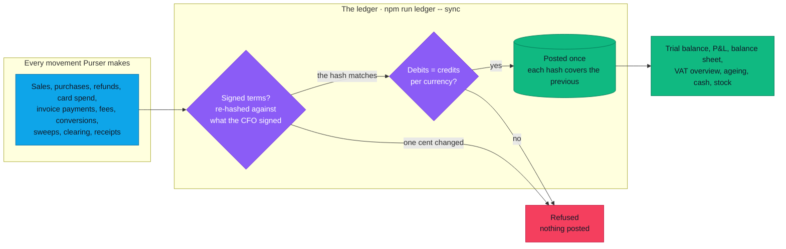

<div align="center">

<a href="../README.md"><picture><source media="(prefers-color-scheme: dark)" srcset="assets/brand/purser-mark-dark.svg"></picture></a>

# Purser's own books

**A stored general ledger fed from every movement of money Purser makes: balanced, append-only and hash-chained.**

[](https://github.com/agamemnon-coder/x402-business-agents/actions/workflows/ci.yml?query=branch%3Amain)&nbsp;[](#what-holds)&nbsp;[](#what-holds)&nbsp;[](#what-holds)&nbsp;[](#not-yet)&nbsp;[](#fx-differences-and-token-financing)&nbsp;[](../README.md#built-with)

[Run it](#run-it) · [What holds](#what-holds) · [FX and token financing](#fx-differences-and-token-financing) · [For other parts](#for-other-parts-of-purser) · [Not yet](#not-yet)

</div>

Purser keeps the books itself: a stored general ledger, fed from every movement of money Purser makes, with VAT,
reports, closing and stock. Design: [docs/archive/superpowers/specs/2026-11-08-bookkeeping-core-design.md](archive/superpowers/specs/2026-11-08-bookkeeping-core-design.md).
Test money only, like the rest of Purser.



## Run it

```bash
npm run ledger -- sync
```

Posts every movement Purser recorded that is not in the ledger yet: data sales, purchases, refunds, card spend,
invoice payments and their fees, conversions, sweeps, clearing and receipts, plus the opening balances. Each posts
once; run it as often as you like.

| Command | What it shows |
|---|---|
| `npm run ledger -- trial [--date 2026-11-30]` | Trial balance per account and currency |
| `npm run ledger -- pnl [--year 2026]` | Profit and loss |
| `npm run ledger -- balance [--date 2026-11-30]` | Balance sheet; it must balance in every currency |
| `npm run ledger -- vat --quarter 2026Q4` | Overview for the Dutch VAT return (rubrics 1a to 5c) |
| `npm run ledger -- ageing receivables` / `payables` | Open customer and supplier invoices, by due date |
| `npm run ledger -- cash` / `stock` | Cash per account and currency; stock at average cost |
| `npm run ledger -- close --month 2026-11` | Locks a month and every month before it; a late item posts on the first day after the last closed month |
| `npm run ledger -- close --year 2026` | Moves the year's result to retained earnings and locks the year |
| `npm run ledger -- export --csv` / `--json` | Every line; the JSON carries the chain check |
| `npm run ledger -- verify` | Recomputes the ledger's hash chain from the first entry |
| `npm run ledger -- serve` | All reports on a read-only page at http://127.0.0.1:4500/ |

## What holds

- **Balanced or refused.** Debits equal credits per currency, or nothing is written.
- **Nothing is changed or deleted.** The database refuses it. A mistake is corrected by a reversing entry that names
  the one it reverses. Each entry's hash covers the previous one, so `verify` finds any change.
- **Closed months stay closed.** A month close is a row that is only ever added.
- **No guessed VAT.** What Purser fed in has no VAT code (its records do not say which VAT applies); the VAT overview
  counts those lines as "no VAT code yet". Documents booked with a code (purchase and sales invoices) are added up into
  the rubrics.

- **Signed terms are booked only as signed.** Before the feed or a document posts an accrual or a payment that a signed
  proposal speaks for, it recomputes the hash of the stored terms and compares it with the hash the CFO signed
  (`src/ledger/termsLock.ts`). One cent changed after the Face ID is refused with a sentence that quotes the signed
  hash, and nothing is posted or reversed. Payment and tokenizing refuse the same change
  (`test/one-cent-three-locks.test.ts`).
- **An entry can name its approval and its rail.** `approval_sha256` (the CFO's Face ID hash) and `rail_ref` (an
  Airwallex transfer or conversion id, or a transaction hash) sit next to `doc_sha256`. Both are nullable columns added
  on 12 November; an entry carries them in its hash only when they are set, so every earlier entry hashes as before.

<picture><source media="(prefers-color-scheme: dark)" srcset="assets/anim/hash-chain-dark.svg"></picture>

## FX differences and token financing

- **Realised FX** (`src/ledger/fx.ts`): an invoice in another currency is carried at its booked rate. When the
  conversion that paid it sold more or less of the functional currency, `postFxDifference` posts the difference
  against money in transit (1590) and 7900 "FX differences, realised". The booked value is rounded half up to a whole
  cent; a property test holds that booked value plus difference is always what was paid. **Not wired in yet:** the
  ledger feed does not call it, so today 7900 stays empty and a conversion leaves a balance on 1590 per currency.
- **Invoice token financing** (`src/ledger/financing.ts`), for a company's own sales invoice that was tokenized. With
  recourse (the default): on the financier's accept, the bank receives the price and 2150 holds what is owed to the
  financier; at settlement the receivable (1300) and 2150 are cleared and the discount is posted to 7100 "Finance
  cost". Without recourse: the receivable goes at once and the discount is the cost then. The price is the token
  contract's own (`discountedPrice`, rounded down to a cent). The financier is a test key on testnet: account 2150 is
  named "Simulated financier (testnet)" in every report.

## For other parts of Purser

`src/ledger/documents.ts` books a purchase invoice (expense or stock, input VAT, payables), a sales invoice
(receivables, revenue, output VAT) and a payment or receipt against an open item; `src/ledger/stock.ts` buys and sells
goods at weighted average cost. The payables inbox and the company API call these.

## Not yet

- Filing the VAT return: the overview is for a person to check and file; filing to the tax authority needs a
  certified connection (Digipoort/SBR).
- One reporting currency: every report is per currency; revaluation is a later step.
- The XAF audit file for the tax authority (XML, needs validating against its schema), depreciation and payroll.
