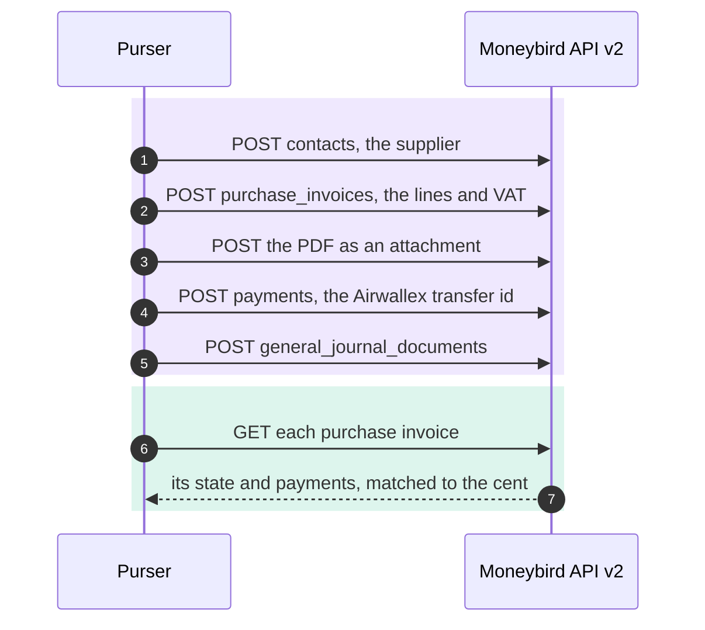

<a href="../README.md"><picture><source media="(prefers-color-scheme: dark)" srcset="assets/brand/purser-mark-dark.svg"></picture></a>

# Moneybird

**Purser's first accounting link for small companies: each booked or paid supplier invoice lands in Moneybird.**

&nbsp;&nbsp;&nbsp;&nbsp;&nbsp;

[What it sends](#what-it-sends) · [How it behaves](#how-it-behaves) · [Going live](#going-live-max) · [The run of 12 Nov](runs/2026-11-12-moneybird-sandbox.md) · [ERP connectors](erp.md)

Purser's first accounting link for small companies. When Purser has booked or paid a supplier invoice, the
invoice lands in the company's Moneybird administration, together with its supplier, the PDF, the VAT, the ledger
account and the payment.

**Status: run live once, in a Moneybird sandbox administration with test data (12 November 2026,
[run record](runs/2026-11-12-moneybird-sandbox.md)). Purser sent suppliers, purchase invoices with their PDF, a
payment, a journal entry and a correction, read every purchase invoice back, and found no difference with its own
ledger to the cent. A second sync sent nothing. Not done: a real company's administration, OAuth for customers (the
run used the owner's personal API token), other currencies than EUR, and VAT other than 21% and 9%.**

## What it sends

| Purser | Moneybird (API v2, `https://moneybird.com/api/v2/{administration_id}/…json`) |
|---|---|
| Supplier | `POST contacts`: `company_name`, `tax_number`, `bank_account` (IBAN), `country`, and `customer_id` = `PURSER-<id>` |
| Purchase invoice | `POST documents/purchase_invoices`: the supplier's number as `reference`, date, due date, currency, `prices_are_incl_tax: false`, and one detail per line (net price, mapped `tax_rate_id`, mapped `ledger_account_id`, optional `project_id`) |
| The PDF | `POST documents/purchase_invoices/{id}/attachments` (multipart, field `file`) |
| Payment | `POST documents/purchase_invoices/{id}/payments`: `payment_date`, `price`, and the Airwallex transfer id as `transaction_identifier`, so Moneybird can match the bank line |
| Journal entry | `POST documents/general_journal_documents`: `reference` = `Purser <id>`, with debit and credit per ledger account |
| Credit note (a correction) | the same lines with negative prices, reference `<number> (credit note)` |
| Paid or not | `GET documents/purchase_invoices/{id}`: its `state` and payments |

In the sandbox run of 12 November a supplier went as its name and `customer_id` only: Purser's feed to the ERP link
holds no VAT number, and of the IBAN only the last four digits and a hash.

## How it behaves

- **Sent once.** The ERP sync (`docs/erp.md`) records Moneybird's id per object, so a second run sends nothing.
- **Lost answers.** If an answer was lost, Purser looks the object up before sending again:
  - a supplier by its `customer_id`;
  - an invoice by supplier and reference;
  - a payment by its transaction identifier;
  - a journal entry by its reference.
- **Totals checked.** Moneybird computes the VAT itself. Its totals on the answer must match the invoice to the cent.
  If they don't, the invoice waits for a person (`needs_review`), and nothing is paid against it.
  - The same goes for an invoice found without its PDF.
- **No guessing.** Purser refuses an account, VAT kind or cost centre that has no Moneybird counterpart, and names it.
  - It also refuses a ledger account that is not allowed on purchase invoices.
  - It also refuses a tax rate that is not a purchase rate.
- **Errors and limits.**
  - A 401 is tried once more, then stops.
  - A 429 waits out Moneybird's `Retry-After`, whether given as seconds, a date or a moment.
  - A 5xx is retried after looking first.
  - The limit is 150 requests per 5 minutes per IP address.
- **Other currencies.** A payment or journal entry in another currency than the administration's is refused for now.
  Moneybird needs the base-currency amount too (`price_base`).
- **Ids and money are exact.** Moneybird's ids go past 2^53, so they are read as strings. Amounts are sent as exact
  decimal strings.
- **One administration, a fixed list of requests.** Before a request leaves, Purser checks two things: it goes to the
  administration in the settings, and it is on the connector's own list (`MONEYBIRD_ENDPOINTS` in
  `src/erp/moneybird.ts`).
  - Nothing on that list sends an e-mail, an invoice or a reminder to a contact, and nothing changes or removes what
    was sent. A supplier's e-mail address is never sent to Moneybird.
  - `ERP_MONEYBIRD_SANDBOX_ONLY=on` allows only the sandbox administration of Purser's own tests.
- **A go and a call budget.** A live command runs only with the owner's go and an approved number of requests
  (`docs/erp.md`, "A go and a call budget"). The call log names each request under its administration.
- **Console.** The **Koppelingen** card in the settings shows the link's state: niet gekoppeld, gekoppeld or vraagt
  aandacht. It also shows the last sync and what was sent, failed or waits.
  - The card reads it from the sync results in the audit log.
  - The cloud never holds the token.

## Going live (Max)

1. **Account and administration.** Create a Moneybird account.
   - For testing first, use a sandbox administration: moneybird.com/administrations/sandboxes/new.
   - Note the administration's number from the web app's address.
2. **API token.** Create one at moneybird.com/user/applications/new.
   - Choose a **personal API token** with only the **`documents`** scope. That one scope covers purchase invoices,
     their payments and attachments, journal documents, contacts, ledger accounts and tax rates.
   - For customers later, register an **OAuth application** with the same scope (`documents`).
   - Moneybird's access tokens do not expire for now.
3. **Settings on the runner** (environment only, never in git or chat):
   - `ERP_MONEYBIRD_TOKEN`;
   - `ERP_MONEYBIRD_ADMINISTRATION_ID`;
   - `ERP_MONEYBIRD_TAX_RATES`, for example `{"NL21":"<id>","NL9":"<id>","NL0":"<id>"}`. Fill it in after step 4.
   - Optional:
     - `ERP_MONEYBIRD_GL_MAP` (a Purser account to a ledger account id; otherwise the codes are matched);
     - `ERP_MONEYBIRD_PROJECTS` (a cost centre to a project id);
     - `ERP_MONEYBIRD_IGNORE_COST_CENTRES=on`;
     - `ERP_MONEYBIRD_BASE_CURRENCY` (default EUR);
     - `ERP_MONEYBIRD_SANDBOX_ONLY=on` (only Purser's own sandbox administration may be called).
4. **Look before sending.**
   - `npm run erp -- pull --connector moneybird --live` lists the ledger accounts and tax rates with their ids, for the
     maps above. It needs the token and the administration, not the maps. Each account shows its kind and whether it
     may stand on a purchase invoice or a journal entry.
   - Expect to need `ERP_MONEYBIRD_GL_MAP`. The sandbox's chart had Moneybird's own account codes and none of Purser's.
   - `npm run erp -- sync --connector moneybird --dry-run` shows the requests without sending them.
     - A dry run asks no administration. It takes each id in your maps at its word; the live run checks every one
       against Moneybird's own chart and tax rates before it sends.
5. **Send, then read back.**
   - `npm run erp -- sync --connector moneybird --live` sends what changed.
   - `npm run erp -- readback --connector moneybird --live` reads every purchase invoice back and sets it next to the
     ledger: net, VAT, gross, paid and state. It names each difference with both amounts.
   - `npm run erp -- record --connector moneybird` writes the run's record as data.
6. **Seen in the sandbox on 12 November, and still to check with a bookkeeper before a real administration:**
   - Moneybird took a negative-price purchase invoice as the credit note of a correction. It does not link the two:
     the replaced invoice and its credit note both stay open until a person sets them against each other.
   - Moneybird computed the same VAT as four test invoices at 21% and 9%. Check its rounding on a few real invoices.
   - A payment sent without a bank account lands on "Te rubriceren betalingen". Matching it to a bank line was not
     tested.

Sources:
- developer.moneybird.com ("Welcome to Moneybird", "Authentication");
- Moneybird's OpenAPI file, version v2-20261110-3df079017e. The subset the tests use is in
  `test/fixtures/moneybird/openapi-subset.json`, rebuilt with `test/fixtures/moneybird/extract.py`.
