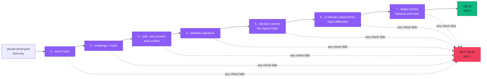
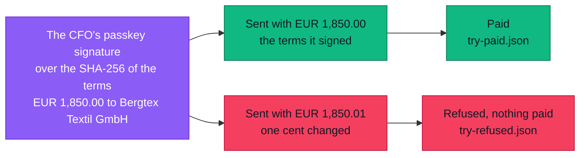

<a href="../../README.md"><picture><source media="(prefers-color-scheme: dark)" srcset="../assets/brand/purser-mark-dark.svg"></picture></a>

# Proof bundles

**The file /try hands over on Paid and on the one-cent refusal, so anyone can check the payment without trusting our server.**

&nbsp;&nbsp;&nbsp;&nbsp;&nbsp;

[What it holds](#what-it-holds) · [Check one](#check-one) · [The two samples](#the-two-samples-here) · [/verify](https://kit11.max-31b.workers.dev/verify) · [Tamper matrix](../evidence/tamper-matrix.md)

| At a glance | Record |
|---|---|
| Format `purser.proof-bundle/v1`: the signed terms, the passkey's signature, the decision, the ledger entries | [src/proof/bundle.ts](../../src/proof/bundle.ts) |
| **7 checks**, the same code in the browser and offline | [/verify](https://kit11.max-31b.workers.dev/verify) · `npm run verify-bundle` |
| **2 samples** from the live /try, 15 Nov 2026: EUR 1,850.00 paid; EUR 1,850.01 refused | [try-paid.json](try-paid.json) · [try-refused.json](try-refused.json) |
| Every signed field of both samples (and of the other signed files committed here) changed by one step: every changed copy refused, 0 accepted | [tamper-matrix.md](../evidence/tamper-matrix.md) · `npm run tamper-matrix` |

<picture><source media="(prefers-color-scheme: dark)" srcset="../assets/payment-life-wide-dark.svg"></picture>

## What it holds

On /try it is the "Download the proof (JSON)" button; the format is `purser.proof-bundle/v1`.

- the signed terms, their canonical JSON (RFC 8785) and its SHA-256;
- the WebAuthn assertion (authenticatorData, clientDataJSON, signature) and the passkey's public key (COSE), with the rpId;
- the engine's decision (both layers' words);
- the payment's ledger entries and the ledger's head;
- for a refusal, the terms that were asked, and their hash.

There are no secrets and no personal data: a test company and test money only.

## Check one

| Where | How |
|---|---|
| In a browser | Drop it on [/verify](https://kit11.max-31b.workers.dev/verify): no server call; WebCrypto on your device |
| Offline | `npm run verify-bundle -- docs/proof/try-paid.json`: exit 0 when every check passes, 1 when one fails |

Both run the same code. The checks:

1. The SHA-256 of the canonical terms equals the file's hash.
2. `clientDataJSON.challenge` equals that hash.
3. The authenticator data's first 32 bytes are SHA-256 of the rpId, and its flags say "user present" and "user verified".
4. The ES256 or RS256 signature verifies over `authenticatorData ‖ SHA-256(clientDataJSON)` with the public key.
5. The decision names the signed hash.
6. A refusal's asked terms hash differently, so the signature cannot cover them.
7. Every ledger entry balances and hashes as posted.

## The two samples here

`try-paid.json` and `try-refused.json` come from the deployed site, on 15 November 2026:

- paid at 04:26:10 UTC and refused at 04:26:16 UTC (each file's `made_at`);
- one run of the live /try, https://purser-try.max-31b.workers.dev/try, so the rpId is `purser-try.max-31b.workers.dev`;
- a fresh test company, on the simulated bank (test money; ids such as `tr_5`), signed by Chromium's virtual passkey (user verification on);
- the clean sample invoice, EUR 1,850.00 to Bergtex Textil GmbH (a test supplier), paid; then the same signature sent with EUR 1,850.01, refused.

Both pass every line on the live [/verify](https://kit11.max-31b.workers.dev/verify) and with `npm run verify-bundle`.
`npx tsx test/browser/proof.check.ts --live --write` makes them again; without `--live` it runs the same walk on this
machine, on `localhost`.
