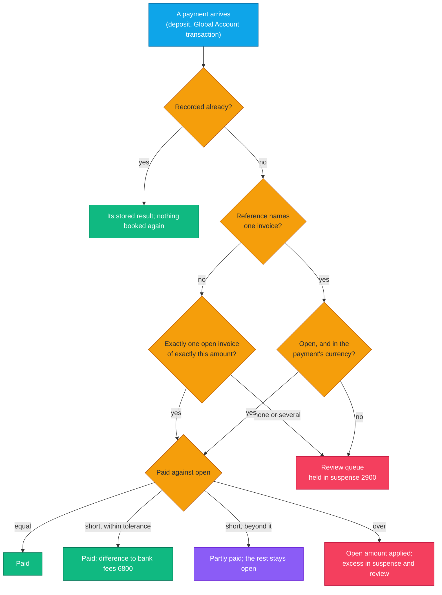

<div align="center">

<a href="../README.md"><picture><source media="(prefers-color-scheme: dark)" srcset="assets/brand/purser-mark-dark.svg"></picture></a>

# Receivables: money in

**Invoices to customers, booked when issued, paid through an Airwallex payment link or a bank transfer, matched by code, and chased with reminder drafts a person sends.**

[](airwallex.md)&nbsp;[](#what-is-real-and-what-is-not)&nbsp;[](#the-books)&nbsp;[](#aged-debtors-and-reminders)

[Run it](#run-it) · [Matching rules](#matching-rules) · [The books](#the-books) · [Aged debtors and reminders](#aged-debtors-and-reminders) · [Treasury advisor](treasury.md)

</div>

Purser pays suppliers; receivables is the other half. Northwind issues an invoice, Purser books it and asks Airwallex
for a single-use payment link for exactly that invoice (`src/airwallex/paymentLinks.ts`). Money that arrives, a deposit
to a Global Account (`src/airwallex/deposits.ts`, the `deposit.settled` webhook) or a transaction on one
(`src/airwallex/globalAccountTx.ts`), is matched to an invoice by code and booked once. What code cannot place goes to
a review queue and to suspense, never to revenue. The code is `src/receivables/ar.ts`.

The older receivables agent (`src/agents/receivables.ts`, the Kit 11 world's retailer payments, booked cash basis
through the journal) keeps working as before: a deposit whose reference names one of its invoices still goes to it,
and every other deposit goes to the receivables module once that has invoices (`routeDeposit`). Each deposit is
recorded by exactly one of the two, once.

## Run it

```bash
npm run receivables -- issue --no NW-1001 --customer "Alpenweg Sport AG" --currency EUR --net 1000.00 --due 2026-12-31 [--vat S21] [--email ap@example.com] [--no-link]
npm run receivables -- match [--days 7] [--file payments.json]
npm run receivables -- aging [--as-of YYYY-MM-DD]
npm run receivables -- dunning [--as-of YYYY-MM-DD]
npm run receivables -- review
```

`issue` makes the payment link only with the Airwallex sandbox keys set (read back against the invoice before it is
kept: amount, currency, reference, single use). `match` reads the settled deposits of the last days from Airwallex
(read-only), or a JSON file of payments, and switches off the link of each invoice no longer open. The older modes
(`demo`, `poll`, `customer-pays`) are unchanged.

## Matching rules



| Rule | What code does |
|---|---|
| Once | A payment is matched once, by its Airwallex id; the same id again returns the stored result and books nothing |
| Reference | The reference names an invoice number, written any way (`src/lib/invoiceKey.ts`: case, spaces and dashes do not matter); the longest one named wins; two different ones of the same length go to review |
| Amount | No invoice named: exactly one open invoice in the same currency with exactly this amount open. None, or more than one, goes to review: never a guess |
| Tolerance | Short by at most **the smaller of 2.00 and 0.5% of what is open**: paid in full, the difference written off to bank fees (a bank's charge on the way in). Short by more: partly paid |
| Over | The open amount is applied; the excess waits in suspense and in the review queue: a refund or a credit is the CFO's decision |
| Review | Wrong currency, an invoice already paid, no invoice, or more than one: the whole payment to suspense (2900) and the review queue |

## The books

Every step posts to the stored ledger (`src/ledger/core.ts`), balanced per currency, once per source key:

| Event | Debit | Credit |
|---|---|---|
| Invoice issued | 1300 Debtors (the gross) | 4200 Revenue (net), 2210 Output VAT |
| Payment matched | 12xx Bank of its currency | 1300 Debtors (the part applied) |
| Short within tolerance | 6800 Bank and transfer fees | 1300 Debtors (the difference) |
| Overpayment, or a payment to review | 12xx Bank | 2900 Unidentified receipts (suspense) |

## Aged debtors and reminders

`aging` sorts each open invoice by **days past its due date** into 0-30, 31-60, 61-90 and 90+, per currency (an
invoice not yet due counts as 0 days, in 0-30, and is also totalled apart). Currencies are never added together.

`dunning` writes a reminder draft for each open invoice at **due + 3, due + 10 and due + 20 days**, once per invoice and
stage. The table holds only drafts (`ar_dunning.status` can only be `DRAFT`); Purser sends nothing. A person reads the
draft and sends it; the contact address is shown masked on the console. A paid invoice gets no new draft.

> [!IMPORTANT]
> Customer names, contact addresses and payer names never go to the audit log or the console log: invoice numbers and
> amounts do (`test/receivables-ar.test.ts` checks both). The address is stored for the drafts only
> ([data classification](security/data-classification.md): Restricted).

## What is real and what is not

| Part | State |
|---|---|
| Invoices, matching, books, ageing, drafts | Code over the ledger; tested in `test/receivables-ar.test.ts` with a mocked Airwallex client |
| Payment links | Airwallex **sandbox** (`POST /pa/payment_links/create`); the checkout page is Airwallex's, test cards only |
| Incoming payments | Airwallex **sandbox** deposits, read-only, or simulated there (`npm run receivables -- demo`); test money |
| Card payments through a link | Still booked by the older path (`src/airwallex/acceptance.ts`, `payment_intent.succeeded`), not yet by this module |
| Reminders | Drafts only; nothing is e-mailed |
| Forecast | Open invoices feed the [Treasury advisor's](treasury.md) 13-week cash forecast as expected cash |
