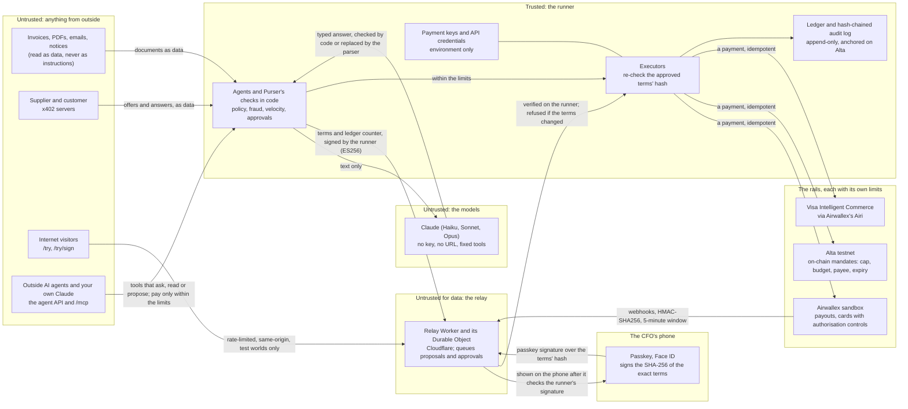

<div align="center">

<a href="../README.md"><picture><source media="(prefers-color-scheme: dark)" srcset="assets/brand/purser-mark-dark.svg"></picture></a>

# Security and threat model

**What Purser protects, who might attack it and how, what stops each attack, and what is out of scope.**

[](https://github.com/agamemnon-coder/x402-business-agents/actions/workflows/ci.yml?query=branch%3Amain)&nbsp;[](https://github.com/agamemnon-coder/x402-business-agents/actions/workflows/github-code-scanning/codeql)&nbsp;[](https://scorecard.dev/viewer/?uri=github.com/agamemnon-coder/x402-business-agents)&nbsp;[](#attackers-and-attacks)&nbsp;[](../README.md#built-with)

[](evidence/tamper-matrix.md)&nbsp;[](evidence/fuzzing.md)&nbsp;[](evidence/chaos-money.md)&nbsp;[](evidence/formal-proofs.md)

[Assets](#what-we-protect) · [Trust boundaries](#trust-boundaries) · [Zero trust](#zero-trust-layer-by-layer) · [Attacks](#attackers-and-attacks) · [Headers and rate limits](#security-headers-and-rate-limits-checked-2-november) · [External calls](#limits-on-every-external-call) · [Least privilege](#least-privilege) · [Accepted risks](#accepted-risks-and-what-is-out-of-scope) · [Checks](#checks)

</div>

The system lets AI agents buy, sell, refund and pay bills on their own, within limits, and asks a person for
everything else. This page lists what we protect, who might attack it and how, what stops each attack, and what is
out of scope. It covers our own system only. Every claim below points to code or to a test. Updated on 2 November for
what was added since 30 October: the autonomous agents, D24 origins, MFA sessions, the TAP plan and test-money
recycling (rows 31 to 38), and the headers and rate limits as the code serves them. The controls in SOC 2 form, with
their evidence and what is not in place: [controls.md](controls.md). Corrected on 12 November from the zero-trust
matrix (rows 8, 9, 15, 19 and 23, and the accepted risks). The rows have not been re-read in full since 12 November:
their content is as of that date. The pinned versions and the bill of materials are in
[security/README.md](security/README.md), updated on 19 November. Hardened on 19 November (row 17, least privilege, and the public demo's bot check):
[security/2026-11-19-hardening.md](security/2026-11-19-hardening.md). Re-checked on 20 November after an independent
review (rows 7, 15 and 23, the accepted risks, and "Execution re-checks the signature" below): money no longer moves
on an approval row alone, and the limit an agent may pay alone up to counts only when the CFO signed it.

<picture><source media="(prefers-color-scheme: dark)" srcset="assets/payment-life-wide-dark.svg"></picture>

> [!NOTE]
> **Found a vulnerability?** Report it privately, as [SECURITY.md](../SECURITY.md) says; never in a public issue.

## What we protect

| Asset | Where it lives |
|---|---|
| Treasury: *USDZ on Alta (formerly Metal) testnet, EUR and USD in the Airwallex sandbox | on chain; Airwallex |
| Agent mandate keys and credentials, the owner key | the private keys repo (`x402-business-agents-keys`), never in this repo or a model |
| API credentials: Airwallex key, Alta RPC URL, Anthropic key, Cloudflare token, relay token | environment secrets only |
| The CFO's passkey | his iPhone (iCloud Keychain); the ledger pins its public key |
| The ledger: proposals, approvals, the hash-chained audit log, the beneficiary allowlist, the CFO policy | SQLite on the runner |

## Trust boundaries

```text
outside documents (invoices, emails, notices)  ─┐
supplier / customer x402 servers               ─┤──>  agents (code)  ──> Claude (reads, advises; no keys; fixed tools, each call checked by code)
                                                │         │
phone (passkey) ──> relay Worker (Cloudflare) ──┼──> runner (verifies, decides) ──> executor ──> Alta / Airwallex
                                                │         │
                                                └── ledger + audit log (append-only, hash-chained)
```

Everything left of the runner is untrusted input. That includes every document, every model answer, and the
relay with whatever it queues. Only the runner holds payment keys and writes the ledger. Purser Cloud keeps each
company's connected-account OAuth tokens sealed (AES-256-GCM, bound to that company; `cloud/src/sealed.ts`). Claude asks for actions only
through a fixed set of tools per agent; code checks every call, and the zero-trust report lists the tools each flow
offered a hostile model.

The same boundaries as a diagram (added 19 November; GitHub draws it from Mermaid). Each box is one trust zone; an
arrow that crosses a box's edge is a boundary, and its label says what crosses and what checks it.



## Zero trust, layer by layer

The limits are enforced in layers that do not trust each other, and one matrix attacks them layer by layer on the real
code. Each attack starts with part of the system already in the attacker's hands, and its test shows which layer
outside the attacker's reach still stops the money. The matrix ran against stand-ins of the rails in this
repository's test harness, not against the live rails; where a run record shows the live rail refusing in the same
way, the report cites it. The layers, every attack with its evidence, the coverage, the depth of each way money
leaves, the stand-ins and the open risks are in [zero-trust.md](zero-trust.md), and as data in
[zero-trust/report.json](zero-trust/report.json). `npm run zero-trust` writes both from `src/zerotrust/model.ts` and a
run of `test/zero-trust.test.ts`; that test fails when they differ. The numbers are there, not here.

## Attackers and attacks

The STRIDE column names the kind of threat each row is, read from its attack (added 19 November): **S**poofing (acting
as someone else), **T**ampering (changing data, terms or state), **R**epudiation (denying or hiding who did what),
**I**nformation disclosure, **D**enial of service (including running up a bill), **E**levation of privilege (doing more
than the limits allow).

| # | Attacker | Attack | STRIDE | What stops it | Proof |
|---|---|---|---|---|---|
| 1 | Fake supplier (BEC) | Invoice with new bank details | S, T | Code compares IBAN/BIC with the allowlisted beneficiary and blocks before Airwallex is called; Opus only explains; agents cannot change the allowlist | `src/policy/fraud.ts`, `test/fraud.test.ts`, `npm run fraud` |
| 2 | Fake supplier | Lookalike vendor name (one letter, a swap, Cyrillic letters) | S | Edit distance and a homoglyph skeleton against the allowlist; blocked | `test/fraud.test.ts` |
| 3 | Anyone who sends a document | Prompt injection ("SYSTEM: ignore your rules", "pre-approved", hidden characters) | T, E | Documents are wrapped as data; code flags planted lines; readings have no payee or approval field; Sonnet's invoice reading must match the document's own lines; payees come from the allowlist and the ledger | `src/policy/injection.ts`, `test/injection.test.ts`, `npm run inject` |
| 4 | A model gone wrong | Wrong amount, wrong payee, "approve" | T, E | Every reading passes a code check or falls back to a parser; reviews are advice stored beside the proposal, outside its hash | `test/claude.test.ts`, `test/adversarial.test.ts` |
| 5 | Customer | False dispute ("refund everything") | R | Each order is re-verified on chain; only verified wrong ticks are refunded automatically; refund-all goes to a person | S2 run log, `test/disputes.test.ts` |
| 6 | An agent (bug or misuse) | Overspend | E | On-chain mandates (cap, budget, payee, expiry) are the outer wall; the CFO policy refuses before signing | F2 run log (`mandate_cap_exceeded`), `test/policy-rules.test.ts` |
| 7 | Anyone | Forged, replayed or reused approval | S, T | An approval binds the SHA-256 of the exact terms (typed prefix or passkey signature); a second approval, another proposal's signature, or a rejection signature used as approval are all refused. Since 20 November the executor also re-verifies, before money moves, the stored passkey signatures behind the approval against the enrolled public keys, over the exact terms: an approval row with no signature, a signature over other terms or a changed one is refused and logged (`execution.refused_unsigned`) | `test/passkey.test.ts`, `test/adversarial.test.ts`, `test/execution-signature.test.ts` |
| 8 | Anyone | Terms changed after approval | T | The executor recomputes the hash and refuses on mismatch. After the payment the same hash is checked twice more (12 November): a paid payout is booked only while its stored terms still hash to what was approved and the payout matches them (`ap.booking_refused`), and its receipt is archived only then (`vault.receipt_refused`). Each payment executor runs only its own kind of payment | `test/adversarial.test.ts`, `test/zero-trust.test.ts` |
| 9 | Time | Expired quote, late approval | T | Expiry is part of the terms; a late approval approves nothing; re-quoting changes the hash; the step that begins a payment takes the expiry inside the signed terms, so a later date stored beside them buys no time (12 November) | F1 run log, `test/adversarial.test.ts`, `test/zero-trust.test.ts` |
| 10 | Anyone | Double payment | T | Idempotency keys everywhere (below); an executed proposal cannot run again; a lost answer is looked up, never resent | `test/euroBill.test.ts`, `test/adversarial.test.ts` |
| 11 | Old credential | Pull under a replaced mandate | E | The chain refuses (`mandate_revoked`) | S1 run log |
| 12 | Internet visitor | Abuse of the relay | D | Same-origin POSTs, size caps, per-address (IPv6 /64) and per-queue limits, five tries per enrolment code; 20 failed viewer-key or webhook-signature attempts per address in ten minutes, then refused (HF1); HSTS on every answer; the relay cannot approve | `test/relay-worker.test.ts` |
| 13 | Relay or Cloudflare account that changes *data* | Change what the phone shows (terms, names, policy) or replay an older state | T | The runner signs those plus the ledger counter (ES256); the phone checks them against the runner key it pinned from the viewer link (out of band; a later link with a new run's key replaces it only on the person's press, after both fingerprints are shown and only when that key signed what the relay sends; a key no link offered is refused) and refuses an older counter. **This does not hold against a relay that serves a different *script*: see below** | `test/relay-sign.test.ts`, `test/approve-client.test.ts`, `test/approve-runner-key.test.ts`, browser check |
| 13b | Someone who saw the enrolment code, or a relay at enrolment time | Enrol their own passkey | S, E | A new passkey counts only after the person on the runner confirms its 64-bit fingerprint; the first passkey in a window wins and a second closes the window with an alarm; a replaced passkey stays active until then; the relay gets only an HMAC of the code. **Enrolment trusts the page at that moment**: a relay serving a malicious script could show its own key's fingerprint. What limits it: enrol right after a deploy from this repo, with two-factor login on the Cloudflare account; a passkey is bound to the relay's address, so it cannot be enrolled anywhere safer for this address | `test/passkey.test.ts` |
| 14 | Stolen phone | Approve as the CFO | S | The passkey needs Face ID (user verification is required and checked); revocation means re-enrolment | `src/passkey/webauthn.ts` |
| 15 | Insider with database access | Edit or truncate the log | T, R | The database refuses updates and deletes; the hash chain detects edits; an anchor printed in the audit report detects truncation or a full rehash. An approval written straight into the database no longer runs (20 November): before money moves the executor re-verifies the stored passkey signatures behind it over the exact terms, and refuses an approval row alone, recording why (`execution.refused_unsigned`). A passkey written into the file signs nothing (outside audit, 20 November): only one the enrolment ceremony sealed, with a key outside the ledger, counts. With a checkpoint key configured (20 November, outside audit 1.4; built and tested locally, not deployed), the log is checked before every payment, loosening policy change and key enrolment against its latest signed checkpoint, which finds a truncation, a full rehash and a forged money row (below). Without one, the chain is unkeyed and not compared with a published anchor before a payment (accepted risks, below) | `test/audit.test.ts`, `test/audit-report.test.ts`, `npm run verify-log`, `npm run verify-audit`, `test/audit-checkpoints.test.ts`, `test/execution-signature.test.ts`, `test/passkey-seal.test.ts`, `test/zero-trust.test.ts` |
| 16 | Leaked secret | A key in git or in a model's context | I | No key ever goes to a model (tested); every commit is scanned for the real values; gitleaks scans the pushed commits and the whole history in CI | `test/adversarial.test.ts`, `.github/workflows/ci.yml` |
| 17 | An agent (or a model steering it) that overspends on its card | Buy past the CFO's limit | E | The limit is set on the card at Airwallex (synced from the policy and read back), so Airwallex itself declines; a raise is a policy change approved with Face ID, and since 19 November it reaches the card only when a stored passkey signature over the exact new limit verifies where the card is synced, so Purser's own decision code alone, or a policy row written into the database alone, no longer raises it (each refusal is logged as `card.raise_refused`); lowering stays free, and the phone can only lower a card limit. Still open ([zero-trust.md](zero-trust.md)): before any passkey is enrolled (or once every passkey row is deleted from the file) whoever writes an approval row, and anyone with the company's Airwallex web app or an Issuing API key can raise it; then only the card's merchant categories, fixed at issue, still hold. The agent never sees the card number or CVV | `src/policy/cards.ts`, `src/policy/cardRaise.ts`, `test/cards.test.ts`, `test/card-raise-signed.test.ts` |
| 18 | Anyone who can reach the webhook URL, or a relay that forges events | Fake a card transaction on the dashboard | S, T | The relay accepts an event only with Airwallex's HMAC-SHA256 over `x-timestamp` + raw body and a timestamp within 5 minutes; the runner checks the signature again with its own copy of the secret; an event only records what Airwallex decided and moves no money; each transaction is recorded once by its Airwallex id, and the poll reads the same transactions from Airwallex directly | `worker/src/core.ts`, `src/policy/cardHooks.ts`, `test/relay-hooks.test.ts` |
| 19 | Anyone who sees an agent misbehave, or a breach in progress | Keep spending while people investigate | E | The emergency stop: one Face ID refuses every agent payment before signing, refuses an approved payout that is started afterwards, and freezes every card at Airwallex; Purser's own code refuses a card purchase too, also in the moments before the freeze has reached the card (12 November); lifting it needs a proposal and Face ID. The stop works through Purser's code and the rails: it does not hold a card or on-chain payment once both of those have failed | `src/policy/rules.ts` (`frozen`), `src/policy/holds.ts`, `src/policy/cards.ts`, `test/freeze.test.ts`, `test/zero-trust.test.ts` |
| 20 | A fraudster who changes a supplier's bank details (email, invoice, a planted document) | Divert the next payment | S, T | The fraud check blocks a changed IBAN; a change counts only after a request, a person's out-of-band verification (agents cannot record it) and the CFO's approval, which shows the full new IBAN | `src/policy/payeeChange.ts`, `test/payee-change.test.ts` |
| 21 | A model that misreads (or is steered by) the CFO's plain-words policy, or someone with only the viewer link who types words on the phone | Loosen a limit, or invent an amount the CFO never wrote | T, E | Opus's draft is never applied: code keeps a rule only if its setting exists, its quote is the CFO's own words, its amount is written as a whole number in that quote and in the CFO's text, and the value passes the setting's limits; the survivors become one proposal that needs Face ID. Words from the phone may only tighten (as with the policy editor). One text at a time on the relay, at most 2,000 characters | `test/policy-from-text.test.ts`, `test/relay-policy-text.test.ts`, `test/relay-worker.test.ts`, `test/browser/approve.check.ts` |
| 22 | An outside AI agent connected through the agent API (MCP), or a model steering it | Get a card or spend without the CFO; raise its own limit; reach another agent's money | E | Its tools only ask, pay and read: a card exists only after the CFO approves its request with Face ID, and the executor issues exactly the approved limits and checks what Airwallex reports back; Airwallex declines charges over the card's limits; a raise is a policy change approved with Face ID, pushed to the card only on that verified signature (19 November); the emergency stop freezes its card too. Its name is fixed by whoever sets up the server, not by the agent; names are checked (`ext:` plus lower-case letters, digits and dashes, never one of ours). Inputs are schema-checked before any code runs | `test/external-agents.test.ts`, `test/mcp-server.test.ts` |
| 23 | One person (a CFO acting alone, a stolen phone, or the agent's own proposer) | Approve a large payment or a bank-detail change alone | S, E | Four eyes (E1): above the CFO's threshold, approval needs two different people's passkeys; the first signature only counts toward it, and only for the exact terms it was made over (12 November); whether two are needed is read from the signed terms, not from a copy beside them, and the executor of a change of the agents' mandates runs only terms signed as one (12 November); the same person twice does not count; the proposer can never approve; one rejection stops it; a typed prefix never counts; each person has one active passkey; `npm run verify` re-checks both signatures, and since 20 November so does the executor before money moves, two different people's whenever four eyes applies to the signed terms, whatever the approval row says. It counts passkeys under two names, not two human beings (accepted risks, below) | `test/four-eyes.test.ts`, `test/relay-e2e.test.ts`, `test/zero-trust.test.ts` |
| 24 | A runaway or hijacked agent, or a loop in our own code | Pay many times, or a lot, inside each single limit | E, D | Velocity limits per agent (payments a minute, amount an hour, per rail), checked before signing on Alta and on card events; a breach turns on the policy rule `stop.<agent>`, which freezes its card at Airwallex; only an approved policy change with Face ID lifts it; declines and refunds do not count (D7) | `test/velocity.test.ts` |
| 25 | An agent (or whoever controls it) with a card | Use the card for something it is not for, or after its time | E | Airwallex `authorization_controls` on every card: allowed merchant categories (the support card pays only helpdesk software, MCC 7372; in the 30 October recording it paid only ads), EUR only, valid 90 days; the issuer itself declines (`MERCHANT_CATEGORY_NOT_ALLOWED`, seen live in rehearsal 6) | `test/cards.test.ts`, [rehearsal 6](runs/2026-10-29-rehearsal-6.md) |
| 26 | A supplier or a mistake that sends the same invoice twice | Get paid twice | T | A copy of an invoice already paid, with a payout, or waiting for approval escalates with options; if two proposals were approved anyway, the second stops before any currency is converted; one live payout per invoice is also a database rule | `test/euroBill.test.ts`, `test/evals.test.ts` |
| 27 | A model that answers in a shape it was not asked for | Slip a field past the schema | T | The reader checks every answer against its schema itself and falls back to the deterministic parser otherwise (found by our red team) | `test/claude.test.ts`, `docs/redteam/report.json` |
| 28 | Anything that makes the ledger and the outside world disagree (a lost webhook, a bug, tampering) | Hide a payment, or record one that did not happen | T, R | Agent cards are frozen by default (19 Nov): every agent card is INACTIVE at Airwallex and Purser thaws it only for a purchase it approved under the policy, so a card charge Purser did not start is declined by Airwallex before money moves (see "Agent cards frozen by default" below). Then reconciliation: each Airwallex transfer and card transaction (both ways) and each Alta payment's receipt is checked by id and amount; a difference is an audit row and a red band on the dashboard; nothing is fixed automatically | `test/card-freeze-default.test.ts`, red team `hidden-payment` (`docs/redteam/rerun-2026-11-19b.json`), `test/reconcile.test.ts` |
| 29 | Anyone with the viewer link who types on the phone, an outside agent, or a model steered by the message (task cards) | Get a card without Face ID, a bigger or reusable card than the CFO wrote, a card for something else, or flood the phone with requests | E, D | A message with planted instructions or hidden characters is refused before any model reads it; the amount must be written in the message and be under the kind's cap (flight, hotel, train); through the relay or from an agent the result is only a proposal for Face ID, with who asked in the signed terms; only the CFO at the runner gets a card within the policy (at most the threshold and the four-eyes threshold, 3 a day, amount next to €); one waiting request per agent, three from the dashboard link, at most 50 proposals sent to the phone, policy changes first; the card Airwallex issues is single-use, for the task's merchant categories, until the task's date, and is read back and frozen if it differs | `test/ask-purser*.test.ts`, `test/relay-ask.test.ts`, red team `ask-*` and `task-card-second-use`, `test/review-oct30.test.ts` |
| 30 | A customer (or its agent) disputing purchases, or a planted line in the dispute (Dispute desk) | Get refunds for orders its agent signed, refunds sent to another address, or the same sale refunded twice | R, T | The desk decides from evidence in code: the signed order, `verifyMandatePayment` against the bound mandate, the delivery hash; the claim text is data; a refund goes only to the payer, never above what was paid and never twice; above the CFO's limits it is a proposal for Face ID | `test/dispute-desk.test.ts`, `test/dispute-case.test.ts`, red team `dispute-refund-elsewhere` |
| 31 | Someone with a leaked viewer link, a stolen session cookie, a replayed sign-in, a passkey that is not enrolled, or another site (D20, **behind `MFA_SESSIONS=on` / `KIT11_MFA=on`; not yet on the hosted relay, which needs Max's redeploy**) | Change the policy, send policy-in-words or Ask Purser as the CFO | S | The viewer link only reads and its key changes every ISO week (this and last week's work). The CFO's endpoints need a passkey session: a one-time challenge (2 minutes), a WebAuthn assertion the Worker verifies itself (challenge, origin, RP id hash, UP and UV flags, counter, ES256 signature) against an enrolled credential's public key; the cookie is random, stored hashed, 12 hours, `HttpOnly; Secure; SameSite=Strict; Path=/api`, and dies when its passkey is no longer enrolled. Sign-ins have their own rate limit. Money approvals still need their own per-terms passkey signature | `worker/src/webauthn.ts`, `test/worker-webauthn.test.ts`, `test/relay-mfa.test.ts`, `test/relay-mfa-runner.test.ts`, `test/browser/approve.check.ts` with `KIT11_MFA=on` |

### Added since 30 October

Rows 32 to 39 cover what was built after the 30 October review: the autonomous agents (D19, D22), origins (D24), the
TAP plan (D25), test-money recycling, the contract and header checks of 2 November, and `/try/sign` (4 November). Row 31 (MFA sessions, D20) is
above.

| # | Attacker | Attack | STRIDE | What stops it | Proof |
|---|---|---|---|---|---|
| 32 | A world event or another agent's message that carries instructions (autonomous agents, D19 and D22) | Steer an agent into paying, raising its own limit, or skipping a check | T, E | An agent acts only through its tools, and each tool runs code's checks and then the rail's own limit (the mandate on chain, the card at Airwallex); messages between agents move no money (at most two per wake); a raise is a proposal for Face ID; the prompt and every tool result are redacted; the CFO's pause or idle switch stops the rest of a wake (finish aside) | `src/agents/loop.ts`, `src/autonomy/runtime.ts`, `test/autonomy-runtime.test.ts`, `test/autonomy-blocked.test.ts`, [agents-autonomy-redteam.md](agents-autonomy-redteam.md) |
| 33 | A runaway agent loop, or an agent that burns the model budget | Many payments, or a large Claude bill | E, D | Velocity limits (row 24); a Claude cost cap per agent per hour and per run, with an 80% warning (`agent.cost_warning`): over the cap the agent makes no call and code's labelled fallback decides; a pause per agent revokes its mandate on chain (`npm run pause`; the `pause_not_revoked` alarm stands until the chain agrees); the emergency stop (row 19); System health shows fallbacks, refused tool calls and latency per agent | `src/agents/loop.ts` (`overCap`), `src/policy/pause.ts`, `src/metal/pauseChain.ts`, `test/agent-pause.test.ts`, `test/claude-cost.test.ts`, `src/dashboard/health.ts`, `test/system-health.test.ts` |
| 34 | Anyone, or a bug, that makes a money movement nobody can attribute (repudiation) | Pay with no recorded decider, or claim later that someone else decided | R | D24: every money event records its origin when the action starts (the agent's run with its model and API request id, the CFO's approval and passkey, a named code rule, or the outside party), hashed into the audit chain; a missing origin is an error the origins check counts, and a run with one is blocked; System health holds "0 missing origin" | `src/provenance/origin.ts`, `src/provenance/check.ts`, `test/origin-doors.test.ts`, `test/origin-check.test.ts`, `npm run origins`, [dry-118](runs/2026-11-01-dry-118-origins.md) |
| 35 | Someone who forges, replays or re-targets an agent's TAP signature at a card-only merchant (D25; **behind `KIT11_TAP_RAIL=on`, a dev test until the interop test is green; claims follow that test**) | Buy as our agent, or replay its purchase | S | The merchant verifies the RFC 9421 signatures against the agent registry and refuses an unknown key, an expired or replayed signature (nonces kept in `tap_nonces`), another domain or path, and a tampered body (our second signature over `Content-Digest`; TAP itself does not bind the body); the card still pays only within Airwallex's limits; no code of Visa's reference is in the repo until Max accepts its terms | `src/visa/*`, `test/visa-tap.test.ts`, `test/visa-merchant.test.ts`, [decisions.md D25](decisions.md) |
| 36 | A mistake in the test-money recycling (`KIT11_RECYCLE=on`) | Move funds out of the reserve world, Thursday's world or an owner's key | E | Off by default; only from finished `dry-N` worlds (ledger unchanged for an hour), never the world being filled; only the customer owner's plain wallet, keeping 0.10 for gas; whole cents; every transfer is appended with its tx to [testgeld-recycling.md](archive/runs/testgeld-recycling.md); test funds only | `src/metal/testFunds.ts`, `test/test-funds.test.ts` |
| 37 | Airwallex or Alta answering with a documented error our code did not expect | Leave a payout half-booked, or license a second payment | T | Contract tests per call against the documented shapes and error codes. Found and fixed on 2 November: a payout Airwallex refused at create (`fee_unknown`, `balance_insufficient`, the other documented 400s) stayed "under way" and blocked its invoice; `duplicate_request_id` after a lost answer failed the payment while Airwallex had paid it (now adopted by its id, same `request_id` only); an FX rate or quote refusal (`unconfigured_client_fee`) crashed planning (now an escalation). Every facilitator reason that may have moved money is "in doubt", never "refused" | `test/contract/airwallex.test.ts`, `test/contract/metal-facilitator.test.ts`, `test/contract/metal-cli.test.ts` |
| 38 | A browser on a network that strips HTTPS, or a page that frames ours | Read or change what the CFO sees | I, T | HSTS, `nosniff`, `no-referrer` and `no-store` on every relay answer (on 2 November `/health`, the passkey sign-in, `/api/try` and the 404 lacked HSTS and `no-referrer`: fixed in code, live after Max redeploys the relay); every page a CSP with `default-src 'none'`, hashes instead of `'unsafe-inline'` and `frame-ancestors 'none'`; the local servers answer loopback Hosts only | `test/security-headers.test.ts`; below |
| 39 | An internet visitor on `/try/sign` (behind `TRY_SIGN_ENABLED`; **live since 4 November 2026**, the Worker deploy of commit `852b323`), or someone who abuses it | Use a test passkey on the CFO's world; use the CFO's passkey, another visitor's passkey or a replayed signature in a test world; sign the proposal a rule blocks; change the terms after signing; keep worlds alive or flood them; run up a model bill | S, E, D | Each visitor's world is a test world with stand-in executors (no Airwallex, Alta or Claude call; the desk is handed no key), in its own Durable Object instance (`try-sign`) and its own `ts_*` tables: it never reads the relay's state, enrolled passkeys, sessions or queue. A world's passkey counts in that world only; the relay and the runner know only enrolled credentials, so a test passkey approves nothing real and opens no session. The challenge is the SHA-256 of the exact canonical terms, bound to the world's id; the Worker checks it with the D20 verifier (challenge, origin, RP id, UP, UV, counter, ES256); a proposal runs once; a proposal that fails a check has no button and the server refuses any signature for it. One hour TTL (ten minutes for a world with no passkey), then deleted; 6 new worlds an hour per address (IPv6 /64) and 20 per network (IPv4 /24, IPv6 /48); 30 requests a minute per address, 60 per network and 600 from everyone; 30 refused signatures an hour; bodies counted as they arrive (16 KB); at most 2,000 live worlds, and when full the oldest world without a passkey makes room. The agent's words are fixed text. Accepted: test passkeys share the site's RP id (one host), so a visitor's device lists "Purser test passkey" for this site; it is not in any enrolled list, and the real pages always pass the enrolled ids as `allowCredentials`. Accepted: no attestation is checked, so a script with a software key can make test worlds; someone with many networks and software keys could still fill the 2,000 worlds for an hour (a challenge such as Turnstile would be the next step) | `worker/src/trySign.ts`, `test/try-sign.test.ts`, `test/try-sign-separation.test.ts`, `test/browser/trysign.check.ts` |

### Execution re-checks the signature (20 November, independent review)

An independent review found two weaknesses on the money path. Both are fixed, each with a test that failed before:

- **Finding 1 (high): execution trusted database rows, not signatures.** The execution guard (`beginExecution`,
  `src/policy/approvals.ts`) compared the stored terms' hash with the hash on the approval row; both live in the same
  database. The reviewer wrote an approvals row with method `passkey` and no stored signature, set the proposal
  APPROVED, added an audit row through `audit()`, and the guard returned terms for EUR 9,999.00. Now, inside the same
  write lock, the guard re-verifies the approval (`src/policy/signedApproval.ts`): every stored passkey signature it
  counts must verify against the enrolled public key over the exact terms (challenge, origin, RP id, user present and
  verified, ES256 or RS256 signature: the checks `verifyApprovalSignature` makes, run synchronously by
  `src/passkey/storedSignature.ts` and held to the same answers by `test/stored-signature.test.ts`); as many different
  people as the approval names, and two people's whenever four eyes applies to the signed terms; a high-risk payment's security
  key too; a line of a signed batch through the batch's own signatures, over terms that list the line's hash. A typed
  hash prefix runs only while no passkey is enrolled. The earlier check every money executor makes before any outside
  call (`hashFirst`, `src/policy/hashFirst.ts`) asks the same, so such an approval never reaches Airwallex or the
  chain. A refusal is written to the audit log (`execution.refused_unsigned`) and committed, as the ledger-tamper
  refusal is. One signature check per signer per execution; the chain is not hashed again for it. Proof:
  `test/execution-signature.test.ts`; the zero-trust attack `database-approval-forged` now shows the row refused first.
- **Finding 7 (medium): the limit to pay alone sat outside the signed policy.** A `/try` test company's seed wrote
  `ap.alone_eur` as a plain setting the CFO never signed, any value written there counted, and `npm run verify` flagged
  every payment code approved within it once a passkey was enrolled (a false alarm). Now the limit is CFO policy like
  the rest (`ap.alone_eur` in `src/policy/rules.ts`; raising it loosens, so it is proposed and signed with Face ID) and
  counts only when the last record of it is a policy change the CFO signed with the passkey, or a test company's
  default written by its seed and labelled "system default of a /try test company (TRY_ALONE_LIMIT), not signed by the
  CFO" (`src/policy/aloneLimit.ts`); a setting written any other way is no limit. A payment code approves within it
  (method `policy`) records where the limit came from (`limit_source` in `proposal.within_limit`), and runs only when
  that record stands, a limit was in force at that moment and the exact amount is within it, with the signed limit's
  own signature re-verified. `npm run verify` accepts such an approval on the same terms, names the source on its
  line, and fails one without them. Proof: `test/alone-limit-signed.test.ts`.

What this did not close then, a passkey written into the database file, the outside audit closed (below).

### Outside audit: page integrity and credential changes (20 November)

- **Finding 1.5, the approval page.** The approval, enrolment and policy pages are each one document: script and
  stylesheet inline, under a CSP that allows exactly those two by SHA-256 (no `'self'`, no `'unsafe-inline'`), so the
  served HTML is all that runs (`src/approve/integrity.ts`). `npm run approval-page-record` publishes each page's hash
  and CSP in [evidence/approval-page.json](evidence/approval-page.json), with Purser Cloud's console (nonces and the
  deployment's addresses set aside); each phone page shows its build id. `npm run verify-approval-page -- <url>`
  fetches a live page from any machine and compares. The test fails when the record and the code differ. A lying page
  still cannot get a payment run on other terms: the runner and the engine verify the signature over their own
  canonical terms. Proof: `test/approval-page-integrity.test.ts`, `test/browser/approve-design.check.ts`.
- **Finding 1.3, a passkey written into the database.** Before, it was enrolled. Now the enrolment ceremony seals each
  passkey: an HMAC of its id, public key, RP id, origin, person and enrolment time, with a key outside the ledger
  (`PURSER_ENROLMENT_SEAL_KEY`, or `passkey-seal.key` in the keys directory; `src/passkey/seal.ts`). The intake of a
  signature, the execution guard, a card raise, an endorsement of a new key and `npm run verify` refuse a passkey
  without a valid seal; health raises `passkey_unsealed` (critical). A passkey enrolled before the seal is sealed with
  `npm run passkey -- seal <fingerprint>`, on the runner. Proof: `test/passkey-seal.test.ts`.
- **Finding 1.3, telling every owner.** In Purser Cloud each passkey, approval key or security key added, replaced or
  removed, and each step of an owner recovery, is a security event naming the owners told, an event to the alert
  webhook, and an e-mail to every owner with an address when the e-mail provider is set (`cloud/src/ownerNotice.ts`).
  A person and passkey written into D1 can sign in but approve nothing: an approval key of their own needs an active
  key or a second owner, every owner is told at once, and it cools off 72 hours. Proof: `test/cloud-owner-notice.test.ts`.

### Agent cards frozen by default (19 November, fifth round)

Until the fifth round, an agent's card was ACTIVE at Airwallex all the time, bounded by its own limits and merchant
categories. A charge Airwallex approved on those limits that never reached the ledger (a merchant charging the card by
itself, a leaked card number, a lost webhook and poll) was found afterwards by the reconciliation, not prevented: the
red team's `hidden-payment` was the last attack "found afterwards". Now:

- **Frozen at rest.** Every agent card (our three agents' and each outside agent's) is INACTIVE at Airwallex. A new
  card is frozen right after it is issued, and the runner's card sync keeps it so (`wantCardStatus`,
  `src/policy/cards.ts`).
- **Thawed for one approved purchase.** Purser opens a window only for a purchase it approved under the policy (an
  agent's plan purchase, an outside agent's payment after its own checks and the spend hold, a renewal a scene expects).
  The window is recorded in the audit log (`card.window_opened`: agent, merchant, amount, until), so the runner in
  another process leaves the card thawed while it is open. No window opens while the policy has the card frozen
  (emergency stop, pause, velocity stop, revoked agent).
- **Frozen again at the first of three.** Airwallex answers the purchase (approved or declined), the window runs out
  (`CARD_WINDOW_MS`, two minutes: the runner's sync freezes the card), or an authorisation arrives by webhook or poll
  that Purser did not start and that fits no window (same card, same amount, while open):
  `card.unexpected_authorization` closes the window and the next sync freezes the card.
- **What is checked.** `test/card-freeze-default.test.ts` against the Issuing stand-in (`src/redteam/issuing.ts`, which
  declines an inactive card with `CARD_INACTIVE` as the sandbox did on 2026-10-29). The red team's `hidden-payment` now
  charges the card at that stand-in, inside its limits and categories, with no window: declined before money moves
  (`docs/redteam/rerun-2026-11-19b.json`, 35 of 35 stopped before money moved, none found only afterwards). **Not yet
  run against the live Airwallex sandbox**: the thaw, the refreeze and their timing at Airwallex are tested only on
  the stand-in.

What it does not cover, said plainly:

- **A charge that races Purser's own purchase inside its window** (seconds, at most two minutes after a crash) is
  approved on the card's own limits and categories, as before. It is found afterwards by the webhook, the poll and the
  hourly reconciliation, and the card is frozen at once; with the same amount as the approved purchase it is not told
  apart from it until the two charges are counted.
- **Status latency at Airwallex.** If a thaw has not taken effect when the merchant charges, the purchase is declined
  (`CARD_INACTIVE`) and its hold released: it fails safe, and the agent can try again. If a refreeze has not taken
  effect yet, a charge in that gap is approved and handled as the race above. How long Airwallex takes to apply a
  status change has not been measured.
- **Purser's own code.** Freezing and thawing are Purser's switch: code forced to say pay would open the window
  itself. Against that, the card's own limits and categories at Airwallex are what is left (the zero-trust depth test
  models it so).
- **Merchant-initiated charges.** A renewal or a later charge from a merchant meets a frozen card unless Purser opens a
  window for it; the live card scenes open one for the renewal they expect. Refunds and reversals to a frozen card are
  not tested live.
- **Task cards** keep their own control: single-use, the task's merchant categories, the approved amount,
  closed by Airwallex after the one purchase. They are not frozen between purchases, since they make only one.
- **Cost.** Two more Airwallex calls per purchase (thaw and refreeze).

### Signed audit checkpoints (20 November, outside audit 1.4)

The outside audit's finding 1.4: the audit log is hash-chained, but its anchors are unsigned, so whoever can write the
SQLite file can append rows after the last published anchor, or rewrite the chain and recompute every hash. The chain's
own check (`npm run verify`, the gate before a payment) cannot see either: what is left verifies. **Exercised on 20
November on a runner's ledger file, through the runner's own code ([checkpoint drill](runs/2026-11-20-checkpoint-drill.md):
56 of 56 steps; six attacks each refused before a payment, a loosening policy change and a key enrolment, and found by
`npm run verify-audit`). No standing runner has it switched on yet, and Purser Cloud's hosted engine (Durable Objects)
does not run it. The key is a file on the runner, not in a KMS or an HSM.**

- **A checkpoint** is one JSON line: its own number `n`, the rows it covers (`entries`), the head hash (`row_hash` of
  the last of them), the time, the key id and public key, and the id of the checkpoint before (`prev`), signed with
  Ed25519 (`src/audit/checkpoint.ts`). The lines go to an append-only file (`PURSER_CHECKPOINT_FILE`, by default
  `<ledger>.checkpoints.jsonl`), so the checkpoints are a chain of their own.
- **The key is not in the ledger.** It is a PKCS#8 PEM file named by `PURSER_CHECKPOINT_KEY_FILE` (mode 0600; a file
  others can read is refused), or the PEM in `PURSER_CHECKPOINT_KEY`; `npm run verify-audit -- keygen --out <file>`
  makes one and refuses a path inside this repository. With neither set, checkpoints are off and nothing changes.
  Tests make a fresh dev key per test (`test/support/checkpointKey.ts`); no key is committed.
- **When they are written** (`src/audit/checkpointer.ts`): at a new ledger's first row, right after every money row
  (`MONEY_EVENTS`; inside a transaction, once it has committed, at the latest when the process exits), on the
  runner's schedule (`PURSER_CHECKPOINT_EVERY_MS`, 5 minutes by default), and after a sensitive operation's check has
  passed. Each is written inside the ledger's write lock, only after the ledger has been checked against the latest
  one: a checkpoint is never signed over a mismatch.
- **A money row's intent.** Before a money row is committed, the process recording it appends a signed intent for that
  row's exact seq and hash to the same file. A process killed between the commit and its checkpoint (a SIGKILL, a power
  cut) leaves a row its intent vouches for, so a restarted runner resumes as before; another process's money row is
  vouched for the same way the moment it is visible. An intent whose row was never committed names a hash no row has,
  and excuses nothing.
- **Before a payment** (an agent's spend, `reserveSpend` and `holdBeyondCap`; every approved action,
  `beginExecution`), **a policy change that loosens anything, a key enrolment** (a passkey, a security key, an agent's
  key) **and a rotation of the checkpoint key**, the runner checks that the chain verifies and matches its latest
  checkpoint. A mismatch refuses the operation (`audit_checkpoint_mismatch: …`), records `audit.checkpoint_refused`
  and raises the critical `/health` alarms `audit_checkpoint_mismatch` and `audit_checkpoint_refused`. A policy change
  that only tightens (the emergency stop, a pause, a lower limit) still runs, so the stop works in an incident.
- **What the verifier finds** (`npm run verify-audit`, and the same code before each operation), each attack tested in
  `test/audit-checkpoints.test.ts`, each passing the chain's own check:

| Attack | Found as |
|---|---|
| Rows cut off the end | `truncated` |
| A row changed and every hash after it recomputed | `rewritten` (the row no longer has the head a checkpoint signed) |
| An old checkpoint appended again as the latest | `replay` (its number does not follow, its link does not match) |
| The checkpoint file cut back to an old checkpoint | `replay`, against the latest checkpoint the running process saw or a copy kept earlier (`--known`); in a fresh process, through the money rows the removed checkpoints covered (`uncovered_money`) |
| A money row appended after the latest checkpoint | `uncovered_money`: one that no checkpoint covers and no signed intent announced was not written by Purser's code |
| A checkpoint line forged or changed | `bad_signature` |
| A checkpoint signed by a key the chain never introduced | `unknown_key` |
| A checkpoint signed by a key rotated out (say it leaked) | `rotated_out_key` |
| A whole checkpoint file made with someone else's key | `untrusted`: no checkpoint is signed by a pinned key |

- **Key rotation.** A new key is introduced only by a checkpoint signed with the old one (`rotate_to`); the rotation
  writes that one and then one signed with the new key, and from then on the old key signs nothing that verifies.
  An auditor who pinned the first key follows the rotation; one who pinned the new key accepts the history through the
  checkpoints' links.

What it does not cover, said plainly:

- **A non-money row appended between two checkpoints** is signed by the next one, as if Purser had written it: the
  writer cannot tell its own rows from a well-formed forged one. Only money rows are checkpointed at once. With real
  clocks, `--max-tail-age-min` finds rows left uncovered past the schedule or dated before the checkpoint that skipped
  them.
- **A fresh process shown a checkpoint file cut back, with the ledger rewritten after it,** finds it only through the
  money rows that are no longer covered, or against a copy of the file kept elsewhere (`--known`). Within a running
  process the latest checkpoint seen is remembered. The file is not shipped anywhere automatically, and the latest
  checkpoint is not anchored on Alta: the anchor (`npm run anchor`) still covers committed run records, unsigned.
- **Whoever holds the runner host** holds the key file too (out of scope, below). A KMS or HSM would keep the key off
  the host; none is used.
- **A ledger that had rows before checkpoints were switched on** is refused until a person has run `npm run verify`
  and `npm run verify-audit -- init` (the first checkpoint trusts the rows as they are then).
- **Rows deleted before any checkpoint covers them** (seconds for a money row, up to the schedule for others) leave
  nothing behind to compare with, beyond an intent naming a row that is gone, which reads the same as a rolled-back
  transaction.
- **Rows recorded while the checkpoint file cannot be written** (a full disk) have no intent. The process that wrote
  them covers them with its next checkpoint; if it dies first, the next gate refuses until a person accepts them
  (runbook).

### Purser Cloud's emergency stop, and the proof bundles fuzzed again (26 November)

Row 19's emergency stop held on the runner only. A company's engine in Purser Cloud (one Durable Object per company,
`cloud/src/engine/`) ran the same payment executors, which already ask the stop before and during every payment, but
nothing in the Cloud could pull it: someone who saw an agent misbehave in a Cloud company could reject proposals one by
one, not stop them all. Now:

- **One stop, the runner's.** It is the same CFO policy setting (`freeze`), changed by the same policy change
  (`src/policy/emergencyStop.ts`, `src/executors/policyChange.ts`): `POST /v1/engine/emergency-stop` with `{ on: true }`
  or `{ on: false }`, from a signed-in session only (a key gets 403), files it, and nothing changes until the CFO
  approves it with the passkey (`POST /v1/engine/proposals/{id}/approve`: the signature over its exact terms, and a new
  key's cooling-off, as for a payment). Lifting it loosens the policy, so it is signed the same way. Both are
  `policy.changed` rows in the company's audit log, shown in its events and `GET /v1/engine` (`emergency_stop: { on,
  since, proposal_id }`), and told to every owner (`emergency_stop.requested`, `.on`, `.lift_requested`, `.lifted`).
- **What it stops.** While it is on, no new payment is planned (the planner refuses), the agent pays nothing alone
  (`src/ap/pay.ts`), an approval pays nothing: the executor refuses when it begins and again immediately before each
  create (`transfer.held_before_create`), and the approval stays blocked with its reason (`execution.blocked`) until
  the stop is lifted and someone tries it again, every check asked again. The routed rail asks once more right before a
  conversion, a payout or a batch reaches either bank (`src/airwallex/routedRail.ts`, audited with `checked: rail`; the
  payout row the executor wrote for it is closed, not left counting as money under way),
  `/try`'s mirror of a paid payment at the Airwallex sandbox is not sent (`emergency_stop`), and no agent card is
  issued, unfrozen, raised or tested (`POST /v1/cards/actions` and its signature answer 409); a freeze still goes.
- **In the console.** Settings has an **Emergency stop** card (`cloud/src/console.ts`, `stopCard`): the state, a red
  button, then a confirm step that says the stop takes effect only after the CFO's Face ID. The CFO signs the policy
  change there with the passkey; a person without the approve scope reads the state only. While the stop is on, every
  console page carries a red banner, asked afresh on each page, and the card offers **Lift the stop** through the
  same signed path. `test/browser/console.check.ts` (`engineStop`) walks it in Chromium: nothing stops while the
  signature is still out; signed, the engine says on and the banner shows on other pages; lifted, it is gone.
- **Proof.** `test/cloud-emergency-stop.test.ts`: through the Cloud's routes and inside a `/try` company's Durable
  Object (`cloud/src/engine/hostWorker.ts`), a stop set between an approval and its send refuses the send with the
  bank's transfers unchanged; an unknown key's signature does not lift it; lifted, the payment approved before it is
  sent once. The runner's own case, a stop landing mid-execution, stays in `test/stop-mid-execution.test.ts`.
- **What it does not do.** Money in (a deposit on the bank's simulation) and a new payee are not stopped: neither pays
  anyone. A transfer already created at the bank before the stop is not recalled: Purser stops what it has not sent.
  Like row 19, it works through Purser's code and the rails, so a company engine that is not reached at all (its
  Durable Object down) sends nothing either way.

The proof bundles and receipts were fuzzed again with the nightly suite (`npm run fuzz`, scale 1) on seeds 20261123,
20261124 and 20261126: all 17 properties held on each, `bundle-context` and `receipt-mutations` included (the two that
had failed in earlier nightly runs), and the field-by-field sweep of every committed bundle and receipt found no change
to a signed field that still verifies. Nothing in the verifiers (`src/proof/bundle.ts`, `src/try/receipt.ts`) needed
changing this time; the committed evidence (`docs/evidence/fuzzing.md`) was not rerun.

### Approval notifications in Slack or Teams, Face ID kept (26 November)

The runner can tell a Slack or Microsoft Teams channel that a payment or a policy change waits for the CFO
(`src/integrations/approvalNotify.ts`, hooked where the runner syncs the waiting proposals to the relay). A chat
message is outside Purser's trust boundary, so:

- **It never approves.** One deep link to the passkey approval page (`/approve/<id>` on the relay), with no query or
  fragment (no viewer key, no token); no button that acts, no reply word. A Teams card's only action is `OpenUrl`.
- **The webhook URL is a credential.** Read from `PURSER_NOTIFY_SLACK_WEBHOOK` / `PURSER_NOTIFY_TEAMS_WEBHOOK` only,
  off when unset; never logged, never in the audit trail (`notify.sent` / `notify.failed` rows hold the channel, the
  HTTP status and the attempts), never in an error. Hosts allowed: `hooks.slack.com` (https, port 443); Teams'
  `*.webhook.office.com` or a Power Automate workflow's host (`*.logic.azure.com`, `*.environment.api.powerplatform.com`).
  Any other URL is refused at start and that channel stays off.
- **No injection from a payee's name.** Words from outside Purser lose links, markup and mention characters (`@` becomes
  `＠`) and are cut to length; in Slack they sit in `plain_text` blocks, which Slack does not parse. A payee named
  `<!channel> *x* <https://evil|click>` arrives as `channel x (link removed) click`. An account shows its last four
  characters only; other kinds (a new supplier, changed bank details) show their title only.
- **A failure blocks nothing.** Posted after the sync, never awaited by it; retried at most once; logged as
  `notify.failed`, and the proposal waits for the passkey as before. Tested with a fake fetch only
  (`test/approval-notify.test.ts`); not yet posted to a live channel.

## Security headers and rate limits (checked 2 November)

Read from the code that serves each answer and asserted in `test/security-headers.test.ts`.

| Where | Headers | Finding |
|---|---|---|
| Relay Worker pages (`worker/src/core.ts` `pageResponse`) and the 404 | A CSP per page from `src/relay/assets.ts` (`default-src 'none'`, script and style by hash or `'self'`, never `'unsafe-inline'`, `frame-ancestors 'none'`, `base-uri 'none'`), HSTS (`max-age=31536000; includeSubDomains`), `x-frame-options: DENY`, `nosniff`, `no-referrer`, `no-store`, `cross-origin-opener-policy: same-origin`, a permissions policy (passkeys for this site only; no camera, microphone, location, payment sheet or USB), `x-robots-tag` | 6 November (A3): the 404 lacked the permissions policy and the opener policy, `/favicon.ico` was a 404, and Firefox logged a CSP error for the icon it fetches by itself on `/policy`, `/approve` and `/metal/report` (`img-src 'none'`); fixed: the 404 is built like a page, `/favicon.ico` serves Purser's mark, those pages name it and allow `img-src 'self'`. **Live only after `npm run relay:deploy` (Max).** |
| Relay Worker JSON, redirects, assets | `COMMON_HEADERS`, now with `x-frame-options: DENY` and a CSP that loads nothing (`default-src 'none'; base-uri 'none'; form-action 'none'; frame-ancestors 'none'`) | `/health`, the passkey sign-in, `/api/try` and the Worker's 404 built their own headers without HSTS and `no-referrer`; fixed (they now use `COMMON_HEADERS`). Every kind of answer is asserted in `test/security-headers.test.ts` and, on a running relay, by `npx tsx test/browser/headers.check.ts [--live <url>]`. **Live only after `npm run relay:deploy` (Max).** |
| Local dashboard (`src/servers/dashboard.ts`) | Loopback Host only (DNS rebinding), `nosniff`, `no-referrer`, `no-store`, no `x-powered-by`; a strict CSP per page, `/system-health` style-only | No HSTS: plain HTTP on loopback, where it does not apply |
| Local approvals page (`src/servers/approvals.ts`) | Loopback Host and same-origin posts only, a one-time form token, `frame-ancestors 'none'`, `form-action 'self'`, `nosniff`, `no-store`; `no-referrer` added on 2 November | 🟠 Its CSP still allows `'unsafe-inline'` script and style (its markup escapes every ledger value; hashes would remove the risk) |

Rate limits, where the docs say them (each asserted in the same test or the test named):

| Limit | Where | Docs |
|---|---|---|
| 10 submissions per address (IPv6 /64) per 10 minutes; sign-ins in their own bucket | relay | row 12, row 31 |
| 20 failed viewer-key or webhook-signature attempts per address per 10 minutes, then 429 | relay | HF1 |
| One policy text and one Ask Purser message waiting at a time; five tries per enrolment code | relay (`test/relay-worker.test.ts`) | rows 13b, 21, 29 |
| Try Purser: 6 tries a minute and 40 a day per address; 60 model calls a minute for everyone (a typed task counts two) | relay | HF13 says 30: D21 raised it to 60 with the weighting; the hardening log is the record of 30 October |
| `/try/sign` (`TRY_SIGN_ENABLED`): 6 new test worlds an hour per address (IPv6 /64), 20 per network (IPv4 /24, IPv6 /48); 30 requests a minute per address, 60 per network, 600 from everyone; 30 refused signatures or passkeys an hour; at most 2,000 live worlds (the oldest without a passkey makes room); each deleted after one hour, or ten minutes without a passkey; no model calls | relay, its own instance (`test/try-sign.test.ts`); on the hosted site (4 November) the 31st request in a minute was refused and the page said "a few requests a minute; wait a moment.", answered again a minute later | row 39 |
| An outside agent 5 asks an hour; 3 waiting requests from the dashboard link; 3 cards a day within the policy | runner (`src/config/policy.ts`) | R1, R2 |
| Airwallex: one call per 200 ms (half the sandbox's 10 per second per endpoint), backoff on 429 | runner (`src/airwallex/client.ts`) | [airwallex.md](airwallex.md) |

## Limits on every external call

| Call | Timeout | Retries | When the answer is lost |
|---|---|---|---|
| Airwallex API | 30 s | up to 4 with backoff on 429 (nothing was done); GET also on a network error; one call per 200 ms (half the sandbox limit) | a POST without an answer is never resent: it becomes "ambiguous" and is resolved by its `request_id` |
| Alta RPC | 15 s | none | the step fails and is re-run from the ledger |
| x402 paid request | 60 s | none | if signed, "in doubt": looked up by its nonce on the facilitator, never paid twice |
| Facilitator settlements, x402 offers | 15 s | none | the step fails safely |
| Claude (all three models) | 180 s | 2 (SDK) | the deterministic parser decides |
| Relay sync | 20 s | the next sync | verdicts are kept and sent with the next sync |
| metal-agent CLI | 180 s | none | an `error:` line is an error, never a refusal |

**Idempotency keys:**
- x402 settlement ids;
- refund payment ids (`refund-<sale>`);
- sweep ids;
- Airwallex `request_id` for every conversion and transfer;
- a single-use FX quote;
- one live payout per invoice;
- one credit per on-chain transfer.

## Least privilege

- **Agents:** each agent has its own on-chain mandate, with a per-payment cap, a total budget, a single payee and an
  expiry, and holds only its own mandate key. The CFO policy can only be stricter.
- **Each agent's tools** (25 November): every agent principal lists exactly the tools it may call and the money actions
  it may take; anything else is refused in code before it runs and audited (`principal.tool_refused`). The table, held
  to the code by `test/agent-permissions.test.ts`: [security/agent-permissions.md](security/agent-permissions.md).
- **Know your agent** (26 November): each agent principal has its own Ed25519 signing key (the ledger keeps the public
  half). A request to the agent API carries a signature over its tool, its body, its time and a nonce, so it can be
  attributed to one agent key, and a replay is refused (`principal.identity_refused`, with a reason code). The money
  action records the key id. Required on the runner's agent API (`npm run mcp`) by default; `PURSER_AGENT_IDENTITY` can relax it:
  [security/agent-identity.md](security/agent-identity.md).
- **No agent has or can use an owner key** (checked 1 November, `test/no-owner-key.test.ts`), also in autonomous mode:
  the business owner's key file is named only by the owner signer, the pause on chain (both run by the executor after
  the CFO's Face ID), the one-off bootstrap and two CLIs a person runs; no agent, autonomy, Claude or /try module names
  it; `mandate replace` is called from the executor only. One nuance, by design: when the Treasury agent proposes new
  mandates, the owner's issuer signs the replacement credential off chain at proposal time. It moves nothing until
  `mandate replace` binds it, and the CFO approves exactly that credential (its hash is in the terms). Recording
  Alta's refusal on chain now pays gas from a gas-only key that owns nothing (it used the owner key before).
- **People in Purser Cloud** (20 November, review finding 5): the CFO approves (`read` + `approve`) and manages
  nothing; an owner manages (`read` + `admin`) and approves only in a company that has no CFO who can sign in, where
  the console says so; an accountant or viewer reads. No API key holds `approve`. The matrix of roles, scopes and
  actions is [security/roles.md](security/roles.md), held to the code by `test/cloud-roles.test.ts`.
- **The approval key's life in Purser Cloud** (20 November, review finding 2): a key added while one is active needs
  an active approval key's signature over its id and public-key hash, or a second owner's passkey co-signature, or a
  recovery by two platform admins; it then approves nothing for a cooling-off of 72 hours (configurable, never under 24
  in the deployed Worker; 0 on /try's test companies, labelled). Refusals are in the security log and the engine's
  audit log; every owner is told through the security events and the alert webhook. Owner recovery takes two named
  admin keys, one to ask and a different one to approve (`test/cloud-key-life.test.ts`,
  `test/cloud-recovery-two-admins.test.ts`, `test/engine-key-life.test.ts`).
- **Models:** no key, URL, credential or tool. They read text and return typed data that code checks (the test sends
  fake secrets through the environment and asserts that none reaches a request).
- **Airwallex:** use a *scoped* API key, not an admin key. Airwallex lets each key have Read or Write per resource;
  Read covers GET endpoints, and Write covers GET and POST
  ([Airwallex: manage API keys](https://www.airwallex.com/docs/developer-tools/api/manage-api-keys)). This build
  calls only these endpoints:

  | Resource | Endpoints used | Permission |
  |---|---|---|
  | Balances | `GET /balances/current` | Read |
  | Global accounts | `GET /global_accounts`, `POST /global_accounts/create` (once, at setup) | Write at setup, then Read |
  | Deposits | `GET /deposits` | Read |
  | Beneficiaries | `GET /beneficiaries`, `POST /beneficiaries/validate`, `POST /beneficiaries/create` (setup only) | Write at setup, then Read |
  | FX quotes and conversions | `POST /fx/quotes/create`, `POST /fx/conversions/create`, `GET /fx/conversions` | Write |
  | Transfers | `POST /transfers/create`, `GET /transfers`, `GET /transfers/{id}` | Write |
  | Simulation (sandbox only) | `POST /simulation/deposit/create`, `POST /simulation/transfers/{id}/transition`, `POST /simulation/issuing/create` | Write |
  | Issuing (cards) | `GET /issuing/cardholders`, `GET /issuing/cards`, `GET /issuing/cards/{id}`, `GET /issuing/transactions`, `POST /issuing/cardholders/create` and `POST /issuing/cards/create` (setup only), `POST /issuing/cards/{id}/update` (limits) | Write |
  | Webhooks | `GET /webhooks`, `POST /webhooks/create` (setup only) | Write at setup, then none |

  Since 19 November the code can hold **one scoped key per role** (`AIRWALLEX_API_KEY_READ`, `_PAYOUT`, `_ISSUING`,
  `_SPEND`, each falling back to `AIRWALLEX_API_KEY` while unset): with a role key, the client refuses any call outside
  that role's scopes before sending it, and the runner refuses to start if its code would use a role key outside them
  (`src/airwallex/keyScopes.ts`, `test/airwallex-key-scopes.test.ts`). The scopes the owner creates per role are in
  [security/owner-actions.md](security/owner-actions.md). Calls made without a role (setup, webhooks, the payee name
  check, platform and acceptance calls) still use the general key.

  The client refuses any base URL other than the sandbox (`src/airwallex/client.ts`). In production, an IP
  allowlist would be added as well, as Airwallex recommends
  ([API key best practices](https://www.airwallex.com/docs/developer-tools/api/api-key-best-practices)).

## If the approver is unavailable

1. **Away or out of reach:** nothing above the limits is paid. The payment waits for the signature and expires unsigned; payments inside the limits go on. (`src/policy/approvals.ts`)
2. **No deputy, no delegation:** neither is built. A second person can be enrolled beforehand; where four eyes does not apply either passkey approves, where it applies both must sign. Our runs had one person: the second signature came from a test passkey. (`src/policy/fourEyes.ts`; `npm run passkey -- add <name>`)
3. **A lost phone:** the passkey is replaced, not recovered. The old one counts until the new one is confirmed, and is revoked then. (`src/passkey/ledger.ts`)
4. **Who may enrol a new passkey, on the runner:** only the person at the runner, who opens a ten-minute window with a one-time code and confirms the new passkey's fingerprint. (`npm run relay -- --enrol --replace`, then `npm run passkey -- confirm`)
5. **Who may enrol, in Purser Cloud (built, not live):** a signed-in owner or an API key with the admin scope starts a person's enrolment; an owner's passkey, once any owner has one, only a signed-in owner. An owner who lost the passkey gets a one-time recovery key only when two of Purser's platform admins agree after an out-of-band check (one asks, a different one approves; since 20 November); using it removes the old passkeys and ends their sessions. A new or recovered approval key needs an active key's signature or a second owner, then waits out a cooling-off before it approves. (`docs/cloud.md`: `POST /v1/users/{id}/enrolment`, `POST /v1/admin/tenants/{id}/recovery`; [security/roles.md](security/roles.md))

## Accepted risks and what is out of scope

- **zod advisory (fixed 2026-10-29).** `@x402/*` is at 2.29.0, which uses fixed zod 4, and an override gives
  `@metalntwx/metal-agent` zod 4.6.7 as well. `npm audit` reports 0 vulnerabilities. A live `npm run verify` (21 checks,
  through metal-agent) and an x402 sale refused by policy behaved as before.
- **The relay serves the phone's script.** A compromised Worker or Cloudflare account can serve a script that
  shows one thing and asks Face ID to sign another waiting proposal's hash. The runner key and its signatures cannot
  stop a lying script; only a page not served by the relay could (a native app).
  What still holds:
  - the runner executes only waiting proposals' exact terms, so payees come from the allowlist and amounts are
    built by code;
  - the phone can only tighten the CFO policy, and the runner enforces that (any loosening is proposed on the
    runner);
  - every approval is in the audit report.
  **With passkey owners on (block 1, `KIT11_PASSKEY_OWNERS=on`) this no longer holds for the passkey-owned account**
  (security review, 1 November). The two passkeys are that account's on-chain owners, and the system prompt for Face
  ID shows the site, never the challenge. A lying script can wait for any routine approval, ask Face ID to sign its own
  Execute digest instead (a transfer of the account's balance, a new signer), collect both people's signatures that
  way and send `executeSigned` itself; the runner would never see it. What limits it today: the passkey account is a
  separate demo account holding at most 1.00 test USD (`npm run owners -- setup` funds 0.60), the agents' real
  mandates stay on the business account, and the runner refuses owner calls other than one call that binds, replaces
  or revokes a mandate on the account itself: it decodes that call and checks that its cap, budget and payee (and, for a
  replace, the mandate it ends and the one it creates) match the words shown. The phone checks less: that there is one
  call, to the account itself, with no value, of the kind the words name, with a deadline that ends with the proposal
  and a two-owner nonce lane. The earlier limits a replace shows ("0.05 before") are words in the terms that no check
  can prove from the call. **Before real funds** the owner
  signing needs a page the relay cannot serve (a native app, or a separate origin the relay does not control), or an
  on-chain delay or guardian on the account; until then the passkey account stays small and labelled as a demo.
  Since 20 November (outside audit) the page's hash is published and `npm run verify-approval-page` checks the live
  page from outside. That shows a swapped script to anyone who checks; it cannot see a script served only to the
  CFO's phone, and the build id the page shows is the page's own claim. The phone does not check its own page.
- **Audit anchors are not signed.** Someone who can write the SQLite file can append forged rows after the last
  anchor, including a passkey row, and `verify` still passes. Anchors in committed run records and audit reports
  limit this to rows after the last published anchor. Since 20 November (outside audit 1.4) a runner with a
  checkpoint key configured signs a checkpoint after every money action and on a schedule, and refuses a payment, a
  loosening policy change or a key enrolment on a ledger that does not match the latest one (above). That is tested and
  exercised in a drill on a runner's ledger file ([record](runs/2026-11-20-checkpoint-drill.md)), not switched on on a
  standing runner, and not run by Purser Cloud's hosted engine; the key is a file on the runner (no KMS or HSM); a non-money row forged between
  two checkpoints is still signed by the next one; and the published anchors themselves are still unsigned.
- **Whoever can write the ledger file gets past Purser's own layers.** Until 20 November the executor trusted its
  own database: an approval written straight into it, with terms and hashes that agree, was run. Now the executor
  re-verifies the stored passkey signatures behind every approval before money moves, so an approval row alone is
  refused (`execution.refused_unsigned`). Since the outside audit (20 November) a passkey written into the file signs
  nothing either: it lacks the enrolment seal, whose key the ledger does not hold. It is still the same database:
  whoever writes the file can append audit rows (the chain is unkeyed, and a payment does not compare it with a
  published anchor), change the policy rows that say how many people must sign, and delete every passkey row so that
  approval falls back to a typed hash prefix. Whoever also holds the seal key (the runner host) is out of scope.
  Purser Cloud's engine has no seal key yet: its approval keys rest on its Durable Object's storage, which only the
  engine's code writes, and a key with no recorded cooling-off counts as the company's first. What still holds:
  Airwallex's own approval of transfers holds the payout once the company has switched it on (it is optional; the
  attack `database-approval-forged` in `test/zero-trust.test.ts`). With that approval switched off, nothing stops a
  typed-prefix payout after every passkey row was deleted.
- **Four eyes counts passkeys, not people.** It counts passkeys enrolled under two names and cannot know that two
  names are two human beings. A second name can only be added through an enrolment opened and confirmed on the
  runner, and the enrolment is in the audit log; the phone and the relay cannot add one.
- **A ledger restored from an old backup can plan a payment again.** A backup taken before a payment was planned no
  longer knows that payment. Planned again, it gets a new request id, and Airwallex would treat it as a new transfer.
  The second plan needs the CFO's signature again. A backup taken after the plan carries the request id; in the test
  harness the Airwallex stand-in then refuses the repeat, and no run record shows the live rail doing so. Compare a
  restored ledger with Airwallex before paying from it.
- **No limit per invoice beyond the reserve floors.** An invoice to the allowlisted payee with a larger amount is
  stopped only by the person who reads the amount on the confirm screen before Face ID.
- **metal-agent runs with zod 4 by override** (it asks for zod 3). The unit tests use fakes. A live `npm run verify`,
  which goes through the metal-agent mandate commands, passed after the change, and each rehearsal runs it again.
- **The viewer key is a bearer key.** Whoever has the viewer link sees the dashboard and can send signatures,
  which still need Max's passkey to count. It is derived from the relay token; rotating that rotates the key.
- **The *USDZ to Airwallex bridge is simulated:** a sandbox deposit references the sweep's transaction hash. The
  sandbox cannot receive stablecoins.
- **Out of scope:**
  - Airwallex's and Alta's own security;
  - the phone's operating system;
  - a compromised runner host. It holds the keys, which is why they live in a separate private repo and nowhere
    else.

## Checks

- `npm test`: the full suite, including `test/adversarial.test.ts`. CI runs it on every push, with type checks,
  gitleaks on the pushed commits and the whole history of the branch under check, and `npm audit` for the root and
  `worker/`.
- `npm run redteam`: 35 scripted attacks plus documents Claude Opus writes as the attacker, each in a fresh
  throwaway world, through the code the runner runs; every attack must fail (report in `docs/redteam/report.json`,
  shown on the landing).
- `npm run zero-trust`: the zero-trust matrix, every attack against the real code with the rails stood in, and its
  report ([zero-trust.md](zero-trust.md)); with `-- --check` it writes nothing and fails when the committed report
  differs. The matrix also runs in `npm test`.
- `npm run evals`: the agents' eval set (normal, too expensive, fraud, injection, double payment, price notice)
  with the real models; CI runs the same cases with the parsers.
- `npm run reconcile`: the ledger against Airwallex and Alta; the runner does it a minute after start, then daily.
- `npm run verify`: re-checks the chain, the mandates, the Airwallex records and every passkey signature, offline
  where it can.
- `npm run verify-log -- --anchor <seq>:<hash>`: proves the log still contains a row printed earlier.
- `npm run verify-audit`: the audit log against its signed checkpoints, offline (`--known <copy>` with a copy of the
  checkpoint file kept earlier, `--trust <public key>` to pin the key); exits 1 on a truncation, a rewrite, a replayed
  or forged checkpoint, an uncovered money row, or an unknown or rotated-out key.
- `npm run transparency -- verify` (26 November): the anchor head of the committed records, logged in Sigstore's public
  Rekor log, checked offline: the statement against the repo, the signature, Rekor's signed entry timestamp, the
  inclusion proof and the signed checkpoint ([transparency/README.md](transparency/README.md)).
- `test/contract/*.test.ts` (2 November): every Airwallex and Alta call against its documented request, response and
  error codes, offline; `test/security-headers.test.ts`: the headers and rate limits above.
- System health (`/system-health` on the local dashboard, `src/dashboard/health.ts`): per run and per agent, and the
  service levels (decisions under 10 s, 0 double payments, 0 missing origin, fallbacks under 10%), from the ledger.
- Before each commit, the real secret values are searched for in the diff. On 2026-10-29 the full history of the
  code, plan and keys repos was searched for every secret value. Nothing was found.
- No third-party penetration test has been run: every check above is our own, and no auditor has tested the controls
  ([controls.md](controls.md)). An outside audit is on the list for a real launch
  ([compliance.md](compliance.md#what-a-real-launch-would-add)). Stated on 12 November.
