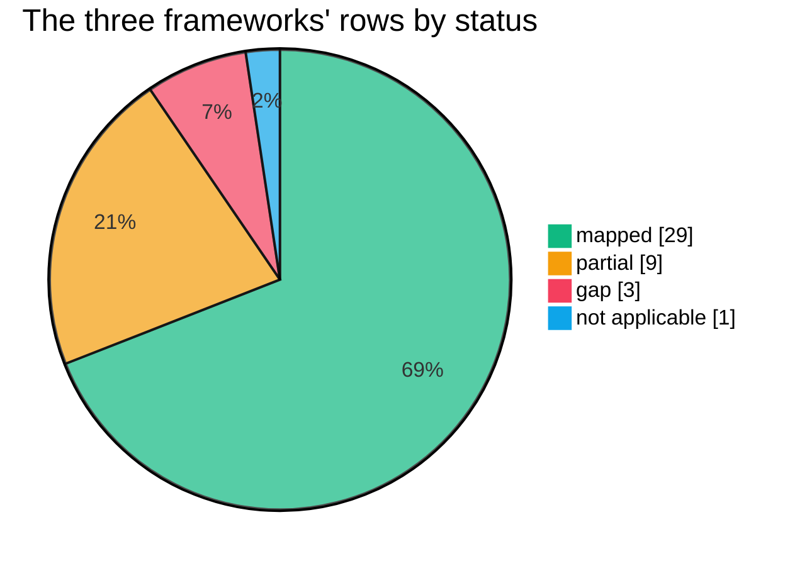

<a href="../../README.md"><picture><source media="(prefers-color-scheme: dark)" srcset="../assets/brand/purser-mark-dark.svg"></picture></a>

# Security controls mapped to SSDF, OWASP LLM Top 10 and DORA

**Purser's existing controls mapped to three public frameworks: a map, not a claim of compliance; every gap named.**

&nbsp;&nbsp;&nbsp;&nbsp;&nbsp;

[The controls](#the-controls) · [SSDF](#nist-sp-800-218-ssdf-11) · [OWASP LLM Top 10](#owasp-top-10-for-llm-applications-2025) · [DORA](#eu-dora-regulation-eu-20222554) · [Gaps](#gaps-in-one-list) · [Security index](README.md)

This page maps Purser's existing controls to three public frameworks. It is a map, not a claim of compliance or
certification: nobody has audited Purser against any of them. Purser is a hackathon project that moves test money
only (the Airwallex sandbox, Alta (formerly Metal) testnet). Each row links the file or the record that shows the
control. Where a framework expects something Purser does not have, the row says **gap**.

Frameworks and versions used (ids and names checked on 19 November 2026 against the official sources):

- **NIST SP 800-218, SSDF version 1.1** (February 2022), the final version. A draft version 1.2 (SP 800-218 Rev. 1, initial public draft) exists; the ids below are those of 1.1. Source: [csrc.nist.gov/pubs/sp/800/218/final](https://csrc.nist.gov/pubs/sp/800/218/final).
- **OWASP Top 10 for LLM Applications 2025** (LLM01:2025 to LLM10:2025). Source: [genai.owasp.org/llm-top-10](https://genai.owasp.org/llm-top-10/).
- **EU DORA, Regulation (EU) 2022/2554**: Chapter II ICT risk management (Articles 5 to 16), Chapter III ICT-related incident management, classification and reporting (17 to 23), Chapter IV digital operational resilience testing (24 to 27), Chapter V managing of ICT third-party risk (28 to 44). Source: [eur-lex.europa.eu/eli/reg/2022/2554/oj](https://eur-lex.europa.eu/eli/reg/2022/2554/oj/eng). DORA binds financial entities. Purser is not one; the rows show which of its controls would support such an entity.

## The controls

| # | Control | Where it is | Evidence |
|---|---|---|---|
| C1 | Hash-locked terms: the CFO signs the SHA-256 of the exact terms; the executor refuses terms that no longer hash to it, before any outside call | `src/lib/terms.ts`, `src/policy/hashFirst.ts`, `beginExecution` in `src/policy/approvals.ts` | [tamper-matrix.md](../evidence/tamper-matrix.md): 894 changed copies, 894 refused |
| C2 | Passkey signing: above the limit only a WebAuthn assertion over the terms hash approves; high-risk needs a second key, some kinds four eyes | `decide` in `src/policy/approvals.ts`, `src/passkey/` | [chaos-money.md](../evidence/chaos-money.md) (I2), [redteam-api.md](../evidence/redteam-api.md) |
| C3 | Unicode and injection screening of every incoming document (hidden characters, orders to the AI, approval claims); documents are data, never instructions | `src/policy/injection.ts` | [fraud-and-injection.md](../fraud-and-injection.md), [redteam-api.md](../evidence/redteam-api.md) |
| C4 | Split-invoice detection: invoices from one supplier received within a window (on Purser's clock, never the dates or months the supplier prints) that together pass the agent's limit go to the CFO; code never approves alone a payment that, with what it approved alone to the same payee in that window, passes the limit | `src/ap/checkerCore.ts` (`possible_split`), `src/policy/approvals.ts` (`approveWithinLimit`) | [adversarial-v2.md](../evals/adversarial-v2.md), [adversarial-v3.md](../evals/adversarial-v3.md) |
| C5 | Scoped Airwallex keys, one per role (read, payout, issuing, spend) | `src/airwallex/keyScopes.ts` | [2026-11-19-hardening.md](2026-11-19-hardening.md) |
| C6 | Rate limits on the relay, `/try`, `/try/sign`, outside agents, and Airwallex calls | `worker/src/`, `src/airwallex/client.ts`, `src/config/policy.ts` | [security.md, rate limits](../security.md#security-headers-and-rate-limits-checked-2-november) |
| C7 | Fail-closed caps: model spend ceilings, per-payment and daily caps, the emergency stop, velocity stops | `src/engine/budget.ts`, `src/claude/budget.ts`, `src/policy/velocity.ts`, `src/policy/rules.ts` | [controls.md](../controls.md), [runbook.md](../runbook.md#the-emergency-stop) |
| C8 | Idempotency and the outbox: every Airwallex create carries a `request_id`; a lost answer is looked up, never resent blind; one live payout per invoice, and per bill: a negotiation's agreed invoice and the bill as issued are one bill, paid once | `src/policy/saga.ts`, `src/executors/invoicePayment.ts`, `src/agents/euroBill.ts` (`invoiceAlreadyHandled`, `otherPayoutForBill`), `src/db/schema.sql` (`one_live_transfer_per_invoice`, `one_live_transfer_per_bill`) | [chaos-money.md](../evidence/chaos-money.md) (I1), [formal-model.md](../evidence/formal-model.md) |
| C9 | Webhooks only record: HMAC checked twice (relay and runner), recorded once, never move money | `src/policy/cardHooks.ts`, `src/policy/airwallexEvents.ts` | [chaos-money.md](../evidence/chaos-money.md) (I5), [formal-model.md](../evidence/formal-model.md) |
| C10 | Hash-chained audit log, anchored on chain, and the hourly reconciliation against Airwallex | `src/audit/log.ts`, `src/anchor/`, `src/finance/reconcile.ts` | [verification-2026-11-15.md](../evidence/verification-2026-11-15.md) |
| C11 | gitleaks on every push and the whole history | `.github/workflows/ci.yml` (job `secrets`), `.gitleaksignore` | CI |
| C12 | Static analysis: Semgrep (blocking, public sets and our own rules); CodeQL through GitHub's default setup | `.github/workflows/ci.yml` (job `security`), `.semgrep/purser.yml` | [README.md](README.md) |
| C13 | SBOM (CycloneDX), locked installs, every Action pinned by SHA, Dependabot | `docs/security/sbom.cdx.json`, `.github/workflows/`, `.github/dependabot.yml` | [README.md](README.md) |
| C14 | Signed releases: build provenance and SBOM attestations through Sigstore, `SHA256SUMS` | `.github/workflows/release.yml` | Ran for v1.2.0 (19 Nov 2026): [record](../evidence/release-v1.2.0.json) |
| C15 | OSV-Scanner daily and on lockfile changes, with OpenVEX statements | `.github/workflows/osv-scanner.yml`, `docs/security/vex/` | [vex/README.md](vex/README.md): 0 in the product's lockfiles, 51 in CI tooling and test fixtures |
| C16 | Harden-Runner on every CI job (egress audit, not block) | `.github/workflows/*.yml` | Runs in CI (audit mode) on every job that has it |
| C17 | Chaos for money movement: the real executor against a faulty Airwallex stand-in, crashes and webhook storms | `src/chaos/`, `npm run chaos:money` | [chaos-money.md](../evidence/chaos-money.md): 317 scenarios, 0 invariants broken |
| C18 | Fuzzing of the reader, canonical terms, verifiers, webhook signatures, MCP schemas | `src/fuzz/`, `npm run fuzz` | [fuzzing.md](../evidence/fuzzing.md): 275,756 runs, 13 properties held, 4 failed (open) |
| C19 | Formal model of the payment state machine, model-checked with TLC, with planted bugs it must catch | `formal/`, `npm run formal`, CI job `formal` | [formal-model.md](../evidence/formal-model.md) |
| C20 | Red team of the public API, the agents and the payables flow | `src/redteamApi/`, `src/redteam/` | [redteam-api.md](../evidence/redteam-api.md), [agents-autonomy-redteam.md](../agents-autonomy-redteam.md) |
| C21 | Threat model (STRIDE, trust zones), assurance case, zero-trust matrix | `docs/security.md`, `docs/assurance.md`, `docs/zero-trust.md` | the documents themselves |
| C22 | Vulnerability disclosure policy and scope | `SECURITY.md` | the document itself |
| C23 | Incident runbook: emergency stop, leaked key, outages, recovery | `docs/runbook.md` | the document itself |
| C24 | Licence and copyright of every file on record (REUSE 3.3) | `REUSE.toml`, `LICENSES/`, CI job `reuse` | `reuse lint` (reuse 6.3.0, 19 Nov): compliant, 3,325 of 3,325 files |

Record: [the three framework tables below](SECURITY-MAPPING.md#nist-sp-800-218-ssdf-11), counted by `test/docs-charts.test.ts` from their Status column: 42 rows; mapped 29, partial 9, gap 3, not applicable 1.

## NIST SP 800-218 (SSDF 1.1)

| Practice | What it asks | Mapped to | Status |
|---|---|---|---|
| PO.1 Define security requirements for software development | Written security requirements | C21 ([security.md](../security.md), [assurance.md](../assurance.md)), C22 | mapped |
| PO.2 Implement roles and responsibilities | Named roles for security | `.github/CODEOWNERS`, [runbook.md](../runbook.md#who-and-what) | partial: one maintainer; **gap**: no separate security role or training record |
| PO.3 Implement supporting toolchains | Tools that check security, configured and kept | C11, C12, C13, C15, C16, C19 | mapped |
| PO.4 Define and use criteria for software security checks | Checks that block on failure | C11, C12 (Semgrep blocks), C15 (product scan blocks), C19 (formal job blocks) | mapped |
| PO.5 Implement and maintain secure environments | Separated, hardened build environments | GitHub-hosted runners, least token permissions per workflow, C16 | partial: **gap**: Harden-Runner only audits egress; no branch ruleset on `main` yet ([owner-actions.md](owner-actions.md)) |
| PS.1 Protect all forms of code from unauthorized access and tampering | Code under access control | GitHub, C11, C13 (pinned Actions) | partial: **gap**: no signed commits, no branch ruleset yet |
| PS.2 Provide a mechanism for verifying software release integrity | Hashes and signatures for releases | C14 ([README.md, Verify a release](README.md#verify-a-release)) | mapped; ran for v1.2.0 |
| PS.3 Archive and protect each software release | Kept releases and provenance | C14, C13 (SBOM per release) | mapped; not run yet |
| PW.1 Design software to meet security requirements and mitigate security risks | Threat modelling | C21, C19 | mapped |
| PW.2 Review the software design | Design review against requirements | [decisions.md](../decisions.md), [adr/](../adr/), C19 | mapped |
| PW.4 Reuse existing, well-secured software | Vetted third-party components | C13, C15, `scripts/audit-check.ts` | mapped |
| PW.5 Create source code adhering to secure coding practices | Input validation, safe APIs | C1, C3, `.semgrep/purser.yml` (no shell strings) | mapped |
| PW.6 Configure the compilation, interpreter and build processes | Safe build settings | `tsconfig.json` (strict), `npm ci` only | partial |
| PW.7 Review and/or analyze human-readable code | Code review and static analysis | C12, pull requests with CODEOWNERS | partial: **gap**: one maintainer, so most changes have no second human reviewer |
| PW.8 Test executable code | Security testing | C17, C18, C20, the test suite with the adversarial suite (`test/adversarial.test.ts`) | mapped |
| PW.9 Configure software to have secure settings by default | Secure defaults | Passkey-only approval once enrolled, `HUB_DECISIONS_ENABLED` off by default, test money only | mapped |
| RV.1 Identify and confirm vulnerabilities on an ongoing basis | Monitoring advisories, disclosure | C15, C13 (Dependabot), C22 | mapped |
| RV.2 Assess, prioritize and remediate vulnerabilities | Triage and fixes | `.audit-allow.json` with expiries, [vex/](vex/), [2026-11-19-hardening.md](2026-11-19-hardening.md) | mapped |
| RV.3 Analyze vulnerabilities to identify their root causes | Root-cause analysis | [agent-was-wrong.md](../agent-was-wrong.md), the hardening log, Semgrep rules added after a canary ([README.md](README.md)) | mapped |

## OWASP Top 10 for LLM Applications 2025

| Risk | Mapped to | Status |
|---|---|---|
| LLM01:2025 Prompt Injection | C3 (screening), C1 and C2 (the model cannot approve or change signed terms), C20 (prompt injection through the code reader, hostile-model eval in CI) | mapped |
| LLM02:2025 Sensitive Information Disclosure | C11, C5, no keys in the repository (`SECURITY.md`), MCP is read and propose only | mapped |
| LLM03:2025 Supply Chain | C13, C14, C15, C16, a pinned model id per call | mapped; C14 and C16 not run yet |
| LLM04:2025 Data and Model Poisoning | No training or fine-tuning; precedents are read from the ledger, and code checks every reading (`src/ap/checkerCore.ts`) | partial: **gap**: no test that poisons the precedent store on purpose |
| LLM05:2025 Improper Output Handling | Model output is parsed and checked by code before it reaches terms (C1, C4); pages escape every ledger value; CSP ([security.md](../security.md)) | mapped |
| LLM06:2025 Excessive Agency | Agents propose, code checks, a person's passkey approves above the limit (C2); per-agent mandates and caps (C7); scoped keys (C5) | mapped |
| LLM07:2025 System Prompt Leakage | Prompts hold no secrets or authority: no key and no approval rule lives in a prompt | mapped |
| LLM08:2025 Vector and Embedding Weaknesses | Not applicable: Purser has no vector store or embeddings | not applicable |
| LLM09:2025 Misinformation | Every reading is checked by code against the ledger and the document; the deterministic parser decides when the model is unsure; evals in [agent-evals.md](../agent-evals.md) | mapped |
| LLM10:2025 Unbounded Consumption | C7 (model spend ceilings that fail closed), C6 (rate limits on `/try`), timeouts on every external call ([security.md](../security.md#limits-on-every-external-call)) | mapped |

## EU DORA (Regulation (EU) 2022/2554)

| Area | Articles | Mapped to | Status |
|---|---|---|---|
| ICT risk management framework | 5, 6 | C21, [controls.md](../controls.md), [assurance.md](../assurance.md) | partial: **gap**: no management body, no yearly framework review (a one-person project) |
| Identification | 8 | C13 (SBOM), [architecture.md](../architecture.md), the trust zones in [security.md](../security.md) | mapped |
| Protection and prevention | 9 | C1, C2, C5, C6, C7, C9, C11 | mapped |
| Detection | 10 | C10 (reconciliation, audit chain), `/health` alarms (`src/ops/health.ts`), C9 (disagreements) | mapped |
| Response and recovery | 11 | C23, the emergency stop (C7), `resumeInterrupted` in `src/policy/saga.ts` | mapped |
| Backup policies, restoration and recovery | 12 | [runbook.md, Recovery](../runbook.md#recovery) | partial: **gap**: no recorded restore test |
| Learning and evolving | 13 | the hardening log, [agent-was-wrong.md](../agent-was-wrong.md), [decisions.md](../decisions.md) | mapped |
| ICT-related incident management process | 17 | C23, alarms in `src/ops/health.ts` | mapped |
| Classification and reporting of major incidents | 18, 19 | none | **gap**: no classification scheme or reporting to an authority (not a financial entity) |
| Digital operational resilience testing | 24, 25 | C17, C18, C19, C20, the test suite in CI | mapped |
| Threat-led penetration testing (TLPT) | 26, 27 | C20 is an in-house red team, not TLPT | **gap**: no independent threat-led test |
| ICT third-party risk: general principles | 28 | C5, C15, C10 (Airwallex checked against the ledger hourly), [runbook.md](../runbook.md#airwallex-or-metal-unavailable) (outages) | partial: **gap**: no register of information, no exit plan per provider |
| Key contractual provisions | 30 | none | **gap**: sandbox terms only; no contracts with providers |

## Gaps in one list

1. No independent audit, certification or threat-led penetration test.
2. One maintainer: no separate security role, and most changes have no second human reviewer.
3. No branch ruleset on `main` and no signed commits yet ([owner-actions.md](owner-actions.md)).
4. Harden-Runner audits egress only; it blocks nothing yet.
5. Closed on 19 Nov 2026: the release workflow attested v1.2.0 ([record](../evidence/release-v1.2.0.json)) and Harden-Runner runs in CI (audit mode).
6. Fuzzing found 4 open property failures ([fuzzing.md](../evidence/fuzzing.md)).
7. 51 known vulnerabilities in CI tooling and test fixtures (not in the product): [vex/README.md](vex/README.md).
8. No incident classification or authority reporting, no register of third-party providers, no exit plans, no recorded restore test.
9. No test that poisons the precedent store on purpose.
10. The formal model is an abstraction of the code, not a proof of the code ([formal-model.md](../evidence/formal-model.md)).
