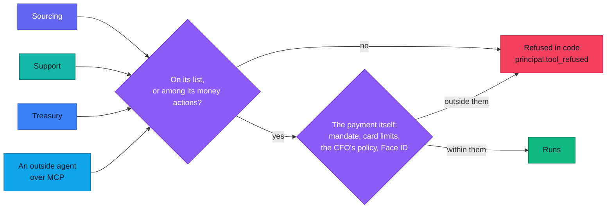

<a href="../../README.md"><picture><source media="(prefers-color-scheme: dark)" srcset="../assets/brand/purser-mark-dark.svg"></picture></a>

# Agent permissions: least privilege, visible

**Each agent that can move money lists exactly what it may call; anything else is refused in code and written to the audit log.**

&nbsp;&nbsp;&nbsp;&nbsp;

[Sourcing](#sourcing) · [Support](#support) · [Treasury](#treasury) · [Outside agents](#outside) · [Agent identity](agent-identity.md) · [Security index](README.md)

Since 25 November 2026. Each agent that can move money is a principal (backend review B5,
[`src/policy/principals.ts`](../../src/policy/principals.ts)) and lists exactly what it may call:

- **its tools as a model** (`AGENT_TOOLS`, by name): what it reads, what it proposes, the messages it sends, and the
  few tools that pay within its own mandate or card limits;
- **its money actions** (its capabilities' `tools`, stored per principal and revocable at once, without Face ID).

Anything else is refused in code before it runs, and the refusal is written to the audit log as
`principal.tool_refused` (the agent as its subject; the tool, where and the task):

| Where | What is checked | Code |
|---|---|---|
| The agent loop, every tool call of every run | the tool is on the agent's list or among its money actions | `toolRefusal` in `src/agents/loop.ts` |
| The agent API (MCP), every call of an outside agent | its current key, not revoked or expired, the tool among its capabilities | the gate in `src/platform/mcpServer.ts` |
| An approved supplier or invoice payment, when it is executed | the Treasury agent may take that action (`supplier_payment`, `invoice_payment`), on Airwallex, in that currency, to a bank beneficiary | `holdReason` in `src/executors/supplierPayment.ts` and `src/executors/invoicePayment.ts` |
| Every other payment path (x402 on Alta, cards, Airi) | the agent's rail, currency and payee | `authorize` in `src/policy/holds.ts`, `src/airi/purchase.ts`, `src/icc/purchase.ts` |

A tool can be on an agent's list and still be refused for the payment itself: the mandate on chain, the card's limits
at Airwallex, the CFO's policy and the CFO's Face ID on the exact terms decide each payment. The list only says which
doors the agent may knock on. Agents that hold no money (the payables Checker and Payer, the Controller, the Books
agent) are not principals: they keep the read-and-propose tools their code hands them, and code checks everything they
propose.

The tables below are the code's lists, row by row: `test/agent-permissions.test.ts` reads them and fails on a tool the
code does not grant, on one it grants that a table leaves out, and on a money action marked as a tool or the other way
round. What each one does and its kind are written here, for people. Kinds: **read** (the record or a partner), **talk** (a message, the end of a turn), **propose** (files something a
person or code still decides), **pay** (moves money within the agent's own mandate or limits), **action** (a money
action among its capabilities).

```mermaid
%%{init: {"themeVariables": {"xyChart": {"plotColorPalette": "#6366f1, #f59e0b"}}}}%%
xychart-beta
  title "Tools and actions per agent (indigo), of which pay or action (amber)"
  x-axis ["sourcing", "support", "treasury", "outside"]
  y-axis "Rows" 0 --> 28
  bar [17, 12, 27, 5]
  bar [6, 4, 5, 5]
```

Record: [the tables below](agent-permissions.md#sourcing), counted by `test/docs-charts.test.ts` from their Kind column: sourcing 17 (6 pay or action), support 12 (4), treasury 27 (5), outside 5 (5).

## sourcing

The Sourcing agent buys what a customer query needs (stock checks, software, reports) under its own mandate on Alta and its own Airwallex card.

| Tool or action | Kind | What it does |
|---|---|---|
| `check_offer` | read | Stockline's live price, and its mandate's cap and budget left on chain |
| `market` | read | the suppliers' prices, data age and recent outcomes; its mandate and buy policy |
| `supplier_terms` | read | a supplier's checkout and the rails it accepts |
| `try_purchase` | pay | buys the next stock check from Stockline under its own mandate (x402 on Alta), once |
| `pay` | pay | pays one purchase on the rail it picks; code refuses a rail the supplier does not accept |
| `buy_software` | pay | buys a software plan on its card within the card's limits, or under its mandate |
| `buy_report` | pay | buys a supplier's report under its mandate, or on a single-use card the CFO approved |
| `set_buy_policy` | propose | sets which supplier and price code follows per query, within its mandate |
| `ask_card_raise` | propose | asks the CFO for a higher per-purchase card limit (Face ID decides) |
| `notify_treasury` | talk | tells the Treasury agent what happened and what it needs |
| `read_decline` | read | why Airwallex declined its card, the card's limits and this month's spend |
| `propose_raise` | propose | asks the CFO for a higher card limit after a decline (Face ID decides) |
| `no_raise` | talk | records that a decline needs no higher limit |
| `send_message` | talk | a message to another agent |
| `finish` | talk | ends its turn |
| `buy_stock_check` | action | a stock check bought over x402 on Alta, under its own mandate |
| `card_purchase` | action | a purchase on its own Airwallex card, within the card's limits |

## support

The Support agent settles customer disputes and refunds from its own mandate, within the CFO's refund limits.

| Tool or action | Kind | What it does |
|---|---|---|
| `verify_order` | read | checks a disputed order on chain: signed by the customer's mandate key, inside its mandate |
| `check_data` | read | compares a delivered stock check with the supplier's correction notice |
| `refund` | pay | refunds one disputed sale to the customer from the Support mandate, within the CFO's refund limits |
| `settle_dispute` | pay | settles a customer's dispute from evidence, with the tools above |
| `escalate_to_cfo` | propose | sends refunds beyond its mandate to the CFO as one proposal (Face ID decides) |
| `read_decline` | read | why Airwallex declined its card, the card's limits and this month's spend |
| `propose_raise` | propose | asks the CFO for a higher card limit after a decline (Face ID decides) |
| `no_raise` | talk | records that a decline needs no higher limit |
| `send_message` | talk | a message to another agent |
| `finish` | talk | ends its turn |
| `refund` | action | a refund to a customer over x402 on Alta, under the Support mandate |
| `card_purchase` | action | a purchase on its own Airwallex card, within the card's limits |

## treasury

The Treasury agent reads the money, plans payments and schedules, codes invoices, and runs the supplier and invoice payments the CFO approved.

| Tool or action | Kind | What it does |
|---|---|---|
| `read_position` | read | balances at Airwallex, the CFO's floors and obligations, the position after a payment |
| `cash_position` | read | cash per currency, the floors, the room above them, the four-eyes threshold |
| `position` | read | the mandates, the prices, the latest refusal and what waits for the CFO |
| `read_quote` | read | the locked FX quote for a shortfall and how long it is valid |
| `open_invoices` | read | the open supplier invoices, due dates and amounts |
| `invoice_lines` | read | an invoice's lines, net, VAT and total as code read them |
| `chart_of_accounts` | read | the accounts a purchase line may be booked to |
| `vat_codes` | read | the purchase VAT codes |
| `cost_centres` | read | the cost centres |
| `coding_history` | read | how this supplier's lines were coded before |
| `vat_regime` | read | the VAT regime between the supplier and the company |
| `submit_advice` | propose | its timing advice for a payment (pay now or wait); code checks it |
| `propose_schedule` | propose | a payment day for each open invoice; code checks it |
| `code_invoice` | propose | an account, VAT code and cost centre per invoice line; code checks it |
| `plan_invoice` | propose | plans a euro invoice's payment (FX only for the shortfall); it waits for the CFO's Face ID |
| `submit_plan` | propose | a rebalance of the agents' mandates for the CFO to approve |
| `design_rebalance` | propose | two options to rebalance the mandates, sent to the CFO |
| `sweep_earnings` | pay | sweeps net earnings to the sweep wallet after finality, as code plans the amount |
| `read_decline` | read | why Airwallex declined its card, the card's limits and this month's spend |
| `propose_raise` | propose | asks the CFO for a higher card limit after a decline (Face ID decides) |
| `no_raise` | talk | records that a decline needs no higher limit |
| `send_message` | talk | a message to another agent |
| `finish` | talk | ends its turn |
| `sweep` | action | a sweep of earnings to the sweep wallet, under the Treasury mandate |
| `invoice_payment` | action | a euro invoice paid over Airwallex, only after the CFO's approval of its exact terms |
| `supplier_payment` | action | a supplier paid in its own currency over Airwallex, only after the approval of its exact terms |
| `card_purchase` | action | a purchase on its own Airwallex card, within the card's limits |

## outside

An outside agent connected through the agent API (`src/platform/mcpServer.ts`), one per key; each tool is an action on its capabilities.

| Tool or action | Kind | What it does |
|---|---|---|
| `request_company_card` | action | asks for a company card (the CFO decides) |
| `company_card` | action | reads its own card and its charges |
| `pay_with_card` | action | charges its own card within the card's limits |
| `request_limit_raise` | action | asks for a higher card limit (the CFO decides) |
| `ask_for_task_card` | action | asks for a single-use card for one task (the CFO decides) |
