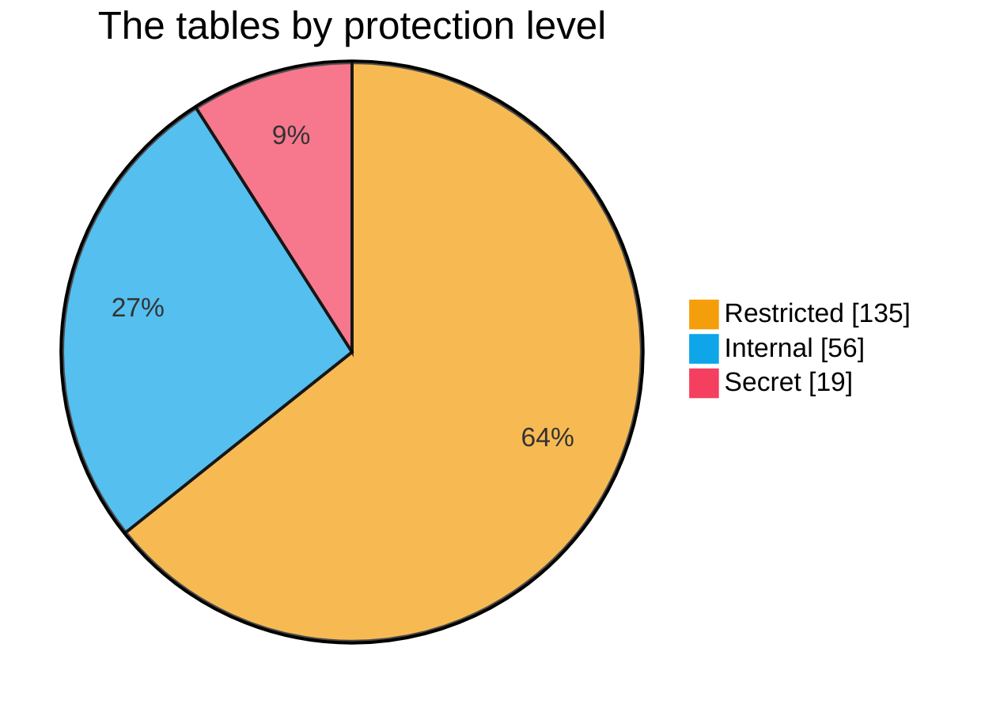

<a href="../../README.md"><picture><source media="(prefers-color-scheme: dark)" srcset="../assets/brand/purser-mark-dark.svg"></picture></a>

# Data classification and protection levels

**Every table Purser creates, by protection level, with the requirements each level carries and where they apply.**

&nbsp;&nbsp;&nbsp;&nbsp;&nbsp;

[Levels](#levels-and-their-requirements) · [Secret](#secret) · [Restricted](#restricted) · [Internal](#internal) · [Public](#public) · [Inventory](#inventory) · [Key management](key-management.md)

Every table Purser creates, by protection level, with the requirements each level carries and where the architecture applies them. ASVS 4.0.3 V1.8.2 (`docs/security/asvs-l2.md`); V1.8.1 lists the assets. Written on 20 November 2026 by Claude (an AI model) for the maintainer. `test/data-classification.test.ts` reads every `CREATE TABLE` in the D1 migrations, the runner's schema and the Workers' and runner's code, and fails when a table has no row here, when a column that holds personal or financial data or a credential is not named in its row, or when such a table is rated below Restricted. Purser moves test money only; the requirements are written for real data, and where one is not met yet it says so and names the open ASVS row.

## Levels and their requirements

Record: [the inventory below](data-classification.md#inventory), counted by `test/docs-charts.test.ts`: 210 tables, each named once; Restricted 135, Internal 56, Secret 19; none Public.

### Secret

Credentials and keys, or what would let someone act as a person, a key or Purser: hashes of keys and tokens, sealed partner tokens, webhook signing secrets, alert targets (a webhook URL is a credential), push subscription keys.

- **Encryption**: never stored in the clear. A bearer secret is stored as its SHA-256 only (`cloud/src/auth.ts`); a token Purser must use again is sealed with AES-256-GCM, bound to its company, provider and field (`cloud/src/sealed.ts`). TLS in transit.
- **Integrity**: written only by the code that issues it; a key's scope and expiry cannot grow (`cloud/src/auth.ts` `newApiKey`).
- **Retention**: until revoked or expired, then the hash and dates stay for the audit trail; sealed tokens are deleted with the connection or the company.
- **Access**: never returned by any API, never exported (`withoutSecret`, `cloud/src/exports.ts`), shown once at creation; alert targets shown masked.
- **Logging**: never logged; a field named like a secret is dropped (`src/lib/securityEvents.ts` `cleanDetail`). Each creation, use failure and revoke is a security event.
- **Export**: never.

### Restricted

Personal data (people, payees, addresses, networks, browsers) and financial data (invoices, payments, bank details, the books, documents, mail, cards, balances).

- **Encryption**: TLS in transit; at rest by the platform (D1, R2, Durable Objects: Cloudflare's encryption at rest), the runner's SQLite on the owner's disk (ASVS V6.1.1, V6.1.3: an encrypted volume or SQLCipher is open). IBANs on the runner are kept as their last four and SHA-256 where the full number is not needed (`beneficiaries`).
- **Integrity**: the ledger and the audit log are hash chains checked on every push (`cloud/src/sync.ts`); invoices, suppliers, payments and transactions are versioned, every earlier version kept (`object_history`); a payment's terms are signed by the CFO's passkey.
- **Retention**: the books seven years (Article 52 AWR), then purged with the company (`cloud/src/privacy.ts`); a person's personal data erased on request (`POST /v1/users/{id}/erase`); security logs a year; sessions a day past expiry.
- **Access**: one company only (every query scoped by `tenant_id`, `cloud/src/tenant.ts`), by role and scope; approving needs the CFO's passkey.
- **Logging**: each read through the API is a `data.access` security event and each export a `data.export` one (ASVS V8.3.5); never the data itself in a log.
- **Export**: by the company's owners only, as a staged export with single-use links (`cloud/src/exports.ts`).

### Internal

Operational data with no personal or financial content: counters, quotas, locks, caches of public reference data, metrics, the hands-on demo's made-up companies' switches and tallies.

- **Encryption**: TLS in transit; platform encryption at rest.
- **Integrity**: written by the code only; no API writes it but the admin's audited switches.
- **Retention**: pruned on the scheduled job (rate windows a day, counts and metrics as their modules say).
- **Access**: the platform admin and the code; aggregate counts on health pages.
- **Logging**: changes by the admin are security events (`admin.action`).
- **Export**: aggregate figures only.

### Public

Published on purpose: the demo company's made-up month, the site's status page, public keys. No table holds only public data; public figures are computed from Internal tables.

- **Encryption**: TLS in transit. **Integrity**: from the code and its records. **Retention**: as published. **Access**: anyone. **Logging**: request logs. **Export**: anyone.

## Inventory

Each table once. Columns: those that hold personal or financial data or a credential (named by the test's rules); "none" when a table has none.

| Tables | Level | Personal, financial or credential columns | What and where |
|---|---|---|---|
| `api_keys`, `enrolments`, `oauth_connections`, `oauth_states`, `oauth_codes`, `oauth_consents`, `webhooks` | Secret | `access_sealed`, `account_ref`, `code_sha256`, `name`, `redirect_uri`, `refresh_sealed`, `secret`, `secret_sha256`, `token_sha256`, `url`, `verifier_sealed` | Credentials of the cloud: key and enrolment hashes, sealed partner tokens, OAuth codes and states, the webhook signing secret; D1 (cloud) |
| `agent_tokens` | Secret | `card_id`, `token_sha256` | The agents' payment tokens: each token's SHA-256 only (never the token), its mandate and status (src/policy/agentTokenStore.ts); runner SQLite |
| `task_tokens` | Secret | `token_sha256` | Task tokens: one agent, one task mandate, at most 24 hours; each token's SHA-256 only (never the token), its mandate, status and expiry (src/policy/taskTokens.ts); runner SQLite, and a Cloud company's engine SQLite (its Durable Object) once a token is checked there |
| `chat_hooks` | Secret | `url` | Slack and Teams incoming-webhook URLs, one per company and product (a webhook URL is a credential; only its host is ever shown); D1 (cloud) |
| `books_connections`, `oidc_states` | Secret | `access_sealed`, `account_ref`, `refresh_sealed` | Accounting connections' sealed OAuth tokens (Xero, QuickBooks, Exact) and OIDC sign-in states (state hash, nonce, PKCE verifier, browser hash); D1 (cloud) |
| `try_companies`, `try_salts`, `ts_worlds` | Secret | `addr`, `balance`, `ip`, `salt`, `token_hash`, `visitor_sha256` | The hands-on demo's visitor-token hashes and the day's address salt; D1 (purser-try); relay DO |
| `principals`, `passkey_enrolments` | Secret | `code_sha256`, `key_sha256` | The runner's principals (key hashes) and passkey enrolment codes; runner SQLite |
| `principal_identity_keys`, `agent_identity_nonces` | Internal |  | The agents' signing keys, public halves only (never a private key), current or retired, and the nonces of signed agent requests seen in the last ten minutes, by key id (src/policy/agentIdentity.ts, docs/security/agent-identity.md); runner SQLite |
| `push_subs` | Secret | `auth`, `endpoint`, `p256dh` | Web push subscriptions (endpoint and its keys); relay DO |
| `alert_targets` | Secret | `target` | Alert targets: phone numbers, e-mail addresses and Slack or Teams webhook URLs (a webhook URL is a credential); D1 (cloud) |
| `users`, `credentials`, `sessions`, `challenges`, `tenants`, `awx_accounts`, `security_settings` | Restricted | `account_id`, `business_name`, `display_name`, `email`, `ip`, `name`, `user_agent` | People and their access: names, e-mail, roles, passkeys' public keys, sessions, sign-in challenges; D1 (cloud), relay DO |
| `identity_links`, `recovery_requests`, `engine_passkey_trust`, `books_pushes` | Restricted | `email`, `subject` | A person's linked Google, Microsoft or Apple account (provider subject and e-mail), owner recoveries two admins approved, the engine's trust in each approval passkey (cooling-off), and which invoices were pushed to the accounting system; D1 (cloud), engine DO |
| `security_log`, `security_events`, `sec_log`, `sec_counts`, `erasures` | Restricted | `ip`, `subject` | Security logs and events: who, the network, the route; D1 (cloud), relay DO |
| `hits`, `try_hits`, `ts_hits` | Restricted | `ip` | Addresses seen by the demo and the relay, cut or kept for limits; relay DO |
| `passkeys`, `passkey_pending`, `passkey_assertions`, `passkey_failures`, `passkey_seals`, `security_keys`, `security_key_assertions`, `security_key_windows`, `cosignatures`, `second_factors`, `approvals`, `engine_passkey_people`, `customer_passkeys`, `mandate_confirmations`, `cred_counters`, `session_challenges`, `ts_creds` | Restricted | `approver`, `note`, `person` | The runner's passkeys, their enrolment seals (an HMAC per passkey), security keys and their signed approvals; runner SQLite, engine DO, relay DO |
| `invoices`, `vendors`, `payments`, `transactions`, `object_history`, `ledger_entries`, `ledger_lines`, `ledger_locks`, `audit_rows`, `audit_log`, `stock_items`, `stock_moves` | Restricted | `account`, `amount`, `beneficiary_id`, `bic`, `body_json`, `credit_cents`, `debit_cents`, `description`, `entry_json`, `iban_sha256`, `memo`, `name`, `party`, `payload_json`, `subject`, `total`, `value_delta_cents`, `vat_cents`, `vendor` | The books: invoices, suppliers, payments, transactions, the ledger, audit chains and their history; D1 (cloud), runner SQLite, engine DO |
| `documents`, `inbound_mail`, `cloud_blobs`, `cloud_blob_parts`, `do_doc_chunks`, `exports`, `export_links_used`, `ap_documents`, `autopilot_files` | Restricted | `data`, `filename`, `name`, `note` | Documents and mail: invoice files, their bytes, inbound e-mail, exports; D1 + R2 (cloud), engine DO, runner |
| `ap_invoices`, `ap_codings`, `ap_scan_readings`, `ap_duplicate_clearances`, `ap_sink_events` | Restricted | `bic`, `iban_last4`, `note`, `subtotal`, `tax`, `total`, `transcription`, `vendor` | Accounts payable: readings, codings, findings, duplicates; runner SQLite, engine DO |
| `beneficiaries`, `payee_adds`, `payee_changes`, `payee_name_checks` | Restricted | `beneficiary_id`, `bic`, `iban`, `iban_last4`, `iban_sha256`, `name`, `new_bic`, `new_iban`, `resolved_name`, `vendor` | Payees and bank details (IBAN, BIC, names) and their checks; runner SQLite, engine DO |
| `proposals`, `executions`, `batch_lines`, `transfers`, `fx_quotes`, `fx_conversions`, `platform_fees`, `holds`, `payout_reservations`, `velocity_events`, `obligations`, `money_steps`, `awx_batches`, `awx_payouts_v2`, `awx_fx_notes`, `awx_payout_notes`, `awx_notes`, `airwallex_events`, `receipts`, `receivables`, `refunds`, `sweeps` | Restricted | `amount`, `amount_cents`, `applied_cents`, `buy_amount`, `cents`, `customer`, `global_account_id`, `name`, `note`, `paid_cents`, `payer`, `sell_amount`, `terms_json`, `to_address` | Payments in flight: proposals, executions, transfers, FX, fees, holds, reservations; runner SQLite, engine DO, relay DO |
| `ar_invoices`, `ar_payments`, `ar_review`, `ar_dunning` | Restricted | `amount_cents`, `applied_cents`, `contact_email`, `customer`, `draft`, `link_url`, `net_cents`, `paid_cents`, `payer`, `reference`, `suspense_cents`, `written_off_cents` | Receivables (src/receivables/ar.ts): invoices to customers with their payment links, the payments matched to them, the review queue and the reminder drafts (never sent by Purser); the contact address is for the drafts only and never logged; runner SQLite, engine DO |
| `cards`, `card_transactions`, `agent_cards`, `card_actions`, `card_reads`, `card_edge_runs`, `task_cards`, `external_agents`, `agent_token_uses` | Restricted | `amount_cents`, `body_json`, `card_id`, `cardholder_id`, `display_name`, `last4`, `merchant`, `monthly_cents`, `nickname`, `per_tx_cents` | Agent cards and their transactions, and the uses of the agents' payment tokens; runner SQLite, D1 (cloud) |
| `sales`, `sale_settlements`, `sale_settlements_v2`, `upstream_purchases`, `x402_payments`, `mandates`, `airi_purchases`, `icc_purchases`, `clearing_ops` | Restricted | `amount`, `body_json`, `budget_cents`, `cap_cents`, `cents`, `description`, `party`, `payer`, `price_cents`, `terms_json` | Sales, purchases and mandates of agents (x402, AIRI, ICC); runner SQLite, relay DO |
| `metal_accounts`, `chain_credits`, `quarantines`, `tokenize_txs` | Restricted | `address`, `amount_base_units`, `amount_units`, `from_addr`, `from_address`, `raw`, `to_address` | On-chain money (testnet): wallets, credits, quarantines, tokenisation; runner SQLite |
| `erp_sync`, `t0_postings`, `t0_records`, `t0_payment_bookings`, `controller_proposals` | Restricted | none | Accounting and ERP sync (records sent out; each payment's T:0 entry); runner SQLite |
| `disputes`, `dispute_decisions`, `try_feedback` | Restricted | `customer`, `note` | Disputes (customer claims and evidence) and the demo visitors' free-text feedback; runner SQLite |
| `agent_messages`, `world_events` | Restricted | `payload_json`, `text` | Agent messages and world events (may quote invoice data); runner SQLite |
| `inbox`, `hooks`, `ar_cache` | Restricted | `body`, `message` | Relay inbox, webhook bodies and the Airwallex read cache (balances); relay DO |
| `do_state`, `balance_snapshots`, `autopilot_runs`, `runner_health`, `alert_deliveries` | Restricted | `target_mask` | The engine's state and the runner's snapshots and settings (may hold balances and policy); engine DO, D1 (cloud), runner SQLite |
| `authority_maps` | Restricted | `body_json` | The runner's authority map as last pushed, one row per company: per agent what it may pay, its limits, payee kinds and what needs the CFO, an outside agent's display name (cloud/src/authorityMap.ts); D1 (cloud) |
| `compliance_summaries` | Restricted | `body_json` | The runner's compliance evidence in short as last pushed, one row per company: counts per framework and control and the control map's gaps, no audit row, subject or payload (cloud/src/compliance.ts); D1 (cloud) |
| `money_loops` | Restricted | `body_json` | The runner's money loop in short as last pushed, one row per company: cash, the forecast, FX and the receivables by invoice number and amount, no customer, contact or payer name and no reminder text (cloud/src/moneyLoop.ts); D1 (cloud) |
| `rate_hits`, `daily_counts`, `engine_companies`, `storage_use`, `push_log`, `push_told`, `ar_calls`, `ar_minute`, `awx_fx_calls`, `mi_calls`, `alta_tx_calls`, `awx_act_spend`, `awx_events`, `awx_routes`, `status_checks`, `locks`, `autopilot_lease`, `autopilot_items`, `autopilot_state`, `agent_claims`, `agent_cursors`, `tokenize_state`, `settings`, `kv`, `cloud_feed_sent` | Internal | `cents`, `endpoint`, `target` | Counters, quotas and limits: no personal data; D1, DO, runner SQLite |
| `awx_fx_cache`, `mi_cache`, `alta_tx_cache`, `finality_certificates`, `finality_evidence`, `finality_pending`, `tap_agents`, `tap_nonces`, `tap_rail_nonces` | Internal | `body` | Public reference data cached: FX rates, chain reads, finality, TAP keys and nonces; relay DO, runner SQLite |
| `policy_versions`, `config_snapshots` | Internal | none | Policy and configuration snapshots (no personal data); runner SQLite |
| `card_designs` | Internal | `logo` | A company's card design for its agents' cards: colour, initials, preset per agent and an optional small raster logo (no personal data, no card numbers, nothing that moves money); written by an owner or admin, purged with a closed company; D1 (cloud) |
| `try_metrics`, `try_model`, `try_resv`, `try_spend`, `try_stage`, `try_status`, `try_switches`, `try_tally`, `try_admin_log`, `ts_spend`, `ts_talk`, `ts_chain`, `ts_policy`, `ts_proposals`, `ts_agent_runs`, `ts_tricks` | Internal | `amount`, `data` | The hands-on demo's metrics, switches, spend and stage (made-up companies, no visitor data); D1 (purser-try), relay DO |
| `ask_tally` | Internal | `n` | Ask Purser's hourly counts by kind (questions, refusals, model calls); no question, answer or address is stored; Durable Object of purser-try |
