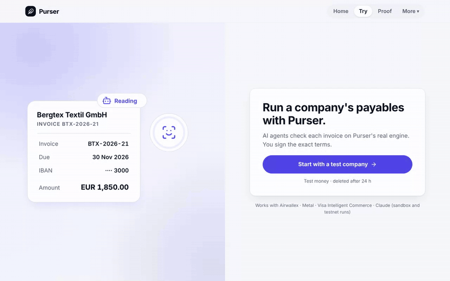
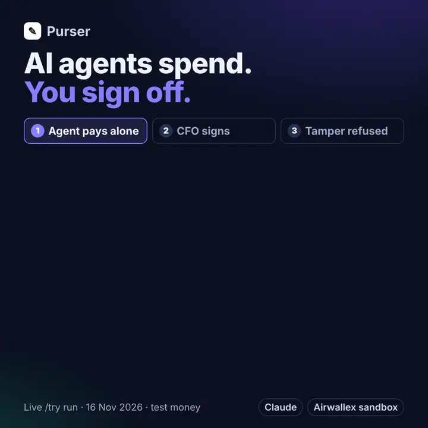
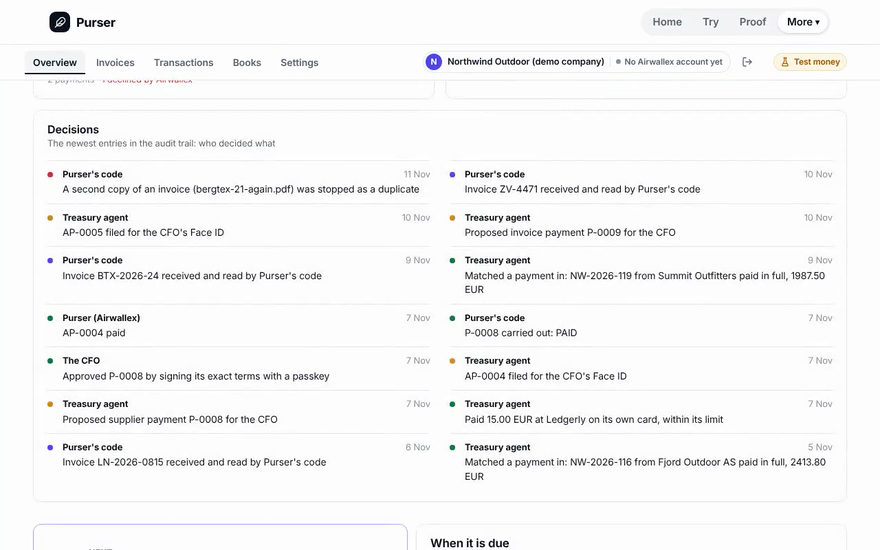
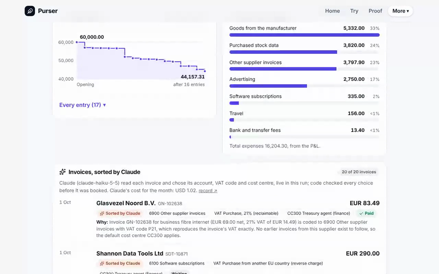
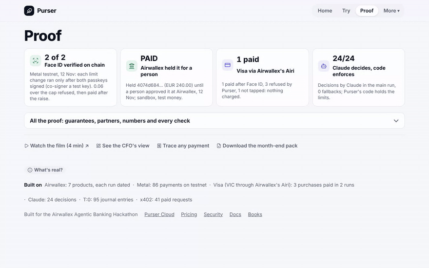
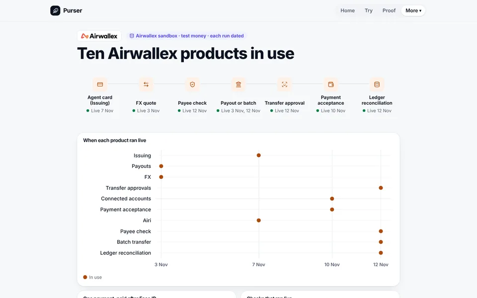
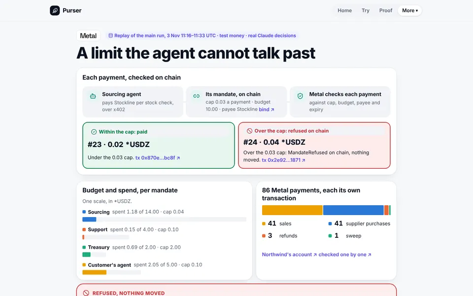
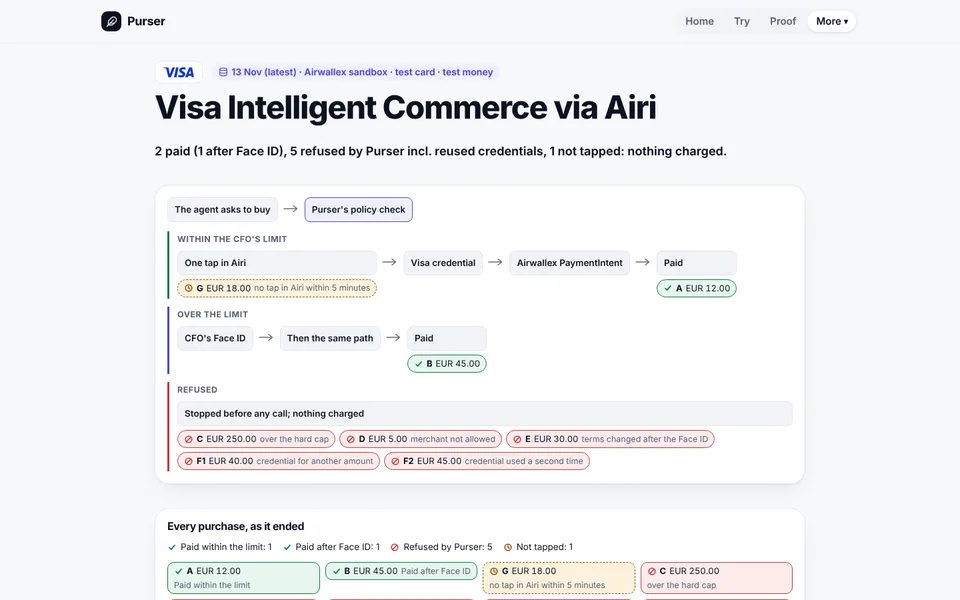
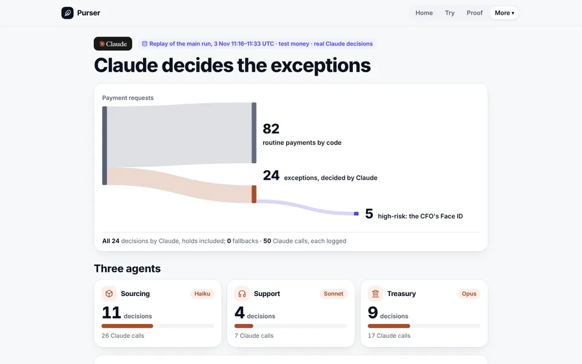
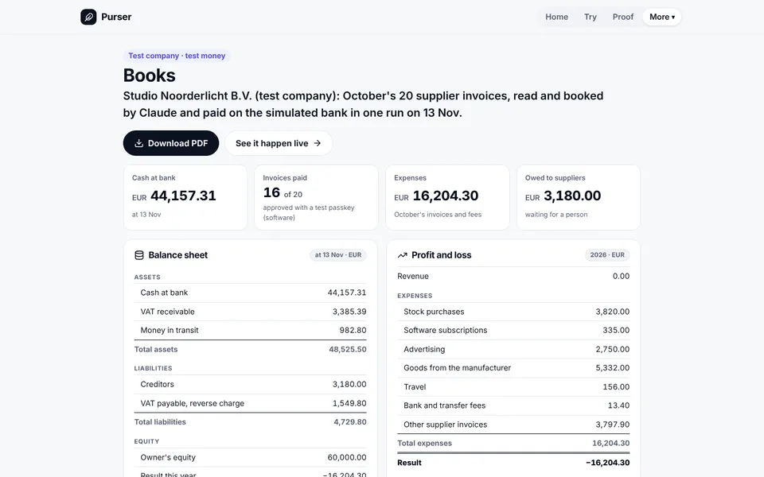

# See it

Moved from the [README](../README.md) on 15 November, to keep it short.

*The hands-on demo, end to end: a test company files a sample invoice, Claude reads it, Pay, the approval passkey (Chromium's virtual authenticator: a test passkey, no person or phone), paid on the simulated bank, booked and filed. Test money.* ([MP4](assets/media/try-flow.mp4)) Recorded from the live sites by `npm run media:record` ([media.json](assets/media/media.json)); the charts are under [Proof in numbers](charts.md) and the diagrams under [How it works in 5 files](how-it-works.md).

*The same payment story, animated from a live /try run of 16 Nov 2026 (test money); it opened the README's "At a glance" until 19 Nov 2026, when the demo's thumbnail took its place at the top.*

<table><tr><td width="33%"> ▶ <a href="assets/media/cloud-dashboard.mp4">MP4, 13 s</a></td><td width="33%"> ▶ <a href="assets/media/books.mp4">MP4, 14 s</a></td><td width="33%"></td></tr><tr><td>Purser Cloud as a guest: the demo company's dashboard (made-up data from a simulated month, test money), then its books.</td><td>kit11 /books: a test company's month, read and booked by Claude live; balance sheet, charts and the invoices sorted by Claude. Test money.</td><td>kit11 /proof: every claim with its run record.</td></tr></table>

<table>
<tr><td width="50%" align="center"> <b>/airwallex</b></td><td width="50%" align="center"> <b>/metal</b></td></tr>
<tr><td width="50%" align="center"> <b>/visa</b></td><td width="50%" align="center"> <b>/claude</b></td></tr>
<tr><td width="50%" align="center"> <b>/books</b></td></tr>
</table>

The pages and the console as the live site showed them on 13 November (`npm run readme:shots -- --live`; without `--live` the same shots from a local build): Purser Cloud as a guest with its demo company, light theme. Test money throughout.
