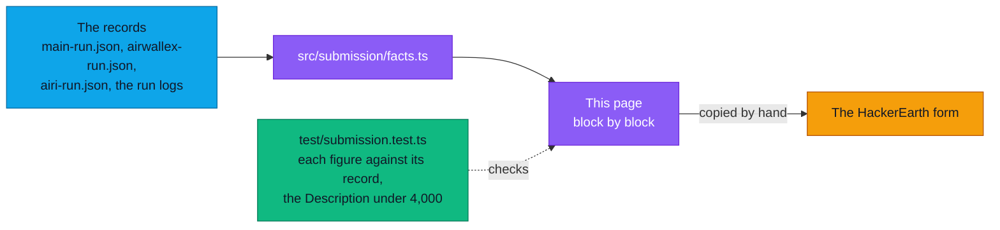

<a href="../../README.md"><picture><source media="(prefers-color-scheme: dark)" srcset="../assets/brand/purser-mark-dark.svg"></picture></a>

# Submission pack (HackerEarth form)

**The text of Purser's entry, block by block as it goes into the form, each figure checked against its record.**

&nbsp;&nbsp;&nbsp;&nbsp;&nbsp;

[Title](#title) · [Synopsis](#synopsis) · [Description](#description) · [Instructions](#instructions) · [Kit 11](#kit-11-step-by-step) · [Links](#links) · [Screenshots](#screenshots) · [Deck and zip](#deck-and-zip) · [Proof sentences](#proof-sentences)

| At a glance | Record |
|---|---|
| **Description: 3,964 characters**, under the 4,000 `test/submission.test.ts` holds it to | [the Description](#description) |
| **Entered for** the Founder's Choice Award, the Judges' Choice Award, the Metal Award and the Visa Award | [rules.md](../rules.md) · [evidence/README.md](../evidence/README.md) |
| Every run figure from **the main run of 3 November** | [main-run.json](../demo/main-run.json) · [run log](../runs/2026-11-03-main-run.md) · [`src/submission/facts.ts`](../../src/submission/facts.ts) |

Copy each block into the form; nothing here is sent by itself. `test/submission.test.ts` checks this page against the
records. The Description tells the demo in the site's order (Home, Try, Proof), then the main run, plus one labelled
sentence each on the reliability run of 6 November, awx-1 (the Airwallex-only run of 7 November: its record
`docs/demo/airwallex-run.json`, log `docs/runs/2026-11-07-awx-1.md`) and the Airi run of 7 November, Visa Intelligent
Commerce via Airwallex's Airi (its record `docs/demo/airi-run.json`, log `docs/runs/2026-11-07-vic-1.md`). The long
text ([long-description.md](long-description.md)) has every other live run under "Other live tests (separate worlds,
dated)", with its date, and what ran only on stand-ins under "Tested on stand-ins (not live)". Sources for each claim:
[docs/claims.md](../claims.md), section "The submission pack".

## Title

Purser · AI agents spend. You sign off.

## Synopsis

<!-- synopsis -->
For CFOs whose AI agents pay suppliers: above its limit, an agent asks; you sign the exact terms with a passkey (Face ID on iPhone). An approval is usually a button. In Purser it's a signature over the exact terms: change one cent and it's worthless. One CFO policy, a lock per rail: Airwallex card controls, Alta's mandate, the CFO's signature on invoices. A prompt is not a control. Real agents: Claude made all 24 decisions (routine payments are code); no key reaches Claude. Try it in 2 minutes.
<!-- /synopsis -->

## Description

Characters: **3,964** (the text between the markers, as pasted; 3,990 if the form counts each line break as two).
The form's own limit is not known; `test/submission.test.ts` checks this count and keeps the text under 4,000, even
with CRLF line breaks. Alta (formerly Metal) at the first mention; the award keeps the hackathon's name, the Metal
Award. The long text, with Airwallex, Alta, Claude, the controls and the other live tests in full:
[long-description.md](long-description.md).

How the Description changed, dated

- 9 November (jury review): a line "After the kit (not live)" for the payables inbox, stand-ins only; the buyer back in
  the business line. To fit it, the demo line and awx-1's line went (both stay in the README, on /airwallex and in the
  long text).
- 10 November: that line became the two-locks run (Airwallex's approval workflow held a passkey-signed payout
  `IN_APPROVAL`; nobody approved it there, so it is unpaid; [record](../runs/2026-11-10-airwallex-two-locks.md)).
- On 12 November the owner approved that transfer in Airwallex's web app and it went PAID, settlement simulated, so the
  line now says so in the same number of characters ([record](../runs/2026-11-12-airwallex-two-locks-paid.md)). The
  same day: no quotes anywhere (3,971 to 3,826 characters); "Payables: in repo, not live." once the product's code was
  merged into `main` ([decisions.md](../decisions.md), D29); Purser Cloud as a public test preview ([cloud.md](../cloud.md)).
- 14 November: the Visa line covers all four Visa runs from their records (7 to 14 November, 6 paid) and the reused
  credential Purser refused; Metal renamed itself Alta, so the text says "Alta (formerly Metal)" at the first mention.

<!-- description -->
**The problem.** AI agents are starting to spend company money.

**The solution.** Per agent, an Airwallex card and an Alta (formerly Metal) mandate.
- An approval is usually a button. In Purser it's a signature over the exact terms: change one cent and it's worthless. Try it in 2 minutes. https://kit11.max-31b.workers.dev/try
- One CFO policy, a lock per rail: Airwallex card controls, Alta's mandate, the CFO's signature on invoices. A prompt is not a control.
- Real agents: Claude made all 24 decisions (routine payments are code); no key reaches Claude.

**The proof.** The Kit 11 scenario, run live on 3 November. Starter Kit 11 (x402 Business Agents), entered for the Metal Award and the Visa Award. Three Claude agents run Northwind Outdoor, an outdoor wholesaler that sells live stock data to retailers per query, on 20 test USD; Max plays the CFO and signs with a personal passkey (Face ID on a phone). The CFO signed 5 decisions with Face ID (+1 co-signature).
1. **The price rise.** Stockline's price doubled. We switched off our own check once to prove the chain holds the line: Purser refuses an over-cap purchase before signing; with that check off for one purchase, Alta refused it anyway. That was purchase #24; the refusal is recorded on chain (tx `0x2e92f9cb…1871`). The CFO signed option A, a higher cap for Sourcing (P-0002).
2. **The dispute.** A simulated customer disputes 12 orders, saying its agent never placed them. Every order carries its agent's signature, so that claim fails. Three orders had wrong data; the Support agent refunds those 3 (0.15 test USD) itself. "Refund the other 9" goes to the CFO, who rejects it with Face ID. Refunds #7, #10 and #13, each on chain.
3. **The euro bill.** The EUR 240.00 licence: EUR 110.00 bought by FX for USD 124.29, SWIFT transfer `03360bfa-afce-457b-89d1-e1097fbe3985`, accepted by Airwallex with the signed hash.

86 Alta payments + 1 card charge, all inside the limits. 16 stops, nothing paid over a limit: one buy rule Claude set stopped 12 overpriced checks, Alta refused 2 purchases, the CFO rejected 1 proposal, and 1 planted instruction changed nothing.

**Airwallex, Alta and Claude.**
- Airwallex (sandbox): the hash of the exact terms the CFO signed with Face ID is in Airwallex's own record of the EUR 240.00 SWIFT payment, and all 3 agent cards carry the CFO's policy as Airwallex's own controls, read back from Airwallex.
- Alta (testnet): a mandate on chain per agent; 86 payments, each its own transaction; purchase #24 refused on chain (mandate_cap_exceeded); the mandates replaced on chain by the owner key after the CFO's Face ID in Purser (four eyes; second approver a labelled test passkey).
- Claude: all 24 decisions in the main run by Claude, 0 fallbacks; a reliability run (rel-1) found a fault in how the agents hand off a card raise, and after the fix the eval rebuilt from that moment now passes every run, and the next run (rel-1b) passed every step.
- Visa Intelligent Commerce via Airwallex's Airi (sandbox, 4 runs 7–14 Nov, 6 paid): above Purser's limit only after Face ID; a reused credential refused by Purser before any call (14 Nov); reuse is left to the integrator.

**After the kit.** Airwallex held a test-passkey payout; a person approved; PAID (simulated). Purser Cloud: a public test preview (test companies, simulated bank; Agents and Tokenisation tabs).

**The business (not validated with customers yet).** Buyer: a CFO on Airwallex. Pilot pricing: Starter €49 a month (100 invoices, then €0.25 each); Business from €249 a month; a small fee per payout. A hypothesis.

**What's real.** Test money. Simulated: customer, supplier, settlement, second approver. Details → https://github.com/agamemnon-coder/x402-business-agents/blob/main/docs/submission/long-description.md#what-is-real-and-what-is-simulated

**Links.** https://kit11.max-31b.workers.dev/proof · https://youtu.be/gEUm8RlhZac · https://github.com/agamemnon-coder/x402-business-agents
<!-- /description -->

## Instructions

<!-- instructions -->
1. Home (<https://kit11.max-31b.workers.dev/>), then Try, then Proof.
   - Home (about 40 s): four steps of one payment (ask, Face ID, paid), then tap "+1 cent": the check in your
     browser says Refused, "Hash no longer matches".
   - Try (about 2 minutes): <https://kit11.max-31b.workers.dev/try> gives you a test company of your own; nothing real
     moves. Claude reads a sample invoice, Purser's code checks it (a file sent twice is caught and nothing is added),
     you approve the exact terms with your own passkey (Face ID, Touch ID or a PIN), and it is paid on a simulated bank,
     booked and filed. Change what you signed: refused.
   - Proof: <https://kit11.max-31b.workers.dev/proof> has every id from the main run, the Alta ones checkable on
     Alta's testnet explorer, awx-1, the Airwallex-only run of 7 November (all seven checks passed), and Visa Intelligent
     Commerce via Airwallex's Airi (4 runs, 7 to 14 November; Airwallex sandbox, test card, test money; 6 paid; a reused
     credential refused by Purser): <https://kit11.max-31b.workers.dev/visa>. The demo (3:15), this entry's video:
     <https://youtu.be/gEUm8RlhZac>. The replay of the main run of 3 November (three Claude agents, a price
     rise, a dispute and a euro bill): <https://kit11.max-31b.workers.dev/replay>
   - Purser Cloud as a guest: <https://purser-try.max-31b.workers.dev/>, then *Try as guest*: the demo company (made-up
     data, test money) with its Agents, Invoices and Tokenisation tabs. Approval alerts by
     e-mail, Slack and Teams are built and tested with stand-ins, not sent live yet.
   - /security: <https://kit11.max-31b.workers.dev/security> draws the layers a payment must pass.
2. Then the repository, offline, no keys and no network after `npm ci` (Node.js 22.13 or later):
   `npm ci`, then `npm test` (the full suite, on stand-ins), then `npm run judge -- --check` (serves Home, Watch, Proof,
   the partner pages, the CFO dashboard and the Scenario Lab from the main run's record, fetches each page once and
   exits; `npm run judge` serves them and opens the browser). Running it live (sandbox keys, an Alta RPC):
   <https://github.com/agamemnon-coder/x402-business-agents/blob/main/docs/run-it.md>.
<!-- /instructions -->

## Kit 11, step by step

For the long form text and the jury: the Starter Kit 11 brief's flow ("x402 Business Agents", the builder guide), step by step, run live once on 3 November on Alta testnet and the Airwallex sandbox with test money. Every id opens on the explorer or in its record.

| Kit 11 step, in the brief's words | What Purser does | Proof, 3 Nov main run |
|---|---|---|
| "create your account, its three mandates, and a customer's account and mandate" | One account on Alta (formerly Metal) testnet; a mandate each for Sourcing (0.03 a purchase, 10.00 in all), Support (4.00) and Treasury (6.00); the simulated customer's own account and mandate | [Sourcing's bind](https://testnet.metalntwx.com/tx/0xb7ef08bb4531c3cbd4b56f4307255b4d88f68d279c8073d9bc96d352fb3d44ad) |
| "run the upstream provider and a query route that requires a signed order" | A simulated upstream provider, and Northwind's stock-check route over x402; each sale's signed order is kept with its transaction hash | [Sale #1](https://testnet.metalntwx.com/tx/0x2cc5a16e4aa74d5912e1b155f815270bd6f8a82796c08371dafa540410fa2fc7) |
| "sell queries" | 41 sales at 0.05, each with its own upstream purchase at 0.02 | [all 86 transactions](https://github.com/agamemnon-coder/x402-business-agents/blob/main/docs/runs/2026-11-03-main-run-metal-transactions.md) |
| "raise the upstream price and show the refusal" | The upstream price rose to 0.04; Alta refused purchase #24 on chain (`mandate_cap_exceeded`); the customer got an error status and was not charged | [#24 refused](https://testnet.metalntwx.com/tx/0x2e92f9cb4549246f58b9b888881c258bf117c6233c1d8f126f4833ae6ae41871) |
| "replace the mandates" | The Treasury agent (Claude) proposed new limits within the 20.00; the CFO signed with Face ID, a labelled test passkey as second approver; Sourcing's new mandate carries what it had spent | [Sourcing's replace](https://testnet.metalntwx.com/tx/0x2a91ac97fc2a459da2b0c73f2b8020edec1901d051c7ef03bb088d36067fe790) |
| "resolve the disputed batch" | The signed orders show the customer's agent placed all 12; Support refunded only the 3 with wrong data (0.15); "refund all 9" was rejected with Face ID | [Refund #7](https://testnet.metalntwx.com/tx/0xe4bf79623f9cb9212a49ea7c0ced60d241041051f322d199e319989d6548c89d) |
| "then move earnings to Airwallex" | 0.69 swept after finality; the Airwallex sandbox deposit (a simulation) takes the transaction hash as its reference | [the sweep](https://testnet.metalntwx.com/tx/0x86936a5b29f9550857676fa710231af9e20882ebe6eee16f75a90af29767ccb4), deposit `b3812e05-2afa-4698-8f64-429f9608e0a0` |
| "and pay the licence fee" | The Treasury agent planned the euro licence; Purser bought only the euros it lacked (FX), and after the CFO's Face ID paid by SWIFT, settlement simulated by the sandbox | transfer `03360bfa-afce-457b-89d1-e1097fbe3985` PAID ([record](https://github.com/agamemnon-coder/x402-business-agents/blob/main/docs/runs/2026-11-03-main-run.md)) |

## Links

- The demo (3:15), this entry's video: <https://youtu.be/gEUm8RlhZac>
- Earlier videos: the film, "Purser, under the hood" (3:29): <https://youtu.be/PNLuqhRzVfE>; the trailer (90 s; an
  AI-generated voice over AI-generated music, ElevenLabs): <https://youtu.be/n3HLVGROJc4>
- Live: <https://kit11.max-31b.workers.dev/>
- Try it yourself: <https://kit11.max-31b.workers.dev/try>: a test company of your own, a sample invoice read by
  Claude, your passkey on the exact terms, paid on a simulated bank and booked; change what you signed: refused.
- The Airwallex-only run, awx-1 (7 November; sandbox, test money): <https://kit11.max-31b.workers.dev/airwallex#awx-1>
- Visa Intelligent Commerce via Airwallex's Airi, 4 live runs (7 to 14 November; Airwallex sandbox, test card, test
  money): <https://kit11.max-31b.workers.dev/visa>; the latest, 14 November:
  <https://github.com/agamemnon-coder/x402-business-agents/blob/main/docs/runs/2026-11-14-vic-5.md>
- Repository: <https://github.com/agamemnon-coder/x402-business-agents> (tag `v1.1-submission`)
- New on 14 November (merged, live, test money): /try puts a live Airwallex sandbox FX quote in the terms the
  passkey signs, within the company's FX limit; after the passkey, one Airwallex sandbox transfer of the signed payment
  (off by default); Purser Cloud has a read-only Airwallex tab, a signed events feed (switched on; no event yet) and each agent's sandbox card
  (card actions off by default); the agents get the CFO's past decisions as precedent; a "Built on Airwallex" badge on
  every page. Not run live: Purser Cloud can also run payables at the Airwallex sandbox (new supplier, pay, pay all
  ready, money in), each step behind the CFO's passkey over the exact terms; switched off by default (admin switches
  awx_act / awx_act_try, daily caps 0). Also: T:0 gates the month close, /visa shows the card rail, Purser Cloud's books add up, stage and
  recording modes for the finals.
- Outside the entry: Visa TAP, in its own section near the foot of <https://kit11.max-31b.workers.dev/visa>. The
  Sourcing agent signed its card checkout with Visa's Trusted Agent Protocol (TAP) in its own run; Visa TAP: built and
  verified against Visa's public reference verifier; not part of this entry. The Visa Award entry is the Airi runs above (Visa
  Intelligent Commerce).

## Screenshots

Screens 1 and 5–8 from the live site (https://kit11.max-31b.workers.dev, deployed from main 877151f) on 7 November;
screens 2–4 from a local build of /try at main 5eeaf5f on 13 November (the code the live /try runs; on this machine, a
virtual test passkey, Purser's code reading instead of Claude, the simulated bank, test money; nothing outside the
machine was called). 1280 px wide at 2× (2560 px; screens 1, 6 and 7 the first 800 px of the page, the others as tall
as their part of the page), light mode, PNG under 500 KB each, in the form's order: the problem, try it, the proof per
partner, the business. The other pages replay the main run (3 November) or show the separate runs of 7 November, and
make no outside call. Screen 1 is Home as it was on 7 November (its first button is now "Try it live").

1. `screens/form/form-1-home.png`: Home's first screen: "AI agents spend. You sign off.", the synopsis line, the three
   sentences, "Start: watch the agents"; beside it the main run replayed: the three agents and
   Metal's on-chain refusal
2. `screens/form/form-2-try-approve.png`: /try, "Approve the payment.": a test company's sample invoice from Bergtex
   Textil GmbH, with every term the passkey signs: the amount, the payee, the account ending, the due date, the
   conversion, the bank fee's cap and the deadline; the button approves that amount with the passkey
3. `screens/form/form-3-try-paid.png`: "Paid, booked, filed.": paid on the simulated bank (test money) with its fee,
   booked in Purser's ledger (debits equal credits), the invoice and the receipt filed in the archive
4. `screens/form/form-4-try-refused.png`: "Pay it with your signature.": the amount changed by one cent and sent with the
   same signature: "Refused by Purser", signed and sent hashes side by side, "Transfers made: 0"
5. `screens/form/form-5-airwallex.png`: /airwallex: the hash the CFO signed beside the one Airwallex returns with the
   EUR 240.00 SWIFT payment (match), all 3 cards matching the CFO policy, awx-1 (every check passes), and Visa Intelligent
   Commerce via Airwallex's Airi, a live run (7 November; Airwallex sandbox, test card, test money): paid alone, paid
   after Face ID, refused by Purser, every check passes
6. `screens/form/form-6-metal.png`: /metal: 3 mandates on chain, 86 payments each its own transaction, #24 refused on
   chain, the mandates replaced after Face ID
7. `screens/form/form-7-claude.png`: /claude: Sourcing · Haiku, Support · Sonnet, Treasury · Opus; all 24 decisions by
   Claude (0 fallbacks), 82 routine payments by code, 50 Claude calls each with a request id, 5 Face ID decisions
8. `screens/form/form-8-business.png`: /proof, "Why this is a company" opened: the problem, who buys, the intended
   pricing, why now, why Purser; not validated with customers yet

The earlier set, made by `npm run submission` from the pages that replay the main run (1440 × 900), stays in
`screens/` for the deck.

## Deck and zip

- `purser-deck.pdf`: twelve slides, one message each, in the story's order (the problem, the three sentences, the demo,
  the run, the Airwallex proof, the Metal proof, the agents, security and tests, what is real, the business, the roadmap),
  made by `npm run submission` from the same figures (`npm run submission -- --deck-only` for the deck alone). Each slide
  as a PNG: [docs/evidence/deck/](../evidence/deck/).
- The zip: `npm run submission` writes `out/submission/purser-source.zip` (`git archive` of the current commit: the
  code, no keys, no ledger). Not committed.

## Proof sentences

One sentence per partner (Airwallex, Metal, Claude), word for word in the Description above, the README and the deck,
from one source: `PROOF_SENTENCES` in `src/config/brand.ts`. On the site, /proof's partner cards open with the same
claims in fewer words, each linked to its proof (`src/redesign/proofLead.ts`, `test/proof-first.test.ts`). `test/proof-sentences.test.ts` reads every number in
them from its record (the GET-only Airwallex read-backs `docs/runs/airwallex-transfer-approval-2026-11-06.json` and
`docs/runs/airwallex-cards-2026-11-06.json`, the main run's record, `docs/demo/reliability.json`,
`docs/runs/reliability-2026-11.md` and `docs/evals/agents.json`). Sources: [docs/claims.md](../claims.md).
