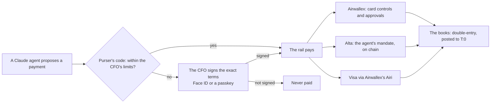

# Purser: the long description

**AI agents spend. You sign off.** Alta (formerly Metal) holds each agent's on-chain budget, Airwallex holds each card's
limit, Purser's code holds the rest; the CFO approves anything beyond them, by signing the exact terms with a passkey.

[▶ Trailer (90 s)](https://youtu.be/n3HLVGROJc4) · [Walkthrough](https://youtu.be/mp9fmOYfBWc) ·
[Try it in 2 minutes](https://kit11.max-31b.workers.dev/try) · [Every id on /proof](https://kit11.max-31b.workers.dev/proof) ·
[Repository](https://github.com/agamemnon-coder/x402-business-agents)

**Entered for:** the Founder's Choice Award, the Judges' Choice Award, the Metal Award and the Visa Award. Alta is the
partner the hackathon calls Metal; it renamed itself on 14 November 2026, and the award keeps the hackathon's name.

## In 30 seconds

- An approval is usually a button. In Purser it's a signature over the exact terms: change one cent and it's worthless.
- One CFO policy, a lock per rail: Airwallex card controls, Alta's mandate, the CFO's signature on invoices. A prompt is not a control.
- Real agents: Claude made all 24 decisions (routine payments are code); no key reaches Claude.

The Kit 11 scenario, run live on 3 November.

**Starter Kit 11 (x402 Business Agents), entered for the Metal Award and the Visa Award (Visa: the Airi run, Visa Intelligent Commerce, under "Other live tests"; Visa TAP is an extra: see the note under Visa).** Also entered for the Founder's Choice Award and the Judges' Choice Award.

## How it works

Each rail holds its own limit again: Airwallex declines a card over its limit, Alta refuses a payment over the
mandate. The CFO's signature covers the SHA-256 of the exact terms; change one cent and it no longer verifies.

## The main run, 3 November, at a glance

| Scene | What happened | Who stopped what | The id |
|---|---|---|---|
| The price rise | Stockline's price doubled, 0.02 → 0.04, over the Sourcing mandate's 0.03 cap | Alta refused the over-cap purchase on chain (our own check off once, on purpose); the CFO then signed new terms | tx [`0x2e92f9cb…1871`](https://testnet.metalntwx.com/tx/0x2e92f9cb4549246f58b9b888881c258bf117c6233c1d8f126f4833ae6ae41871) |
| The dispute | A simulated customer disputed 12 orders | The Support agent refunded the 3 with wrong data itself; the CFO rejected the other 9 with Face ID | the record's P-0004 |
| The euro bill | The EUR 240.00 licence, planned by the Treasury agent | Paid only after the CFO's Face ID; FX for the shortfall, then SWIFT with the signed hash in Airwallex's record | transfer [`03360bfa-afce-457b-89d1-e1097fbe3985`](https://kit11.max-31b.workers.dev/trace#transfer-03360bfa) |

| The run in numbers | |
|---|---|
| Decisions by Claude | 24 of 24, 0 fallbacks, 50 calls, USD 0.3170 at list prices |
| Payments on Alta | 86, each its own transaction, all inside the limits |
| Stops | 16, nothing paid over a limit |
| Signed with Face ID | 5 decisions by the CFO |

Every figure is the main run's record (`docs/demo/main-run.json`, log `docs/runs/2026-11-03-main-run.md`); the
details are under "In depth" below.

## Every live run, by partner

The same runs as [/proof](https://kit11.max-31b.workers.dev/proof), each with its record. Test money only.

**The main run**

| Date | What ran | Id | Record |
|---|---|---|---|
| 3 Nov | Three Claude agents run a company for a day | SWIFT transfer (Airwallex): [`03360bfa-afce-457b-89d1-e1097fbe3985`](https://kit11.max-31b.workers.dev/trace#transfer-03360bfa) | [record (JSON)](https://github.com/agamemnon-coder/x402-business-agents/blob/main/docs/demo/main-run.json) |

**Airwallex**

| Date | What ran | Id | Record |
|---|---|---|---|
| 13 Nov | A payout approved with the owner's own iPhone Face ID | Transfer: `d0353daf-515f-464f-bf8e-9fb99e6cca00` | [run log](https://github.com/agamemnon-coder/x402-business-agents/blob/main/docs/runs/2026-11-13-airwallex-faceid.md) |
| 12 Nov | One signature, one Airwallex batch of two payouts, read back before submit | Airwallex batch: `3960a081-b058-422b-95b1-6298e45fe257` | [record (JSON)](https://github.com/agamemnon-coder/x402-business-agents/blob/main/docs/runs/2026-11-12-airwallex-batch-transfer.json) |
| 12 Nov | The payee's bank checks the name before the CFO is asked | in its record | [record (JSON)](https://github.com/agamemnon-coder/x402-business-agents/blob/main/docs/runs/2026-11-12-airwallex-payee-check.json) |
| 12 Nov | One payout, two locks: signed in Purser, then approved in Airwallex's web app | Transfer: `4074d684-4704-406c-a527-2832753baf4f` | [run log, 12 Nov](https://github.com/agamemnon-coder/x402-business-agents/blob/main/docs/runs/2026-11-12-airwallex-two-locks-paid.md) |
| 10 Nov | A customer pays an invoice by card; Purser books it only once Airwallex says SUCCEEDED | PaymentIntent: `int_sgpv9bnppho0sezgl4a` | [run log](https://github.com/agamemnon-coder/x402-business-agents/blob/main/docs/runs/2026-11-10-payment-acceptance-sandbox.md) |
| 10 Nov | Purser opens a test company's Airwallex account and pays on its behalf | Connected account: `acct_SC-QD89fOneAeqaRFgOymw` | [run log](https://github.com/agamemnon-coder/x402-business-agents/blob/main/docs/runs/2026-11-10-connected-accounts-sandbox.md) |
| 7 Nov | Airwallex itself declines an agent's card over the CFO's limit | Declined by Airwallex (LIMIT_EXCEEDED): `01a1b5e8-6dc2-7000-95bf-c8fc5e6e2f38` | [record (JSON)](https://github.com/agamemnon-coder/x402-business-agents/blob/main/docs/demo/airwallex-run.json) |

**Alta (testnet)**

| Date | What ran | Id | Record |
|---|---|---|---|
| 13 Nov | Records anchored on chain | Anchor: [`0xaa93f270…e6c1`](https://testnet.metalntwx.com/tx/0xaa93f270a37c66e8be033949b8a6dc89278e47722ca0be5067a744a32b20e6c1) | [record (JSON)](https://github.com/agamemnon-coder/x402-business-agents/blob/main/docs/runs/2026-11-13-anchor.json) |
| 12 Nov | An approved invoice becomes a token, is pre-financed, then settled (prototype) | mint: [`0xefc68319…b575`](https://testnet.metalntwx.com/tx/0xefc6831934784df1ae4b65a0d03d5f2e9e08c1d009ef4bd73d07844b5559b575) | [record (JSON)](https://github.com/agamemnon-coder/x402-business-agents/blob/main/docs/runs/2026-11-12-tokenize.json) |
| 12 Nov | Passkeys sign on chain (P-256): the agent's limit changes only when two passkeys sign | Passkey account: `0xb5A370DCdFb60F1Ede241C9c3B28135Ac4216a3c` | [record (JSON)](https://github.com/agamemnon-coder/x402-business-agents/blob/main/docs/runs/2026-11-12-faceid-onchain.json) |
| 12 Nov | A hold for exactly the approved amount on Alta, then captured to the supplier | captureHold: [`0xb371a336…7859`](https://testnet.metalntwx.com/tx/0xb371a336f5a0ec74c4e3a26691dc3f2233882535dcac92e8a74b82f28b7a7859) | [run log](https://github.com/agamemnon-coder/x402-business-agents/blob/main/docs/runs/2026-11-10-metal-extra.md) |
| 30 Oct | Four eyes on chain | CFO alone: reverted · 0xe0976c5a…69c3: [`0xe0976c5a…69c3`](https://testnet.metalntwx.com/tx/0xe0976c5a0ad7ebe51ed0bc9564b2f366fd141b6ba24a55b09fe71ea23e2269c3) | [run record](https://github.com/agamemnon-coder/x402-business-agents/blob/main/docs/runs/2026-10-30-four-eyes.md) |
| 30 Oct | Clearing under load | in its record | [run record](https://github.com/agamemnon-coder/x402-business-agents/blob/main/docs/runs/2026-10-30-clearing-load.md) |
| 30 Oct | Receive policy: money from strangers held | allowlist-only policy set on the sweep wallet · 0xf1a7fe96…0c37: [`0xf1a7fe96…0c37`](https://testnet.metalntwx.com/tx/0xf1a7fe9664053c9d2fdf1b2d11122bde5be0668da8afc8d4f17b08088e220c37) | [run record](https://github.com/agamemnon-coder/x402-business-agents/blob/main/docs/metal-award.md#5-receive-policy-and-quarantine-built-into-purser-30-october) |
| 30 Oct | Compliance before a payout from the policy contract | screened payment: paid · 0xc2eb6814…f237: [`0xc2eb6814…f237`](https://testnet.metalntwx.com/tx/0xc2eb68144c8285a07ac6687a8f1c8085e9ee2826f8d6043663073eca2e79f237) | [run record](https://github.com/agamemnon-coder/x402-business-agents/blob/main/docs/runs/2026-10-30-compliance-policy.md) |
| 29 Oct | Pay-per-call clearing | deposit of 5.00 · 0x055ba899…6766: [`0x055ba899…6766`](https://testnet.metalntwx.com/tx/0x055ba89987f658cb038fcbd1660f4d9e98e78e4c44c86c5346946f8cca1a6766) | [run record](https://github.com/agamemnon-coder/x402-business-agents/blob/main/docs/runs/2026-10-29-clearing.md) |

**Visa via Airwallex's Airi**

| Date | What ran | Id | Record |
|---|---|---|---|
| 14 Nov | Face ID, Airi's tap, paid; Purser refuses the same credential reused, before any call | Paid PaymentIntent (B): `int_sgpvspvj9ho57xv5asj` | [record (JSON)](https://github.com/agamemnon-coder/x402-business-agents/blob/main/docs/runs/2026-11-14-vic-5.json) |
| 13 Nov | Two paid, one after Face ID; Purser refuses a reused credential before any call | Paid PaymentIntent (B): `int_sgpvspvj9ho44vth3wd` | [record (JSON)](https://github.com/agamemnon-coder/x402-business-agents/blob/main/docs/runs/2026-11-13-vic-4.json) |
| 12 Nov | Claude chooses the Airi rail; the CFO's signed hash read back from Airi and Airwallex | Paid PaymentIntent (B): `int_sgpvnmz6rho3h10jnj2` | [record (JSON)](https://github.com/agamemnon-coder/x402-business-agents/blob/main/docs/runs/2026-11-12-vic-3.json) |
| 7 Nov | An agent buys with a Visa credential for one purchase; above the limit, after Face ID | Payment intent, EUR 45.00, after Face ID: `int_sgpvzc9hjhnxvxc26ie` | [record (JSON)](https://github.com/agamemnon-coder/x402-business-agents/blob/main/docs/demo/airi-run.json) |
| 2 Nov | A checkout signed with Visa TAP, on an Airwallex card (an extra, outside the entry) | Card transaction, EUR 19.99: `01a19bfa-df97-7000-b24f-4f59886cdf70` | [record (JSON)](https://github.com/agamemnon-coder/x402-business-agents/blob/main/docs/runs/visa-tap-live-2026-11-02.json) |

**The books (sandbox ledgers)**

| Date | What ran | Id | Record |
|---|---|---|---|
| 12 Nov | Purser's purchase books in Moneybird, read back to the cent | in its record | [record (JSON)](https://github.com/agamemnon-coder/x402-business-agents/blob/main/docs/runs/2026-11-12-moneybird-sandbox.json) |
| 10 Nov | Three test companies, each on its own Airwallex account | Payout PAID: `593c340b-1752-4537-9ef2-0eb3558897cc` | [run log](https://github.com/agamemnon-coder/x402-business-agents/blob/main/docs/runs/2026-11-10-platform-e2e.md) |
| 10 Nov | Purser's books posted to T:0 and matched line by line | First journal entry: `je_prod_z7kTCuZ1iiwad01q` | [run log](https://github.com/agamemnon-coder/x402-business-agents/blob/main/docs/runs/2026-11-10-t0-journal-sandbox.md) |

## What Purser holds to, and who enforces it

| Promise | Enforced by | Evidence |
|---|---|---|
| Beyond the limits, money moves only on the CFO's signature over the exact terms. | Purser's code + the CFO | [Main run: the CFO's Face ID decisions](https://kit11.max-31b.workers.dev/proof#faceid) |
| An agent's card cannot spend over the CFO's limit. | Airwallex | [Airwallex's own decline](https://kit11.max-31b.workers.dev/airwallex#awx-1-steps) |
| A Visa card purchase above the limit waits for the CFO's Face ID. | Purser's code + the CFO | [The Airi runs](https://kit11.max-31b.workers.dev/visa) |
| An agent cannot pay past its on-chain budget. | Alta (on chain) | [A purchase refused on chain](https://kit11.max-31b.workers.dev/alta) |
| An invoice is paid once. | Purser's code | [A renamed duplicate refused](https://github.com/agamemnon-coder/x402-business-agents/blob/main/test/invoice-duplicate-key.test.ts) |
| No key, token or credential reaches Claude. | Purser's code | [Every Claude decision and its tools](https://kit11.max-31b.workers.dev/claude) |
| The record cannot be changed quietly. | Purser's code | [The offline verify](https://github.com/agamemnon-coder/x402-business-agents/blob/main/README.md#verify-it-yourself-in-3-commands) |

## Purser Cloud (the product)

Purser Cloud is the product around the controls: a public test preview at <https://purser-try.max-31b.workers.dev/>
(*Try as guest*: test companies, made-up data, a simulated bank) with its Agents, Invoices and Tokenisation tabs.
Approval alerts by e-mail, Slack and Teams are built and tested with stand-ins, not sent live yet.

## Business (a hypothesis)

Buyer: a CFO on Airwallex. Pilot pricing: Starter €49 a month (100 invoices, then €0.25 each); Business from €249 a
month; a small fee per payout. Not validated with customers yet.

## How to judge it in 5 minutes

1. Watch the [trailer](https://youtu.be/n3HLVGROJc4) (90 s).
2. [Try it](https://kit11.max-31b.workers.dev/try): approve a payment with your own passkey, then change one cent and see it refused.
3. Open [/proof](https://kit11.max-31b.workers.dev/proof): every id of the main run, the Alta ones checkable on Alta's testnet explorer.
4. Offline, no keys: `npm ci`, `npm test`, `npm run judge -- --check`.

## Built with

Airwallex (sandbox) · Alta (testnet) · Visa Intelligent Commerce via Airwallex's Airi (sandbox, test card) · T:0
(sandbox ledger) · Claude by Anthropic. No endorsement implied.

## In depth

**A supplier doubles its price. A customer disputes 12 orders. A €240 bill is due in euros.** Three Claude agents run a
small data business on 20 test dollars through Alta and Airwallex; the CFO signed 5 times with Face ID. One live run,
every id below.

Purser is for the CFO or controller of a small company that runs AI agents and wants them to spend company money only
within limits the CFO sets. Alta holds each agent's on-chain budget, Airwallex holds each card's limit, Purser's code
holds the rest; the CFO approves anything beyond them. The example company is Northwind Outdoor, an outdoor wholesaler
that sells live stock data to retailers per query (here one simulated customer, Summit Outfitters, whose agent we run)
and pays its suppliers. It has Kit 11's three agents, the Sourcing, Support and Treasury agent, each with its own
Airwallex card and its own Alta mandate. The CFO in this demo is Max, the builder, on his own phone.

**In one line:** Claude explains and proposes, the rules in code hold every limit, and a person signs before money
moves beyond them. Sign one yourself: https://kit11.max-31b.workers.dev/try

### The main run (3 November)

One live run, 11:16–11:33 UTC, on the Airwallex sandbox and Alta testnet with test money, real Claude decisions and
Max's passkey (Face ID on his phone); Max plays the CFO. The second approval (four eyes, both signatures) came from a labelled virtual test passkey on the runner
machine, pressed by our build tool, Claude Code, on Max's go; in production the second approver is a second person. The
three runtime agents hold no owner key and no passkey. Log: `docs/runs/2026-11-03-main-run.md`.

- **The price rise.** Stockline, the supplier, went from 0.02 to 0.04 a stock check, over the Sourcing mandate's 0.03
  cap. We switched off our own check once to prove the chain holds the line: Purser refuses an over-cap purchase before signing; with that check off for one purchase, Alta refused it anyway.
  The run's own label: "Defense in depth: Purser normally refuses before signing. To prove the rail itself enforces the limit, one purchase was let through to Alta — Alta refused it; nothing moved."
  The refusal is recorded on chain (`mandate_cap_exceeded`, tx `0x2e92f9cb…1871`). Treasury's options 40 s after the
  refusal, within the same 20.00: option A raises Sourcing's cap to 0.04 and keeps our price at 0.05; option B takes the
  same cap and raises our price to 0.07. The CFO signed A with Face ID (the first of two signatures), then the second approver, the labelled test passkey (the second), and both mandates
  were replaced on chain.
- **The dispute.** A simulated customer disputes 12 orders, saying its agent never placed them. Every order carries its agent's signature, so that claim fails. Three orders had wrong data; the Support agent refunds those 3 (0.15 test USD) itself. "Refund the other 9" goes to the CFO, who rejects it with Face ID.
- **The euro bill.** The Treasury agent planned the EUR 240.00 licence itself (P-0005). After the CFO's Face ID,
  EUR 110.00 bought by FX for the shortfall (USD 124.29, conversion `3ca88196-05da-4d88-9caa-796f03704636`), then
  SWIFT: transfer `03360bfa-afce-457b-89d1-e1097fbe3985`, accepted by Airwallex with the signed hash in its metadata
  (settlement simulated in the sandbox), fee EUR 13.42 (ceiling EUR 20.00).

Each agent's budget, when bound → after the CFO's Face ID (test USD): Sourcing 10.00 → 14.00 (cap 0.03 → 0.04 a
purchase); Support 4.00 (cap 0.10); Treasury 6.00 → 2.00. 20.00 between them before and after, held in code.

### From idea to build

Our idea (submitted 24 October) promised three agents on one Alta account, each under its own on-chain mandate, and
three moments: a price rise, a dispute and a euro bill. Built as promised, each with its proof in
[docs/idea-vs-build.md](../idea-vs-build.md): the three mandates (10, 4 and 6 test USD, at most 3 cents a purchase for
sourcing), the 20 held in code and no agent with the owner key; x402 queries at 5 cents with a signed order, upstream
data at 2 cents; and the three moments above, in one live run.

What got better than the idea: the agents decide for themselves, as Claude agents with their own tools, inside the
same limits; the approval is Face ID on the CFO's phone instead of a typed hash; every agent also has an Airwallex
company card whose limits Airwallex enforces.

### How we use Airwallex

- **A company card per agent (Issuing).** Each agent has a DELEGATE cardholder and a virtual Visa card. The CFO policy
  sets its limits; its merchant categories, currency and end date are fixed per agent. Purser writes them all to the
  card and reads them back. Airwallex enforces them. In the main run the Sourcing agent asked for a card raise first
  (P-0006, EUR 30.00 → 46.00), the CFO approved it with Face ID, Purser synced it to the card, and Airwallex approved
  the TAP-signed EUR 45.00 purchase (authorization `01a1a12f-4113-7000-b76d-014677710007`).
- **FX and SWIFT for the €240 licence.** EUR 110.00 bought by FX for USD 124.29 on a locked quote (conversion
  `3ca88196-05da-4d88-9caa-796f03704636`), only the shortfall above the EUR reserve; then SWIFT, transfer
  `03360bfa-afce-457b-89d1-e1097fbe3985`, fee EUR 13.42, accepted by Airwallex with the signed hash. Its settlement is
  simulated: in the sandbox Purser itself moves the transfer to SENT and then PAID through Airwallex's simulation API. One Face ID covers
  the rate, the payee and the most the fee may be (EUR 20.00). The transfer carries the approval's hash in its metadata.
- **Earnings booked once final.** The 0.69 test USD swept on Alta after finality is booked at Airwallex exactly once,
  as a simulated sandbox deposit (`b3812e05-2afa-4698-8f64-429f9608e0a0`) whose reference is the testnet transaction.
- **Webhooks, through our relay.** Airwallex posts each event to the relay's `/hooks/airwallex`, which checks
  `x-signature` (HMAC-SHA256 over `x-timestamp` plus the raw body, before anything parses it; a timestamp more than five
  minutes off is refused), keeps each event once by its id and answers without waiting for the runner
  (`worker/src/core.ts`); the runner checks the HMAC again with its own copy of the secret and records each event id
  once (`src/policy/cardHooks.ts`). Subscribed to 23 event types since 30 October; none arrived during the main run,
  so the live proof is the 30 October run below (`docs/runs/2026-10-30-webhooks.md`).

### How we use Alta

- **A mandate per agent.** Each agent that pays per request does it under its own on-chain mandate: a cap per payment,
  a total budget, one payee and an end date.
- **A price rise refused against the mandate.** Alta refused the purchase over the cap itself (tx `0x2e92f9cb…1871`);
  after the CFO's Face ID and the second signature (the labelled test passkey), Purser replaced the Sourcing and
  Treasury mandates on chain; a payment under the old mandate is refused (`mandate_revoked`).
- **x402 with signed orders** for per-request sales, and **mandate pulls** for refunds and the earnings sweep.
- **The Dispute desk.** A simulated customer disputes 12 orders, saying its agent never placed them. Every order carries its agent's signature, so that claim fails. Three orders had wrong data; the Support agent refunds those 3 (0.15 test USD) itself. "Refund the other 9" goes to the CFO, who rejects it with Face ID.
  Any seller on Alta can reuse it: `examples/metal-dispute-desk`.

### Visa

Visa: the Sourcing agent signs its card checkout with Visa's Trusted Agent Protocol (TAP), so a merchant can check which agent is buying. Visa's public reference verifier accepted the signatures in a separate test on 2 November; the merchant is ours.

*Visa TAP: built and verified against Visa's public reference verifier; not eligible Visa tooling for this hackathon (Visa, 5 Nov).*

### Where Claude is used

In the main run the three agents (Sourcing on Haiku, Support on Sonnet, Treasury on Opus) made 24 decisions, all by
Claude, 0 fallbacks, in 50 calls each with a request id, for USD 0.3170 at list prices. No key reaches their Claude
models, and no agent can approve. Purser's code checks every payment against the policy, and nothing moves money
beyond the agents' limits without the CFO's Face ID.

### Controls

- **The agent may:** pay inside its card limits and its mandate, alone.
- **Needs the CFO:** anything above a limit, a new payee, a bank-detail change, a refund batch above the threshold, a
  looser policy. The CFO signs the exact terms on the phone with Face ID; the runner checks the signature and
  the terms' hash before it moves money.
- **Exceptions:** a price rise is refused on chain and becomes options; a suspected fake invoice or a planted
  instruction is held for a person; an agent that pays too often is stopped; a payment the ledger cannot explain is
  found by the hourly reconciliation.
- **Audit:** every decision goes into an append-only, hash-chained log that `npm run verify` re-checks.

### Proof from the main run (3 November)

The CFO on his own phone with Face ID; the agents decided with Claude; test money only (Alta testnet, Airwallex
sandbox). Second approver: a labelled test passkey in this demo. In production this is a second person.
- 55 queries, 55 upstream purchases (the cache was off): 41 paid. 14 queries got an error and were not charged (1
  refused by Alta at the cap, #24; 12 stopped at the higher price by the buy rule the Sourcing agent (Claude) set,
  applied by code, #25–#36, until the new mandate was in place; 1 refused `mandate_revoked` while the mandate was being replaced, #37);
- 86 Alta payments + 1 card charge, all inside the limits with no approval at the time: 41 sales + 41 supplier
  purchases + 3 refunds + 1 sweep on Alta, and 1 card charge at Airwallex;
- on Alta testnet, checked against the chain on 5 November: the 4 mandates bound at setup and the 2 replacements,
  86 payments each with its own transaction, and 1 refusal on chain (#24,
  [tx](https://testnet.metalntwx.com/tx/0x2e92f9cb4549246f58b9b888881c258bf117c6233c1d8f126f4833ae6ae41871)); no emulator
  and no clearing in this run. The EUR licence and the card buy ran on the Airwallex sandbox; the other 13 refused
  purchases (12 stopped by the buy rule the agent set, applied by code; #37, refused by Alta against its just-revoked mandate, with no
  transaction of its own) are in the ledger, not as transactions on chain;
- all 24 decisions by Claude, 0 fallbacks; 5 decisions signed with Face ID by the CFO (P-0001, P-0002, P-0004,
  P-0005, P-0006), +1 co-signature (the second approver's, on P-0002);
- the books match the chain and Airwallex: `verify` passes; `reconcile` checked 88 (the 86 Alta payments, the SWIFT
  transfer and the card buy), 0 differences; `data-qa` passed all 217 checks; 110 money movements, 0 without an origin;
- 16 stops, nothing paid over a limit: one buy rule Claude set stopped 12 overpriced checks, Alta refused 2 purchases, the CFO rejected 1 proposal, and 1 planted instruction changed nothing.
  the buy rule's 12: stock checks #25–#36 (the Sourcing agent, Claude, set its buy rule; code applied it to each check
  over the cap); Alta's 2: 1 over the
  mandate's cap (#24), 1 on a mandate that had just been replaced (#37, `mandate_revoked`); the CFO's 1: P-0004, with
  Face ID; the planted instruction: a line aimed at the AI in the dispute document, treated as data;
- Separate run, not counted: Airwallex declined EUR 45.00 over the card limit (LIMIT_EXCEEDED), separate TAP run, 2 November.

### What is real and what is simulated

| Live (test money) | Simulated |
|---|---|
| Airwallex sandbox API calls: cards and their limits, FX, the SWIFT transfer, approvals | The merchants' charges, in the sandbox |
| Alta testnet transactions: mandates, payments, refusals on chain | The deposit that stands in for Alta earnings |
| Claude's decisions, each call with a request id | The SWIFT transfer's last steps (SENT, PAID), through the sandbox's simulation API |
| The CFO's Face ID on the exact terms | The customer Summit Outfitters and its agent, and Stockline, the warehouse API (run by us) |
| T:0: the main run's journal posted to its shared sandbox entity | The second approver: a labelled virtual test passkey |

All money is test money: the Airwallex sandbox and Alta testnet. The cards, limits, conversion, transfer and mandates
are real API and chain results. T:0: 95 journal entries posted to T:0's shared sandbox entity on 10 Nov (first je_prod_z7kTCuZ1iiwad01q); debits equal credits, and T:0 matches our books line by line. Built, not yet live: Simulated by the sandbox: the merchants' charges, the deposit that stands in for Alta
earnings and the transfer's last steps (SENT, PAID), which Purser triggers through the sandbox's simulation API. Run
by us: the customer Summit Outfitters and its agent, and Stockline, the
warehouse API. The second approver (four eyes on P-0002) was a labelled virtual test passkey on the runner machine,
pressed by our build tool, Claude Code, on Max's go; in production the second approver is a second person.

### Other live tests (separate worlds, dated)

Not part of the main run; each ran live on the Airwallex sandbox or Alta testnet (test money), in its own test world,
with its own date.

- **awx-1, the Airwallex-only run (7 November).** Airwallex sandbox only, test money, 0 Alta calls; accepted, all
  seven checks passed in one attempt each. Three agent cards, read back with the policy's limits, merchant category,
  EUR only and an end date. Airwallex approved EUR 19.99, declined EUR 45.00 over the 30.00 limit (LIMIT_EXCEEDED) and
  declined a charge outside the Support card's merchant category (MERCHANT_CATEGORY_NOT_ALLOWED). The Sourcing agent
  (Claude Haiku) read its decline and asked the CFO for a raise instead of retrying; after Max's Face ID the card was
  updated at Airwallex and the same 45.00 approved. Two invoices paid by SWIFT after Max's Face ID, one from free
  euros, one with FX for the shortfall only, each payout carrying the hash of the signed terms in Airwallex's metadata;
  21 webhooks, all recorded. The merchant charges and each payout's SENT and PAID are the sandbox's simulation. Log: [docs/runs/2026-11-07-awx-1.md](../runs/2026-11-07-awx-1.md).
- **Visa Intelligent Commerce via Airwallex's Airi (7 November; Airwallex sandbox, test card, test money; a scripted
  run, no Claude call).** Purser's script, as the Sourcing agent, paid with a single-use Visa (VIC) credential from
  Airwallex's Airi wallet, on Airwallex's hosted checkout page for our own sandbox merchant. EUR 12.00 within Purser's
  limit ran with no Purser approval, and Airi itself asks the cardholder to confirm each purchase with a passkey;
  EUR 45.00 above it ran only after the CFO's Face ID on its exact terms (P-0002); a merchant the CFO does not allow was
  refused by Purser before any call to Airi. Both payments SUCCEEDED in the sandbox; all five checks passed, in the
  second attempt in its world. The earlier attempts that day (a changed answer format, a confirm the sandbox refuses, a
  missed tap, a reused order reference; nothing charged) are in the log: docs/runs/2026-11-07-vic-1.md.
- **Visa TAP run (2 November).** Visa's reference registry self-hosted with a test key, and our own TAP merchant;
  Airwallex approved one card buy and declined EUR 45.00 over the card limit (LIMIT_EXCEEDED).
- **Single-use task cards (30 October).** One sentence (a flight, a hotel or a train, with an amount) becomes one card
  for that task, locked to its merchant category, the amount and a date. Within the CFO's policy it is issued at once;
  otherwise after Face ID.
- **Global Accounts and webhooks (30 October).** Retailers pay Northwind's EUR and GBP accounts (sandbox simulations); a
  receivables agent matches each payment to its invoice by reference and sends anything short or unknown to the CFO.
  Each webhook delivery is signature-checked at the relay and again on the runner. Shown live: two retailer deposits,
  one matched and one sent to the CFO as short, by the webhook alone, and a card transaction. Payout and conversion
  events are subscribed but were not caused live that day (awx-1 caused them on 7 November).
- **For a bigger company, more control on chain (separate test worlds, Alta testnet, 30 October):**
  - **Four eyes on chain.** A 2-of-2 Alta account: the CFO and a controller (two test keys on one machine, not two
    people). A payment signed by the CFO alone, the same payment co-signed by a stranger's key, and a mandate revoke by
    the CFO alone each reverted on chain; with both owners signing, they went through.
  - **Compliance before a payout.** Our send-policy contract pays only with Purser's signed screening decision for
    that payee, amount and moment. Eleven attacks reverted on chain, among them a replay, a redirect to the attacker
    and a self-made decision for a sanctioned stand-in. Agents' mandate payments do not pass through it (Alta's
    design).
  - **Clearing under load.** All 2,000 pay-per-call payments in 471.8 s (4.24 a second, p50 1.4 s, p95 8.1 s), at
    about $0.0007 of RPC calls per payment (an estimate from Alta's published rates, not a bill). A first run paid
    1,879 before one wallet was held by a lost answer; resending the same request fixed it.
  - **Receive policy (30 October, its own test world):** the sweep wallet accepts money only from the business
    account; a stranger's 0.02 was held in quarantine by Alta, recorded by Purser and returned only after the CFO's
    Face ID.

### Tested on stand-ins (not live)

These ran against stand-ins for Airwallex, Alta, the phone or Claude, not on the live rails.

- **Emergency stop.** One Face ID freezes every agent card at Airwallex and stops every agent payment (tested against
  stand-ins, not yet run live).
- **Red team (30 October, in-memory stand-ins for Airwallex, Alta and the phone).** 35 scripted attacks plus 4
  documents written by Claude Opus as the attacker: 37 of 39 stopped, 2 detected afterwards, not prevented (a hidden
  card charge by the reconciliation, a rewritten log row by `npm run verify`), 0 inconclusive. Three more runs on 31
  October (120 attacks): 112 stopped, 6 detected afterwards (the same two kinds in each run), 2 inconclusive (nothing
  was paid or changed). On 2 November Claude Opus wrote 119 more tests: code judged 111 stopped, 5 got through and 3
  inconclusive; all 5 were checked by hand and none is a breach (two reading bugs on Try were filed).
- Scenario Lab: all 18 stories as expected (stand-ins for Airwallex, Alta and Claude).

How this page came to be (editorial history)

The form's Description as it stood on 5 November (about 15,000 characters), before Max asked for a short one. The form
now uses the short Description in [README.md](README.md#description), which links here. One run added since: awx-1, the
Airwallex-only run of 7 November, under "Other live tests". Every run figure comes from the
main run of 3 November (`docs/demo/main-run.json`, log `docs/runs/2026-11-03-main-run.md`) and the reports in this repo
(`src/submission/facts.ts`); `test/submission.test.ts` checks this page against them, as it checks the short one.

