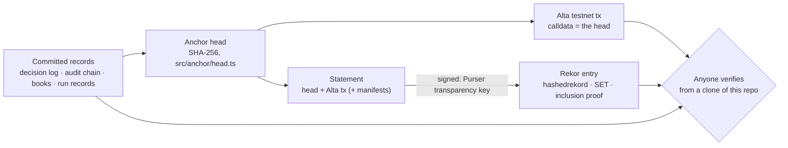

<div align="center">

# Purser · records anyone can check

[](entries/2026-11-26-rekor-4128274903.json)&nbsp;[](#check-it-yourself)&nbsp;[](../runs/2026-11-19-anchor.md)&nbsp;[](../../README.md)

**One SHA-256 over Purser's committed records, held by two parties that are not Purser: an Alta testnet transaction and Sigstore's public Rekor log. Anyone can recompute it from this repo and check both, without trusting us.**

</div>

## What is logged

The **anchor head** (`src/anchor/head.ts`) is one SHA-256 over the heads of Purser's committed tamper-evident records:
the decision log of the 30 October run (every row recomputed), the main run's audit chain (its links), its books (a
digest of the journal) and the run records named when it was anchored. `npm run anchor -- --live` sent it as calldata in
one Alta testnet transaction (`docs/runs/<date>-anchor.json`).

`npm run transparency -- publish` (`src/transparency/transparency.ts`) puts the same head into **Sigstore's Rekor**, the
public, append-only transparency log Sigstore runs:

1. A **statement** is built from the repo: the anchor head and height recomputed over the latest anchor record's parts
   (it must equal the head that record and its Alta transaction carry), that transaction's hash and chain id, and,
   with `--manifest <docs/…/manifest.json>`, the SHA-256 of a compliance-evidence or audit-pack manifest.
2. Its canonical JSON (RFC 8785) is signed with the **Purser transparency key** (ECDSA P-256 with SHA-256). Its public
   half is [`purser-transparency.pub`](purser-transparency.pub); the private half is never in this repo (see
   [key management](../security/key-management.md): `PURSER_TRANSPARENCY_KEY` or `PURSER_TRANSPARENCY_KEY_FILE`).
3. Rekor gets a **hashedrekord v0.0.1** entry (`POST /api/v1/log/entries`): the statement's SHA-256, the signature and
   the public key. Rekor answers with the entry's uuid, log index, integration time, its **signed entry timestamp**
   (SET) and an **inclusion proof** with a signed **checkpoint**.
4. The answer is checked offline before it is kept, then written to [`entries/`](entries/) with the statement itself.



## The entry on record

| | |
|---|---|
| Log | `https://rekor.sigstore.dev` (log id `c0d23d6a…9591801d`) |
| Log index | **4128274903**, integrated 2026-11-26 15:05:17 UTC |
| UUID | `108e9186e8c5677a9a9477b923cb98d052deb19a32a41173fb3325236076e5e8020232356561557c` |
| Statement | anchor head `52c9477d…719770ff`, height 731, from [`2026-11-19-anchor.json`](../runs/2026-11-19-anchor.json); Alta tx `0x2bc04ccd…7b38c2`; no manifest |
| Record | [`entries/2026-11-26-rekor-4128274903.json`](entries/2026-11-26-rekor-4128274903.json) |

It is the one entry published live so far. A new one is made only by running `publish` with the key; nothing in CI
publishes.

## Check it yourself

```bash
npm run transparency -- verify
```

No network. For each entry in `entries/` it checks, and prints `ok` or `FAIL` for each:

- **the statement against the repo**: the anchor head recomputed from the committed records, the Alta transaction the
  anchor record names, each manifest's SHA-256;
- **the entry body**: a hashedrekord whose hash is the statement's SHA-256, whose public key is
  `purser-transparency.pub`, and whose signature verifies over the statement;
- **the SET**: Rekor's ECDSA signature over the canonical JSON of `{body, integratedTime, logID, logIndex}`, with the
  log id equal to the SHA-256 of Rekor's key;
- **the inclusion proof**: the leaf hash, SHA-256(0x00 ‖ body), hashed with the proof's path (RFC 9162, 2.1.3.2) up to
  the recorded root, and the uuid ending with that leaf hash;
- **the checkpoint**: a signed note naming that root and tree size, signed by `rekor.sigstore.dev`.

To check the Alta side too, `npm run verify-anchor` (with `METAL_RPC_URL`) reads the anchor transaction; or open
[/proof](https://kit11.max-31b.workers.dev/proof#check-chain), "Check it on chain", which reads it from Alta testnet now
and compares its calldata with the head recomputed from the repo. Anyone can also look the entry up in Rekor itself,
for example with `rekor-cli get --log-index 4128274903` or on [search.sigstore.dev](https://search.sigstore.dev).

## Rekor's key

[`rekor.sigstore.dev.pub`](rekor.sigstore.dev.pub) is Rekor's production public key, as served at
`https://rekor.sigstore.dev/api/v1/log/publicKey` on 26 November 2026. It matches the `tlogs` entry for
`https://rekor.sigstore.dev` in Sigstore's trusted root (`sigstore/root-signing`, `targets/trusted_root.json`): the same
key bytes, log id `c0d23d6ad406973f9559f3ba2d1ca01f84147d8ffc5b8445c224f98b9591801d`, valid from 2021-01-12. If Sigstore
rotates it, a new entry needs the new key beside this one; this entry stays checkable with this one.

## What it proves, and what it does not

- It proves that the anchor head of these records existed, signed by the holder of the Purser transparency key, no
  later than the integration time Rekor signed, and that Rekor's public log contains it. Rewriting a covered record
  changes the recomputed head, and `verify` says `FAIL`.
- It does not prove the records are true, only that they have not changed since. The main run's audit chain is
  published as links only, so its part proves order and completeness, not each row's content (see `src/anchor/head.ts`).
- Alta is a testnet, and everything Purser moved is test money.
