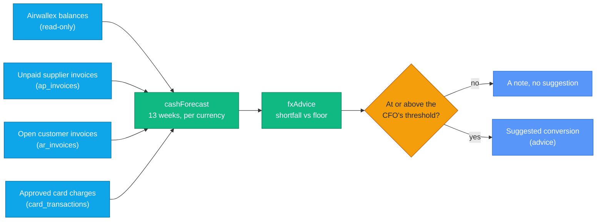
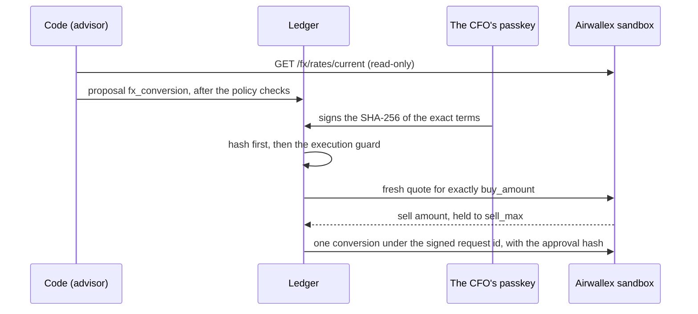

<div align="center">

<a href="../README.md"><picture><source media="(prefers-color-scheme: dark)" srcset="assets/brand/purser-mark-dark.svg"></picture></a>

# Treasury advisor: cash forecast and FX

**A 13-week cash forecast from the ledger and FX advice from code; a conversion moves only after the CFO's passkey.**

[](airwallex.md)&nbsp;[](#what-is-real-and-what-is-not)&nbsp;[](#from-advice-to-a-conversion)&nbsp;[](#the-forecast-method)

[Run it](#run-it) · [The forecast method](#the-forecast-method) · [FX exposure](#fx-exposure-and-the-cfos-threshold) · [From advice to a conversion](#from-advice-to-a-conversion) · [Receivables](receivables.md)

</div>

The Treasury advisor closes the money loop on the cash side. It reads what Purser already holds (unpaid supplier
invoices, open customer invoices, card charges, the CFO's floors), forecasts each currency's cash week by week, and,
when a currency would fall below its floor by more than the CFO's threshold, suggests a conversion. The suggestion is a
proposal like any payment: the CFO approves it with the passkey, or nothing happens. It builds on the Treasury agent's
existing work (the timing advice in `src/agents/timingCore.ts`, the euro-bill planning in `src/policy/treasury.ts`) and
does not replace it.

> [!NOTE]
> Every figure here is a **forecast**: what the ledger implies if customers pay on their due dates and suppliers are
> paid on theirs. It is labelled so in the command line, in the JSON and on the dashboard. Test money only.

## Run it

```bash
npm run treasury -- forecast            # 13 weeks from today; --as-of YYYY-MM-DD, --ledger, --json
npm run treasury -- fx                  # exposure, indicative rates, suggestions; --propose files them
```

With the Airwallex sandbox keys set, the opening balances are Airwallex's available balances (`GET /balances/current`)
and the rates Airwallex's current client rates (`GET /fx/rates/current`): both read-only. Without keys, or with
`--ledger`, the opening balances are the ledger's cash per currency and no rate is read, so nothing is suggested. The
runner's dashboard serves the same forecast and exposure as JSON at `GET /api/treasury` (`npm run dashboard`).

## The forecast method

`cashForecast` (`src/treasury/forecastCore.ts`) is a pure function: no database, no clock, no model. The same input
gives the same forecast to the cent, in integer cents, one currency at a time. The method is also returned with every
forecast (`method`), so the page and the command line show the rules they used.

| Line | Rule |
|---|---|
| Weeks | Week *n* runs from as-of + 7(*n* - 1) to as-of + 7*n* - 1 days; 13 weeks |
| Opening | Airwallex's available balance per currency (pending and reserved money never counts), or the ledger's cash |
| Payables | Each supplier invoice not paid or rejected (`ap_invoices`), in the week of its due date; overdue ones in week 1; due after week 13 left out and listed |
| Receivables | What is still open on each customer invoice (`ar_invoices` and the older `receivables`), in the week of its due date; overdue by 1 to 90 days in week 2; overdue by more is doubtful and never counted as cash |
| Card spend, recurring | A merchant that charged the same currency at least twice, every gap 25 to 35 days (the subscription rule of `src/agents/spendReview.ts`), charges its last amount again every 30 days; one not charged for 45 days is taken as stopped |
| Card spend, other | The approved non-recurring charges of the 8 weeks before as-of, divided by 8, every week |
| Closing | Opening + receivables - payables - card spend; a week below the currency's floor (`eur_floor`, `usd_floor`, `floor.<CUR>`) is flagged |



## FX exposure and the CFO's threshold

`fxAdvice` (`src/treasury/fxCore.ts`) is pure too. For each currency it takes the forecast's lowest closing balance:

- **shortfall**: the floor minus that lowest balance, when it is below the floor: what must be bought to stay at the
  floor in the worst week;
- **spare**: that lowest balance minus the floor, when it is above: what the currency can give up without breaking its
  own floor in its worst week.

A shortfall is worth a conversion only when its cost in EUR, at Airwallex's indicative rate, is at or above the CFO's
policy **`treasury.fx_threshold_eur`**. That setting is CFO policy like the floors: it changes only through a policy
change approved with the passkey (`npm run policy -- set`), and until it is set nothing is suggested. The currency to
sell must have a spare that covers the indicative sell amount plus a 1% rate buffer (the most the CFO signs for); EUR is
preferred when it can, else the currency with the most spare for what it would sell. When no currency can cover it, the
advice says so as a funding question for the CFO, never as a conversion.

## From advice to a conversion



`npm run treasury -- fx --propose` files each suggestion with `proposeFxConversion` (`src/treasury/advisor.ts`). The
policy checks first: no emergency stop, the Treasury agent not paused, the threshold set and met, both currencies ones
Purser converts, the sell currency still above its floor after the most it may sell, and no other conversion of the
same pair waiting. The terms the CFO signs name the buy amount, the most to sell (`sell_max`), the indicative rate and
its source and time, the reason in words, and a hash of the forecast it came from.

The executor (`src/executors/fxConversion.ts`) runs only an approved proposal. It re-hashes the stored terms before any
call to Airwallex, then reads the sell currency's balance and stops for a new approval if selling `sell_max` would take
it under its floor; takes a fresh quote for exactly the signed buy amount and stops for a new approval if the quote
would sell more than `sell_max`; and converts once under the signed request id, carrying the approval hash. A retry
first asks Airwallex for a conversion under that id and adopts it: it never converts twice.

## What is real and what is not

| Part | State |
|---|---|
| Forecast, exposure, suggestions | Code over the ledger; deterministic; tested in `test/treasury-forecast.test.ts` |
| Balances and rates | Airwallex **sandbox**, read-only calls; without keys, the ledger's cash and no rates |
| Conversion | Airwallex **sandbox**, only after the CFO's passkey; tested against a stand-in in `test/treasury-fx-proposal.test.ts`; test money |
| The words | Written by code from code's numbers. No Claude call: the existing per-invoice timing advice (`src/agents/timingAgent.ts`) stays the Treasury agent's Claude task |
| Purser Cloud console | No Treasury card yet: the console bundle is within 2 KiB of Cloudflare's limit (3,066 of 3,068 KiB gzipped); the CLI and the runner's `GET /api/treasury` carry it |

A forecast is not a promise: customers pay late, cards are used differently, rates move. The forecast says what the
ledger implies under the rules above, and nothing more.
