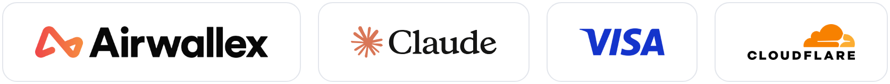

# Who does what

Moved from the [README](../README.md) on 15 November, to keep it short.

 official files, unmodified, each on its own white tile; Visa and Cloudflare named in text. No endorsement implied ([sources](assets/logos/SOURCES.md))

- **Built by Max Geurtsen** (Claude by Anthropic as the developer, directed and reviewed by Max): Purser itself: the CFO's policy and limits, the approval flow (Face ID on the exact terms,
  four eyes), the agents' tools and prompts, the relay and the site, the hash-chained audit log, the books, the tests.
- **Airwallex (sandbox):** the agents' cards and card limits, FX, the SWIFT euro payout, webhooks; its own approval
  workflow as a second lock. [/airwallex](https://kit11.max-31b.workers.dev/airwallex)
- **Alta (testnet):** the on-chain mandates and the agents' payments; it refuses what is over a mandate, and a passkey
  account changes a limit only when two owners sign. [/alta](https://kit11.max-31b.workers.dev/alta)
- **Claude by Anthropic:** two sets of agents. The Kit 11 agents pay for the company's own running costs (cards, x402
  on Alta), the three agents' decisions: Sourcing on Claude Haiku, Support on Claude Sonnet, Treasury on Claude Opus.
  The payables agents handle supplier invoices (Home, /try, Purser Cloud): the Reader reads an invoice, the Checker
  checks it, the Coder books account and VAT, the Payer proposes the payment; code enforces the limits and the CFO
  signs with a passkey (Face ID on iPhone). [/claude](https://kit11.max-31b.workers.dev/claude)
- **Face ID and passkeys (WebAuthn on the CFO's phone):** the CFO's passkey (unlocked with Face ID on an iPhone; Purser asks for no attestation, so it cannot tell which authenticator was used) signs the hash of
  the exact terms.
- **Visa Intelligent Commerce via Airwallex's Airi (sandbox, test card):** an agent pays with a Visa credential Purser binds to one purchase (the sandbox did not refuse a reuse or a higher amount, Purser did: [vic-3](runs/2026-11-12-vic-3.md), [vic-4](runs/2026-11-13-vic-4.md)). This is
  the work entered for the Visa Award (Visa confirmed on 7 Nov that the VIC run counts). The Visa TAP work is an extra:
  Visa said on 5 Nov that TAP is not eligible tooling for this hackathon ([rules](rules.md)). [/visa](https://kit11.max-31b.workers.dev/visa)
- **T:0 (shared sandbox entity):** a general ledger outside Purser. On 10 Nov the main run's books went in as 95 journal entries, debits equal to credits ([record](runs/2026-11-10-t0-journal-sandbox.md)); read back on 14 Nov, T:0 agrees: every account to the cent, plus the entry count. [/t0](https://kit11.max-31b.workers.dev/t0)
- **Cloudflare:** Workers and Durable Objects run the relay, the site and Purser Cloud's engine (one object per company).
