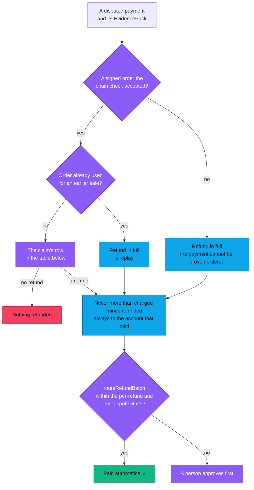

<div align="center">

<a href="../../README.md"><picture><source media="(prefers-color-scheme: dark)" srcset="../../docs/assets/brand/purser-mark-dark.svg"></picture></a>

# Metal Dispute desk (example)

**Refund decisions for disputed x402 payments on Alta (formerly Metal), one payment at a time, from evidence the seller holds.**

[](https://github.com/agamemnon-coder/x402-business-agents/actions/workflows/ci.yml?query=branch%3Amain)&nbsp;[](#requirements-and-tests)&nbsp;[](#what-it-is)&nbsp;[](#requirements-and-tests)&nbsp;[](https://docs.metalntwx.com)&nbsp;[](../../LICENSE)&nbsp;[](#what-it-does-not-prove)

[What it is](#what-it-is) · [What it decides from](#what-it-decides-from) · [The rules](#the-rules) · [Usage](#usage) · [The chain check](#the-chain-check-mandatecheck) · [What it does not prove](#what-it-does-not-prove) · [Tests](#requirements-and-tests)

</div>

| At a glance | Record |
|---|---|
| **The rules in one table**, checked in order; every refund only to the account that paid | [The rules](#the-rules) |
| **One copy:** Purser imports this folder; a parity test fails if the two could ever decide differently | `test/metal-dispute-desk-parity.test.ts` |
| Pure code: no npm dependencies, no database, clock, model or network | [`src/`](src/) · [`test/`](test/) |

## What it is

A small TypeScript module for any seller that takes x402 payments from AI agents on [Alta](https://docs.metalntwx.com).
When a customer disputes payments its agent made, the module decides **for each payment** whether to refund, how much, and
gives the reason in plain words. It decides only from evidence the seller holds and the chain confirms. It is pure code:
no database, clock, model, or network. The one chain lookup it needs is injected.

This is the decision code from Purser's Dispute desk, used as is. Purser imports it from this folder
(`src/seller/disputeDesk.ts`, `src/seller/evidence.ts`, `src/policy/refunds.ts`), so it is the only copy.
`test/metal-dispute-desk-parity.test.ts` fails if Purser and this example could ever decide differently.

## What it decides from

For each disputed payment, the seller assembles an `EvidencePack` of plain data. It can come from your own ledger.

| Evidence | Where it comes from on Metal | What it shows |
|---|---|---|
| The order the customer's agent signed | the signed offer (an SD-JWT) in the x402 payment, read by `orderOf`: amount, payee, resource, nonce | what the agent agreed to, and the price |
| The payment checked against the customer's mandate | `verifyMandatePayment` from `@metalntwx/metal-pay/mandates`, behind the `MandateCheck` port | the agent paid inside the limits its owner bound on chain, from the customer's account |
| The order's first use | the seller's ledger: the first sale each signed order paid for (`firstUseOf`) | whether a later payment on the same order is a replay |
| The delivery | the stored body and the SHA-256 recorded when it was delivered | that what you stored is what you recorded |
| Wrong data | your own check against the supplier's correction (`data_wrong`) | that the delivered data was wrong |
| Earlier refunds | your ledger (`refunded_cents`) | so a payment is never refunded twice |

## The rules

Rules are checked in order. The first two apply to every payment, whatever the claim.



| Situation | Decision |
|---|---|
| No signed order, or one the chain check did not accept | refund in full: the seller cannot prove the payment was ordered |
| The signed order was already used for an earlier sale | refund in full: this payment is a replay |
| "Our agent never ordered this" | refund in full unless the payment verified inside the mandate *and* came from the customer's account |
| "The price was not what our agent agreed" | no refund if the charge is no more than the signed amount; otherwise refund the difference |
| "Our agent was not authorised" | no refund if the payment verified inside the mandate the customer's owner bound; otherwise refund in full |
| "The data you delivered was wrong" | refund in full only if `data_wrong` is set |
| "The order was forged or reused" | no refund (a valid, first-use order has already passed the checks above) |
| "We were charged twice" | the first charge for a request is kept; each later charge for the same request is refunded in full |
| Any refund | never more than what was charged minus what was already refunded; always to the account that paid (`refund_to`) |
| Paying it out (`routeRefundBatch`) | pay automatically if each refund is within your per-refund limit and the total is within your per-dispute limit; otherwise send it to a person for approval |

The result also has an `outcome`: `rejected` (nothing refunded), `refund` (everything charged was refunded) or `partial_refund`.

## Usage

```ts
import { decideDispute, gatherEvidence, routeRefundBatch, type MandateCheck } from "./metal-dispute-desk/src/index.js";

// Your ledger: the disputed sales, and every sale with a signed offer (oldest first) for replay detection.
const disputed = ledger.sales.filter((s) => [5, 6, 7].includes(s.sale_id));
const signedOrders = ledger.sales.filter((s) => s.signed_offer);

// The chain check. In Purser it is verifyOrders (src/agents/disputes.ts), which calls verifyMandatePayment.
const check: MandateCheck = (sales, customer) => myVerifyAgainstMetal(sales, customer);

const packs = await gatherEvidence(disputed, customer, { check, signedOrders, dataWrong: new Set([7]) });
const decision = decideDispute("never_ordered", packs);

for (const s of decision.per_sale) console.log(s.sale_id, s.refund_cents, s.why);
const due = decision.per_sale.filter((s) => s.refund_cents > 0).map((s) => s.refund_cents);
if (due.length) {
  const route = routeRefundBatch(due, { eachCents: 10, perDisputeCents: 20 });
  // route.route === "auto": refund to decision.refund_to; "approval": ask a person first (route.reason).
}
```

If you already hold the evidence in some other form, build `EvidencePack` objects yourself and call `decideDispute`
directly. `packFor` builds one pack from one ledger row and the chain check's answer for it.

### The chain check (`MandateCheck`)

`MandateCheck` takes the disputed sales and the customer's address. It returns, for each sale, whether the payment
verified inside the customer's bound mandate (`within_mandate`), whether the checkout mandate verified as this payment's
signed order (`signed_order`), whether the payer and principal are the customer (`payer_is_customer`), and the
mandate's principal, the tx that bound it, and a detail. Purser's live implementation is `verifyOrders` in
`src/agents/disputes.ts`. It calls `verifyMandatePayment(publicClient, { tx, checkoutMandate, requirements })` from
`@metalntwx/metal-pay/mandates` for each sale and reads steps 4 and `ok`. This example has no dependencies, so it does
not include that code. In tests, pass a stand-in. If the check returns nothing for a sale, the sale counts as unproven
and is refunded.

## What it does not prove

- **That a person stands behind the mandate.** Metal proves the mandate was bound by the customer account's owner key.
  It does not prove that a person holds that key. Purser adds an optional passkey confirmation (`human.passkey`), but
  that is Purser's own addition, Metal does not enforce it, and this module does not use it in any decision.
- **That the data was right.** `delivery.matches` means the stored body has the hash recorded at delivery. It does not
  mean the data was correct. Correctness comes only from `data_wrong`, which you supply. The rules trust that flag.
- **That your inputs are true.** The decision is only as good as the ledger rows and the chain check you pass in. The
  module does not verify signatures, fetch anything, or check that `MandateCheckResult` really came from the chain.
  `orderOf` reads a signed offer but does not verify it. Only `signed_order` from the chain check makes an order valid.
- **Finality.** Whether the payment's block is final is not part of the rules. (Purser records it beside the evidence,
  in the optional `finality` field.)
- **That you can always tell a double charge.** Two charges count as the same only if their `request` strings are
  identical, and only within the payments passed in one call.
- **That the refund was paid.** The module says what to refund and whether a person must approve it. Paying the refund,
  idempotently and only to `refund_to`, is up to you. Purser does it in `src/executors/refunds.ts`.
- **That it suits a real business.** Metal here is a testnet, amounts are in test dollars (\*USDZ, in cents), and the
  rules are one seller's terms. They are not legal or card-scheme dispute rules.

## Requirements and tests

Node 22 or later, ESM, TypeScript. It uses `node:crypto` and `Buffer` and has no npm dependencies. The tests are in `test/`,
use plain data and a stand-in chain check, and make no network calls. In the Purser repository, `npx vitest run` runs them.

## License

MIT, the same as the repository; see [`LICENSE`](../../LICENSE).
